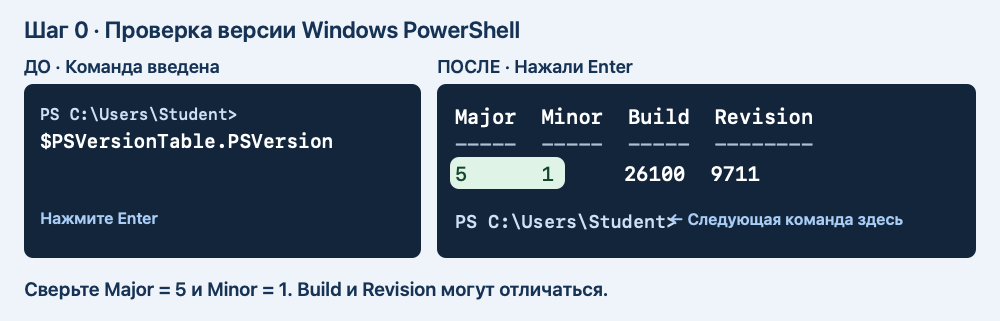

# Пара 1. Папки, текст и Блокнот

[К оглавлению](README.md) · [Дальше — пара 2](02-copy-and-move.md)

Создайте папку и текстовый файл, заполните его, откройте в Блокноте и сделайте копию.

**Порядок работы.** 10 минут на запуск, 35 минут на команды по образцу, 30 минут на самостоятельную часть и 15 минут на проверку и сдачу.

## Шаг 0. Откройте PowerShell и введите первую команду

1. Оставьте этот документ открытым в браузере. Нажмите кнопку **«Пуск»** на панели задач Windows или клавишу **Win** на клавиатуре.
2. Напечатайте **Windows PowerShell**. В результатах поиска щёлкните приложение **«Windows PowerShell»**. Запускайте обычным щелчком.
3. Подождите, пока в новом окне появится приглашение, например `PS C:\Users\Student>`. Имя пользователя на вашем компьютере будет другим. Мигающий курсор сразу после знака **>** показывает, куда вводить команду.
4. Вернитесь в браузер. Скопируйте **только одну строку из блока ниже**. Можно выделить её мышью и нажать **Ctrl+C** или нажать значок копирования в правом верхнем углу блока.

```powershell
$PSVersionTable.PSVersion
```

**Кратко.** Показывает версию PowerShell.

**Разбор команды**

- `$` обозначает переменную, `PSVersionTable` хранит сведения об оболочке.
- `.` обращается к отдельному свойству, а `PSVersion` выбирает версию PowerShell.

**Что можно изменить.** Введите строку как есть. Для этой работы ориентируйтесь на Major 5 и Minor 1.

5. Переключитесь в окно PowerShell, щёлкните внутри и нажмите **Ctrl+V**. Если вставка не сработала, напечатайте строку вручную, начиная со знака **$**. Затем нажмите **Enter**.
6. Посмотрите на вывод. В столбце **Major** должно быть **5**, в **Minor** — **1**. Под выводом появится новое приглашение `PS ...>`. В эту новую строку вставляйте следующую команду.

   

7. Если увидели **7** или вместо `PS ...>` открылась «Командная строка», нажмите **Win+R**, введите `powershell.exe` и нажмите **Enter**. Повторите проверку версии в открывшемся окне.

**Как работать дальше.** Под каждой подписью «Команда» есть отдельная кнопка копирования. Скопируйте первую команду → вставьте в PowerShell → нажмите **Enter** → дождитесь нового приглашения. Затем скопируйте следующую команду. Символы `PS ...>` уже есть в окне. Их вводить не надо. Если команда ничего не вывела, но появилась новая строка `PS ...>`, переходите дальше. Используйте одно и то же окно до конца пары.

Если открыли несколько окон, продолжайте в том, где уже вводили команды этой пары: в нём сохранены пути к учебным папкам.

## Работа по шагам

Схемы «До → После» показывают пример. Буква диска, имя пользователя и дата у вас могут отличаться. Если команда показала красную ошибку, остановитесь и прочитайте подсказку под этим шагом.

### 1.1. Найдите «Документы»

1. Вставьте блок **«Команда 1»** в окно PowerShell и нажмите **Enter**. Она сохраняет адрес папки «Документы» под именем `$docs`. На этом этапе текст на экране может не появиться.
2. Дождитесь нового приглашения `PS ...>`. Вставьте блок **«Команда 2»** — только `$docs` — и нажмите **Enter**. Теперь PowerShell напечатает сохранённый адрес.
3. Сверьте, что на экране появился путь. Если вывода нет, воспользуйтесь подсказкой под рисунком.

**Команда 1**

```powershell
$docs = [Environment]::GetFolderPath('MyDocuments')
```

**Кратко.** Узнаёт у Windows путь к нужной системной папке и запоминает его.

**Разбор команды**

- `$docs` — переменная, в которой хранится путь к «Документам». Знак `$` обозначает переменную.
- `=` сохраняет результат справа в переменную слева.
- `[Environment]` — системный тип. Квадратные скобки обозначают тип, `::` обращается к его методу `GetFolderPath`.
- `( )` передают методу значение. В одинарных кавычках `MyDocuments` — системное имя папки.

**Что можно изменить.** Введите системное имя `MyDocuments` как есть. Windows подставит путь вашей учётной записи.

**Команда 2**

```powershell
$docs
```

**Кратко.** Выводит сохранённое значение в окно PowerShell.

**Разбор команды**

- `$docs` — переменная, в которой хранится путь к «Документам». Знак `$` обозначает переменную.

**Что можно изменить.** Используйте имя переменной из предыдущего шага.


**Что должно получиться**

Показывается полный путь к «Документам». Он может вести в OneDrive.

**Если результат другой**

Если путь пустой, откройте «Документы» в Проводнике и скопируйте путь через адресную строку. Введите его вручную в команду вида `$docs = 'C:\путь\к\Документам'`.

**Что делает команда**

Windows сама сообщает, где находятся «Документы» этой учётной записи.

### 1.2. Проверьте папку

Копируйте команды по порядку. После каждой нажимайте **Enter**.

```powershell
Test-Path -LiteralPath $docs -PathType Container
```

**Кратко.** Проверяет существование файла или папки и выводит `True` или `False`.

**Разбор команды**

- `Test-Path` — имя команды. Дефис соединяет её части.
- `-LiteralPath` — путь к исходному объекту или файлу для этой команды. Символы пути читаются буквально. Начальный дефис обозначает параметр.
- `$docs` — переменная, в которой хранится путь к «Документам». Знак `$` обозначает переменную.
- `-PathType` — тип объекта, который нужно проверить. Начальный дефис обозначает параметр.
- `Container` — проверить наличие папки.

**Что можно изменить.** Для этого шага введите команду как в блоке.


**Что должно получиться**

Должно быть `True`.

**Если результат другой**

Если ответ `False`, вернитесь к предыдущему шагу и проверьте адрес.

**Что делает команда**

`Container` означает, что проверяется папка.

### 1.3. Придумайте имя учебной папки

Копируйте команды по порядку. После каждой нажимайте **Enter**.

**Команда 1**

```powershell
$stamp = Get-Date -Format 'yyyyMMdd-HHmmss'
```

**Кратко.** Сохраняет текущие дату и время для имени учебной папки.

**Разбор команды**

- `$stamp` — переменная, в которой хранится дата и время в виде текста. Знак `$` обозначает переменную.
- `=` записывает результат справа в переменную слева.
- `Get-Date` получает дату и время. Дефис соединяет части имени команды. `-Format` задаёт вид вывода, а начальный дефис обозначает параметр.
- `'yyyyMMdd-HHmmss'` — шаблон в одинарных кавычках. `yyyy` — год, `MM` — месяц, `dd` — день, `HH` — часы, `mm` — минуты, `ss` — секунды. Дефис внутри шаблона разделяет дату и время.

**Что можно изменить.** Для работы оставьте шаблон как есть. В имени папки появятся дата и время вашего запуска.

**Команда 2**

```powershell
$lab = Join-Path $docs "Console-Lab-1-$stamp"
```

**Кратко.** Соединяет адрес папки и имя элемента в один путь. Запись пути сама по себе папку или файл не создаёт.

**Разбор команды**

- `$lab` — переменная, в которой хранится путь к учебной папке. Знак `$` обозначает переменную.
- `=` сохраняет итог. `Join-Path` соединяет две части пути и сам добавляет разделитель. Дефис — часть имени команды.
- `$docs` — переменная, в которой хранится путь к «Документам». Знак `$` обозначает переменную.
- `"Console-Lab-1-$stamp"` — имя новой папки. Двойные кавычки объединяют имя в одно значение и позволяют подставить `$stamp`. Дефисы в `Console-Lab-1-` — часть имени.

**Что можно изменить.** Можно заменить начало имени папки внутри двойных кавычек. Например, впишите `Practice-` перед `$stamp`. Сохраните `$stamp`, чтобы имя отличалось при повторном запуске. Следующие команды возьмут путь из `$lab`.

**Команда 3**

```powershell
$lab
```

**Кратко.** Выводит сохранённое значение в окно PowerShell.

**Разбор команды**

- `$lab` — переменная, в которой хранится путь к учебной папке. Знак `$` обозначает переменную.

**Что можно изменить.** Используйте имя переменной из предыдущего шага.


**Что должно получиться**

Путь заканчивается на `Console-Lab-1-` и дату со временем.

**Если результат другой**

Если путь получился без «Документов», сначала заново выполните первые два шага.

**Что делает команда**

`Join-Path` соединяет адрес папки и новое имя.

### 1.4. Создайте папку и войдите

Копируйте команды по порядку. После каждой нажимайте **Enter**.

**Команда 1**

```powershell
New-Item -ItemType Directory -Path $lab
```

**Кратко.** Создаёт папку или пустой файл.

**Разбор команды**

- `New-Item` — имя команды. Дефис соединяет её части.
- `-ItemType` — тип объекта, который нужно создать. Начальный дефис обозначает параметр.
- `Directory` — создать папку.
- `-Path` — путь, по которому создаётся файл или папка. Начальный дефис обозначает параметр.
- `$lab` — переменная, в которой хранится путь к учебной папке. Знак `$` обозначает переменную.

**Что можно изменить.** Для этого шага введите команду как в блоке.

**Команда 2**

```powershell
Set-Location -LiteralPath $lab
```

**Кратко.** Переходит в указанную папку.

**Разбор команды**

- `Set-Location` — имя команды. Дефис соединяет её части.
- `-LiteralPath` — путь к исходному объекту или файлу для этой команды. Символы пути читаются буквально. Начальный дефис обозначает параметр.
- `$lab` — переменная, в которой хранится путь к учебной папке. Знак `$` обозначает переменную.

**Что можно изменить.** Для этого шага введите команду как в блоке.

**Команда 3**

```powershell
Get-Location
```

**Кратко.** Показывает путь к текущей папке.

**Разбор команды**

- `Get-Location` — имя команды. Дефис соединяет её части.

**Что можно изменить.** Для этого шага введите команду как в блоке.


**Что должно получиться**

Последняя команда показывает путь к новой папке.

**Если результат другой**

Если запись запрещена, покажите преподавателю путь и текст ошибки.

**Что делает команда**

`New-Item` создаёт папку, а `Set-Location` делает её текущей.

### 1.5. Создайте подпапку

Копируйте команды по порядку. После каждой нажимайте **Enter**.

**Команда 1**

```powershell
New-Item -ItemType Directory -Path 'original'
```

**Кратко.** Создаёт папку или пустой файл.

**Разбор команды**

- `New-Item` — имя команды. Дефис соединяет её части.
- `-ItemType` — тип объекта, который нужно создать. Начальный дефис обозначает параметр.
- `Directory` — создать папку.
- `-Path` — путь, по которому создаётся файл или папка. Начальный дефис обозначает параметр.
- `'original'` — текст в одинарных кавычках. Кавычки сохраняют его как одно значение.

**Что можно изменить.** Если меняете `original`, используйте то же имя в связанных командах. Сохраните кавычки.

**Команда 2**

```powershell
Get-ChildItem -Name
```

**Кратко.** Показывает файлы и папки.

**Разбор команды**

- `Get-ChildItem` — имя команды. Дефис соединяет её части.
- `-Name` — показывать имена элементов без подробных столбцов. Начальный дефис обозначает параметр.

**Что можно изменить.** Для этого шага введите команду как в блоке.


**Что должно получиться**

В списке есть `original`.

**Если результат другой**

Если не уверены в текущей папке, выполните `Get-Location`.

**Что делает команда**

`-Name` показывает только имена элементов.

### 1.6. Создайте пустой файл

Копируйте команды по порядку. После каждой нажимайте **Enter**.

**Команда 1**

```powershell
New-Item -ItemType File -Path 'original\request.txt'
```

**Кратко.** Создаёт папку или пустой файл.

**Разбор команды**

- `New-Item` — имя команды. Дефис соединяет её части.
- `-ItemType` — тип объекта, который нужно создать. Начальный дефис обозначает параметр.
- `File` — создать файл.
- `-Path` — путь, по которому создаётся файл или папка. Начальный дефис обозначает параметр.
- `'original\request.txt'` — текст в одинарных кавычках. Кавычки сохраняют его как одно значение. Обратная косая черта `\` отделяет папку от имени или следующей папки. В имени файла точка отделяет расширение `.txt`, которое обозначает текстовый файл.

**Что можно изменить.** Если меняете `original\request.txt`, используйте то же имя в связанных командах. Сохраните кавычки.

**Команда 2**

```powershell
Test-Path -LiteralPath 'original\request.txt' -PathType Leaf
```

**Кратко.** Проверяет существование файла или папки и выводит `True` или `False`.

**Разбор команды**

- `Test-Path` — имя команды. Дефис соединяет её части.
- `-LiteralPath` — путь к исходному объекту или файлу для этой команды. Символы пути читаются буквально. Начальный дефис обозначает параметр.
- `'original\request.txt'` — текст в одинарных кавычках. Кавычки сохраняют его как одно значение. Обратная косая черта `\` отделяет папку от имени или следующей папки. В имени файла точка отделяет расширение `.txt`, которое обозначает текстовый файл.
- `-PathType` — тип объекта, который нужно проверить. Начальный дефис обозначает параметр.
- `Leaf` — проверить наличие файла.

**Что можно изменить.** Если меняете `original\request.txt`, используйте то же имя в связанных командах. Сохраните кавычки.


**Что должно получиться**

Проверка возвращает `True`.

**Если результат другой**

Если файл уже есть после повторного ввода, продолжайте со следующим шагом.

**Что делает команда**

`Leaf` проверяет, что по пути есть файл.

### 1.7. Запишите первую строку

Копируйте команды по порядку. После каждой нажимайте **Enter**.

```powershell
Set-Content -LiteralPath 'original\request.txt' -Value 'Обращение: подготовить учебный отчёт' -Encoding UTF8
```

**Кратко.** Записывает текст в файл. Если файл уже был, его прежний текст заменяется.

**Разбор команды**

- `Set-Content` — имя команды. Дефис соединяет её части.
- `-LiteralPath` — путь к исходному объекту или файлу для этой команды. Символы пути читаются буквально. Начальный дефис обозначает параметр.
- `'original\request.txt'` — текст в одинарных кавычках. Кавычки сохраняют его как одно значение. Обратная косая черта `\` отделяет папку от имени или следующей папки. В имени файла точка отделяет расширение `.txt`, которое обозначает текстовый файл.
- `-Value` — строка текста, которую команда записывает в файл. Начальный дефис обозначает параметр.
- `'Обращение: подготовить учебный отчёт'` — строка для записи. Одинарные кавычки ограничивают текст. Знаки внутри них записываются как часть строки.
- `-Encoding` — способ кодирования текста при чтении или записи. Начальный дефис обозначает параметр.
- `UTF8` — кодировка, в которой сохраняются русские буквы.

**Что можно изменить.** Если меняете `original\request.txt`, используйте то же имя в связанных командах. Сохраните кавычки. Для своего примера измените текст внутри кавычек после `-Value`, например на `'Учебная запись'`.


**Что должно получиться**

Команда обычно выполняется без сообщения.

**Если результат другой**

Если появляется `>>`, нажмите Ctrl+C и проверьте кавычки.

**Что делает команда**

`Set-Content` заменяет содержимое файла.

### 1.8. Добавьте вторую строку

Копируйте команды по порядку. После каждой нажимайте **Enter**.

```powershell
Add-Content -LiteralPath 'original\request.txt' -Value 'Статус: принято' -Encoding UTF8
```

**Кратко.** Добавляет строку в конец файла.

**Разбор команды**

- `Add-Content` — имя команды. Дефис соединяет её части.
- `-LiteralPath` — путь к исходному объекту или файлу для этой команды. Символы пути читаются буквально. Начальный дефис обозначает параметр.
- `'original\request.txt'` — текст в одинарных кавычках. Кавычки сохраняют его как одно значение. Обратная косая черта `\` отделяет папку от имени или следующей папки. В имени файла точка отделяет расширение `.txt`, которое обозначает текстовый файл.
- `-Value` — строка текста, которую команда записывает в файл. Начальный дефис обозначает параметр.
- `'Статус: принято'` — строка для записи. Одинарные кавычки ограничивают текст. Знаки внутри них записываются как часть строки.
- `-Encoding` — способ кодирования текста при чтении или записи. Начальный дефис обозначает параметр.
- `UTF8` — кодировка, в которой сохраняются русские буквы.

**Что можно изменить.** Если меняете `original\request.txt`, используйте то же имя в связанных командах. Сохраните кавычки. Для своего примера измените текст внутри кавычек после `-Value`, например на `'Учебная запись'`.


**Что должно получиться**

Первая строка сохраняется, вторая добавляется в конец.

**Если результат другой**

Если случайно повторили команду, повторите два шага записи в исходном порядке один раз.

**Что делает команда**

`Add-Content` дописывает текст.

### 1.9. Прочитайте файл

Копируйте команды по порядку. После каждой нажимайте **Enter**.

```powershell
Get-Content -LiteralPath 'original\request.txt' -Encoding UTF8
```

**Кратко.** Показывает текст файла в PowerShell.

**Разбор команды**

- `Get-Content` — имя команды. Дефис соединяет её части.
- `-LiteralPath` — путь к исходному объекту или файлу для этой команды. Символы пути читаются буквально. Начальный дефис обозначает параметр.
- `'original\request.txt'` — текст в одинарных кавычках. Кавычки сохраняют его как одно значение. Обратная косая черта `\` отделяет папку от имени или следующей папки. В имени файла точка отделяет расширение `.txt`, которое обозначает текстовый файл.
- `-Encoding` — способ кодирования текста при чтении или записи. Начальный дефис обозначает параметр.
- `UTF8` — кодировка, в которой сохраняются русские буквы.

**Что можно изменить.** Если меняете `original\request.txt`, используйте то же имя в связанных командах. Сохраните кавычки.


**Что должно получиться**

Видны две строки: обращение и статус.

**Если результат другой**

Если видна только одна строка, проверьте, выполняли ли вы `Add-Content`.

**Что делает команда**

`Get-Content` выводит содержимое в терминал.

### 1.10. Откройте файл из консоли в Блокноте

Сначала проверьте, доступен ли Блокнот:

```powershell
Get-Command notepad.exe -ErrorAction SilentlyContinue
```

**Кратко.** Проверяет, доступна ли команда запуска Блокнота.

**Разбор команды**

- `Get-Command` — имя команды. Дефис соединяет её части.
- `notepad.exe` — имя программы, которую ищет PowerShell. Расширение `.exe` обозначает исполняемый файл.
- `-ErrorAction` — что делать, если при выполнении возникла ошибка. Начальный дефис обозначает параметр.
- `SilentlyContinue` — скрыть сообщение об отсутствии команды. Пустой вывод означает, что Блокнот пропускаем.

**Что можно изменить.** Для этого шага введите команду как в блоке.

Если команда показала `notepad.exe`, выполните следующие строки. Если вывода нет, пропустите запуск и перейдите к чтению файла в PowerShell.

**Команда 1**

```powershell
$file = Join-Path $lab 'original\request.txt'
```

**Кратко.** Соединяет адрес папки и имя элемента в один путь. Запись пути сама по себе папку или файл не создаёт.

**Разбор команды**

- `$file` — переменная, в которой хранится полный путь к текстовому файлу. Знак `$` обозначает переменную.
- `=` сохраняет итог. `Join-Path` соединяет две части пути и сам добавляет разделитель. Дефис — часть имени команды.
- `$lab` — переменная, в которой хранится путь к учебной папке. Знак `$` обозначает переменную.
- `'original\request.txt'` — текст в одинарных кавычках. Кавычки сохраняют его как одно значение. Обратная косая черта `\` отделяет папку от имени или следующей папки. В имени файла точка отделяет расширение `.txt`, которое обозначает текстовый файл.

**Что можно изменить.** Можно заменить путь к файлу внутри кавычек, если вы создали файл под другим именем. Укажите имя существующего файла.

**Команда 2**

```powershell
notepad.exe "$file"
```

**Кратко.** Открывает указанный файл в Блокноте.

**Разбор команды**

- `notepad.exe` — имя программы. Точка отделяет расширение `.exe`.
- `"$file"` — путь из переменной `$file`. Знак `$` обозначает переменную. Двойные кавычки позволяют подставить путь целиком, включая пробелы.

**Что можно изменить.** Для этого шага введите команду как в блоке.


**Что должно получиться**

В Блокноте открывается файл request.txt с двумя строками.

**Если результат другой**

Если Блокнот отсутствует или заблокирован на учебном ПК, выполните `Get-Content -LiteralPath 'original\request.txt' -Encoding UTF8` и продолжайте.

**Что делает команда**

В кавычках полный путь передаётся как один аргумент, даже если в пути есть пробелы.

### 1.11. Сделайте отдельную копию

Копируйте команды по порядку. После каждой нажимайте **Enter**.

**Команда 1**

```powershell
New-Item -ItemType Directory -Path 'review'
```

**Кратко.** Создаёт папку или пустой файл.

**Разбор команды**

- `New-Item` — имя команды. Дефис соединяет её части.
- `-ItemType` — тип объекта, который нужно создать. Начальный дефис обозначает параметр.
- `Directory` — создать папку.
- `-Path` — путь, по которому создаётся файл или папка. Начальный дефис обозначает параметр.
- `'review'` — текст в одинарных кавычках. Кавычки сохраняют его как одно значение.

**Что можно изменить.** Если меняете `review`, используйте то же имя в связанных командах. Сохраните кавычки.

**Команда 2**

```powershell
Copy-Item -LiteralPath 'original\request.txt' -Destination 'review\request-copy.txt'
```

**Кратко.** Копирует файл. Исходник остаётся в своей папке.

**Разбор команды**

- `Copy-Item` — имя команды. Дефис соединяет её части.
- `-LiteralPath` — путь к исходному объекту или файлу для этой команды. Символы пути читаются буквально. Начальный дефис обозначает параметр.
- `'original\request.txt'` — текст в одинарных кавычках. Кавычки сохраняют его как одно значение. Обратная косая черта `\` отделяет папку от имени или следующей папки. В имени файла точка отделяет расширение `.txt`, которое обозначает текстовый файл.
- `-Destination` — папка или имя файла, куда отправится копия или перемещаемый файл. Начальный дефис обозначает параметр.
- `'review\request-copy.txt'` — текст в одинарных кавычках. Кавычки сохраняют его как одно значение. Обратная косая черта `\` отделяет папку от имени или следующей папки. В имени файла точка отделяет расширение `.txt`, которое обозначает текстовый файл.

**Что можно изменить.** Если меняете `original\request.txt`, используйте то же имя в связанных командах. Сохраните кавычки. Если меняете `review\request-copy.txt`, используйте то же имя в связанных командах. Сохраните кавычки.

**Команда 3**

```powershell
Get-ChildItem -LiteralPath 'review' -Name
```

**Кратко.** Показывает файлы и папки.

**Разбор команды**

- `Get-ChildItem` — имя команды. Дефис соединяет её части.
- `-LiteralPath` — путь к исходному объекту или файлу для этой команды. Символы пути читаются буквально. Начальный дефис обозначает параметр.
- `'review'` — текст в одинарных кавычках. Кавычки сохраняют его как одно значение.
- `-Name` — показывать имена элементов без подробных столбцов. Начальный дефис обозначает параметр.

**Что можно изменить.** Если меняете `review`, используйте то же имя в связанных командах. Сохраните кавычки.


**Что должно получиться**

В `review` есть `request-copy.txt`.

**Если результат другой**

Если файл не скопировался, убедитесь, что обе папки существуют.

**Что делает команда**

`Copy-Item` сохраняет исходный файл.

### 1.12. Переименуйте копию

Копируйте команды по порядку. После каждой нажимайте **Enter**.

**Команда 1**

```powershell
Rename-Item -LiteralPath 'review\request-copy.txt' -NewName 'request-review.txt'
```

**Кратко.** Меняет имя файла в той же папке.

**Разбор команды**

- `Rename-Item` — имя команды. Дефис соединяет её части.
- `-LiteralPath` — путь к исходному объекту или файлу для этой команды. Символы пути читаются буквально. Начальный дефис обозначает параметр.
- `'review\request-copy.txt'` — текст в одинарных кавычках. Кавычки сохраняют его как одно значение. Обратная косая черта `\` отделяет папку от имени или следующей папки. В имени файла точка отделяет расширение `.txt`, которое обозначает текстовый файл.
- `-NewName` — новое имя файла в той же папке. Начальный дефис обозначает параметр.
- `'request-review.txt'` — текст в одинарных кавычках. Кавычки сохраняют его как одно значение. В имени файла точка отделяет расширение `.txt`, которое обозначает текстовый файл.

**Что можно изменить.** Если меняете `review\request-copy.txt`, используйте то же имя в связанных командах. Сохраните кавычки. Можно выбрать другое имя копии. Оставьте расширение `.txt` и используйте новое имя в следующих командах.

**Команда 2**

```powershell
Get-ChildItem -LiteralPath 'review' -Name
```

**Кратко.** Показывает файлы и папки.

**Разбор команды**

- `Get-ChildItem` — имя команды. Дефис соединяет её части.
- `-LiteralPath` — путь к исходному объекту или файлу для этой команды. Символы пути читаются буквально. Начальный дефис обозначает параметр.
- `'review'` — текст в одинарных кавычках. Кавычки сохраняют его как одно значение.
- `-Name` — показывать имена элементов без подробных столбцов. Начальный дефис обозначает параметр.

**Что можно изменить.** Если меняете `review`, используйте то же имя в связанных командах. Сохраните кавычки.


**Что должно получиться**

В списке новое имя `request-review.txt`.

**Если результат другой**

В `-NewName` указывайте имя файла, без адреса папки.

**Что делает команда**

Файл остаётся в `review`. Изменилось только имя.

### 1.13. Допишите комментарий в копию

Копируйте команды по порядку. После каждой нажимайте **Enter**.

**Команда 1**

```powershell
Add-Content -LiteralPath 'review\request-review.txt' -Value 'Комментарий: передано на проверку' -Encoding UTF8
```

**Кратко.** Добавляет строку в конец файла.

**Разбор команды**

- `Add-Content` — имя команды. Дефис соединяет её части.
- `-LiteralPath` — путь к исходному объекту или файлу для этой команды. Символы пути читаются буквально. Начальный дефис обозначает параметр.
- `'review\request-review.txt'` — текст в одинарных кавычках. Кавычки сохраняют его как одно значение. Обратная косая черта `\` отделяет папку от имени или следующей папки. В имени файла точка отделяет расширение `.txt`, которое обозначает текстовый файл.
- `-Value` — строка текста, которую команда записывает в файл. Начальный дефис обозначает параметр.
- `'Комментарий: передано на проверку'` — строка для записи. Одинарные кавычки ограничивают текст. Знаки внутри них записываются как часть строки.
- `-Encoding` — способ кодирования текста при чтении или записи. Начальный дефис обозначает параметр.
- `UTF8` — кодировка, в которой сохраняются русские буквы.

**Что можно изменить.** Если меняете `review\request-review.txt`, используйте то же имя в связанных командах. Сохраните кавычки. Для своего примера измените текст внутри кавычек после `-Value`, например на `'Учебная запись'`.

**Команда 2**

```powershell
Get-Content -LiteralPath 'review\request-review.txt' -Encoding UTF8
```

**Кратко.** Показывает текст файла в PowerShell.

**Разбор команды**

- `Get-Content` — имя команды. Дефис соединяет её части.
- `-LiteralPath` — путь к исходному объекту или файлу для этой команды. Символы пути читаются буквально. Начальный дефис обозначает параметр.
- `'review\request-review.txt'` — текст в одинарных кавычках. Кавычки сохраняют его как одно значение. Обратная косая черта `\` отделяет папку от имени или следующей папки. В имени файла точка отделяет расширение `.txt`, которое обозначает текстовый файл.
- `-Encoding` — способ кодирования текста при чтении или записи. Начальный дефис обозначает параметр.
- `UTF8` — кодировка, в которой сохраняются русские буквы.

**Что можно изменить.** Если меняете `review\request-review.txt`, используйте то же имя в связанных командах. Сохраните кавычки.


**Что должно получиться**

В копии видны три строки.

**Если результат другой**

Если третья строка появилась в исходнике, проверьте, какой путь вы указали при записи.

**Что делает команда**

Две копии одного документа можно изменять отдельно.

### 1.14. Проверьте исходник

Копируйте команды по порядку. После каждой нажимайте **Enter**.

**Команда 1**

```powershell
Get-Content -LiteralPath 'original\request.txt' -Encoding UTF8
```

**Кратко.** Показывает текст файла в PowerShell.

**Разбор команды**

- `Get-Content` — имя команды. Дефис соединяет её части.
- `-LiteralPath` — путь к исходному объекту или файлу для этой команды. Символы пути читаются буквально. Начальный дефис обозначает параметр.
- `'original\request.txt'` — текст в одинарных кавычках. Кавычки сохраняют его как одно значение. Обратная косая черта `\` отделяет папку от имени или следующей папки. В имени файла точка отделяет расширение `.txt`, которое обозначает текстовый файл.
- `-Encoding` — способ кодирования текста при чтении или записи. Начальный дефис обозначает параметр.
- `UTF8` — кодировка, в которой сохраняются русские буквы.

**Что можно изменить.** Если меняете `original\request.txt`, используйте то же имя в связанных командах. Сохраните кавычки.

**Команда 2**

```powershell
Get-ChildItem -Recurse -Name
```

**Кратко.** Показывает файлы и папки.

**Разбор команды**

- `Get-ChildItem` — имя команды. Дефис соединяет её части.
- `-Recurse` — показывать содержимое вложенных папок. Начальный дефис обозначает параметр.
- `-Name` — показывать имена элементов без подробных столбцов. Начальный дефис обозначает параметр.

**Что можно изменить.** Для этого шага введите команду как в блоке.


**Что должно получиться**

В исходнике две строки. В списке видны обе подпапки и два файла.

**Если результат другой**

Если вывелся список «Документов», вернитесь в учебную папку командой `Set-Location -LiteralPath $lab`.

**Что делает команда**

`-Recurse` показывает содержимое подпапок.

## Самостоятельная часть и сдача

В учебной папке создайте подпапку `notes` и файл `notes\how-to.txt`. Запишите заголовок «Как передать учебный файл» и два своих совета. Сделайте копию в `review` под именем `how-to-review.txt`. Допишите в неё «Проверено». Если на шаге 1.10 Блокнот открылся, откройте в нём копию тем же способом. Иначе прочитайте копию через `Get-Content`.

Проверьте, что у исходника три строки, а у копии четыре. На снимке терминала покажите оба текста и список файлов. Назовите снимок **Пара-1**.

**Если закончили раньше.** Закройте окно Проводника, вернитесь в терминал и найдите любой созданный файл сначала по короткому пути, затем по полному. Запишите обе команды и объясните, какая из них зависит от текущей папки.

## Как быстро вернуться к работе после закрытия окна

1. Найдите учебную папку в Проводнике.
2. Нажмите на адресную строку и скопируйте полный путь.
3. Откройте Windows PowerShell.
4. Присвойте этот путь переменной `$lab` и выполните `Set-Location -LiteralPath $lab`.
5. Командой `Get-ChildItem -Recurse -Name` проверьте, на каком шаге остановились.

Пример записи переменной с вымышленным адресом:

```powershell
$lab = 'C:\Users\Student\Documents\Console-Lab-1-20261112-120000'
```

**Кратко.** Сохраняет вручную указанный путь к уже созданной учебной папке.

**Разбор команды**

- `$lab` — переменная, в которой хранится путь к учебной папке. Знак `$` обозначает переменную.
- `=` сохраняет адрес справа.
- `'C:\Users\Student\Documents\Console-Lab-1-20261112-120000'` — текст в одинарных кавычках. Кавычки сохраняют его как одно значение. Обратная косая черта `\` отделяет папку от имени или следующей папки.`C:` обозначает диск C.

**Что можно изменить.** Замените весь адрес внутри кавычек путём, который скопировали в Проводнике. Оставьте кавычки.

В примере путь замените адресом своей папки.


## Справка Microsoft

- [Windows PowerShell 5.1 — запись текста в файл](https://learn.microsoft.com/en-us/powershell/module/microsoft.powershell.management/set-content?view=powershell-5.1)
- [Добавление текста в файл](https://learn.microsoft.com/en-us/powershell/module/microsoft.powershell.management/add-content?view=powershell-5.1)
- [Копирование файлов](https://learn.microsoft.com/en-us/powershell/module/microsoft.powershell.management/copy-item?view=powershell-5.1)
- [Перемещение файлов](https://learn.microsoft.com/en-us/powershell/module/microsoft.powershell.management/move-item?view=powershell-5.1)

[К оглавлению](README.md) · [Дальше — пара 2](02-copy-and-move.md)
