# Пара 2. Передача файлов на рабочий стол

[К оглавлению](README.md) · [Назад — пара 1](01-folders-and-notepad.md) · [Дальше — пара 3](03-support-request.md)

Скопируйте файл в «Документах», перенесите копию на рабочий стол и проверьте обе папки.

**Порядок работы.** 10 минут на запуск, 35 минут на команды по образцу, 30 минут на самостоятельную часть и 15 минут на проверку и сдачу.

## Шаг 0. Откройте PowerShell и введите первую команду

1. Оставьте этот документ открытым в браузере. Нажмите кнопку **«Пуск»** на панели задач Windows или клавишу **Win** на клавиатуре.
2. Напечатайте **Windows PowerShell**. В результатах поиска щёлкните приложение **«Windows PowerShell»**. Запускайте обычным щелчком.
3. Подождите, пока в новом окне появится приглашение, например `PS C:\Users\Student>`. Имя пользователя на вашем компьютере будет другим. Мигающий курсор сразу после знака **>** показывает, куда вводить команду.
4. Вернитесь в браузер. Скопируйте **только одну строку из блока ниже**. Можно выделить её мышью и нажать **Ctrl+C** или нажать значок копирования в правом верхнем углу блока.

```powershell
$PSVersionTable.PSVersion
```

5. Переключитесь в окно PowerShell, щёлкните внутри и нажмите **Ctrl+V**. Если вставка не сработала, напечатайте строку вручную, начиная со знака **$**. Затем нажмите **Enter**.
6. Посмотрите на вывод. В столбце **Major** должно быть **5**, в **Minor** — **1**. Под выводом появится новое приглашение `PS ...>`. В эту новую строку вставляйте следующую команду.

   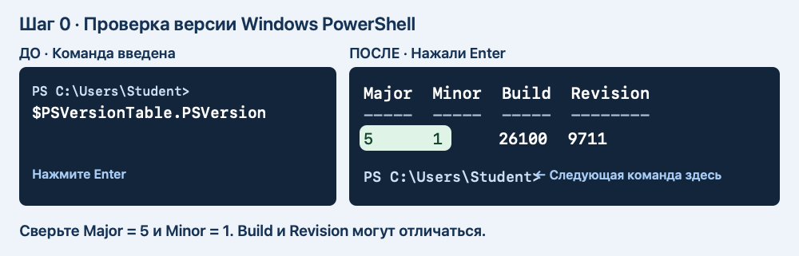

7. Если увидели **7** или вместо `PS ...>` открылась «Командная строка», нажмите **Win+R**, введите `powershell.exe` и нажмите **Enter**. Повторите проверку версии в открывшемся окне.

**Как работать дальше.** В каждом блоке вводите строки по одной. Вставили первую строку → нажали **Enter** → дождались нового приглашения → вставили следующую. Символы `PS ...>` уже есть в окне. Их вводить не надо. Если команда ничего не вывела, но появилась новая строка `PS ...>`, переходите дальше. Используйте одно и то же окно до конца пары.

Если открыли несколько окон, продолжайте в том, где уже вводили команды этой пары: в нём сохранены пути к учебным папкам.

## Работа по шагам

Схемы «До → После» показывают пример. Буква диска, имя пользователя и дата у вас могут отличаться. Если команда показала красную ошибку, остановитесь и прочитайте подсказку под этим шагом.

### 2.1. Найдите «Документы»

1. Вставьте **первую строку** блока в окно PowerShell и нажмите **Enter**. Она сохраняет адрес папки «Документы» под именем `$docs`. На этом этапе текст на экране может не появиться.
2. Дождитесь нового приглашения `PS ...>`. Вставьте **вторую строку** — только `$docs` — и нажмите **Enter**. Теперь PowerShell напечатает сохранённый адрес.
3. Сверьте, что на экране появился путь. Если вывода нет, воспользуйтесь подсказкой под рисунком.

```powershell
$docs = [Environment]::GetFolderPath('MyDocuments')
$docs
```

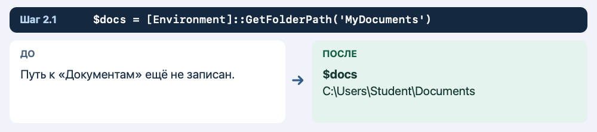

**Что должно получиться**

Показывается полный путь к «Документам». Он может вести в OneDrive.

**Если результат другой**

Если путь пустой, откройте «Документы» в Проводнике и скопируйте путь через адресную строку. Введите его вручную в команду вида `$docs = 'C:\путь\к\Документам'`.

**Что делает команда**

Windows сама сообщает, где находятся «Документы» этой учётной записи.

### 2.2. Проверьте папку

Введите команды по очереди.

```powershell
Test-Path -LiteralPath $docs -PathType Container
```

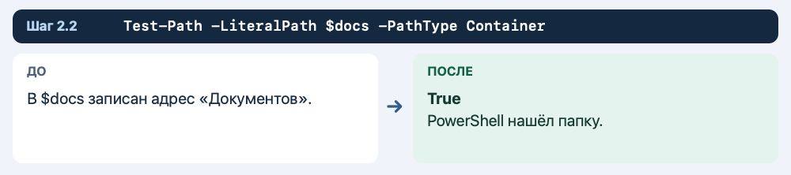

**Что должно получиться**

Должно быть `True`.

**Если результат другой**

Если ответ `False`, вернитесь к предыдущему шагу и проверьте адрес.

**Что делает команда**

`Container` означает, что проверяется папка.

### 2.3. Придумайте имя учебной папки

Введите команды по очереди.

```powershell
$stamp = Get-Date -Format 'yyyyMMdd-HHmmss'
$lab = Join-Path $docs "Console-Lab-2-$stamp"
$lab
```

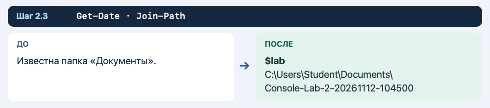

**Что должно получиться**

Путь заканчивается на `Console-Lab-2-` и дату со временем.

**Если результат другой**

Если путь получился без «Документов», сначала заново выполните первые два шага.

**Что делает команда**

`Join-Path` соединяет адрес папки и новое имя.

### 2.4. Создайте папку и войдите

Введите команды по очереди.

```powershell
New-Item -ItemType Directory -Path $lab
Set-Location -LiteralPath $lab
Get-Location
```

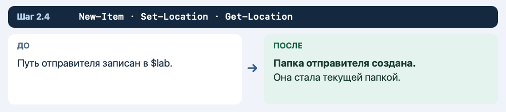

**Что должно получиться**

Последняя команда показывает путь к новой папке.

**Если результат другой**

Если запись запрещена, покажите преподавателю путь и текст ошибки.

**Что делает команда**

`New-Item` создаёт папку, а `Set-Location` делает её текущей.

### 2.5. Узнайте адрес рабочего стола

Введите команды по очереди.

```powershell
$desktop = [Environment]::GetFolderPath('DesktopDirectory')
$desktop
```

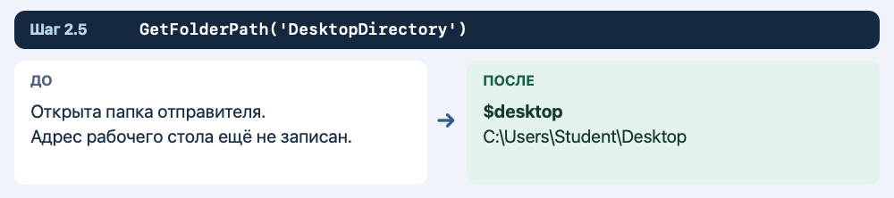

**Что должно получиться**

Показывается путь к рабочему столу вашей учётной записи.

**Если результат другой**

Если путь пустой, пропустите первый блок следующего шага и выполните запасной вариант под ним.

**Что делает команда**

На учебном ПК рабочий стол может находиться в папке OneDrive.

### 2.6. Создайте папку для передачи

Введите команды по очереди.

```powershell
$delivery = Join-Path $desktop "Console-Delivery-$stamp"
New-Item -ItemType Directory -Path $delivery
$delivery
```

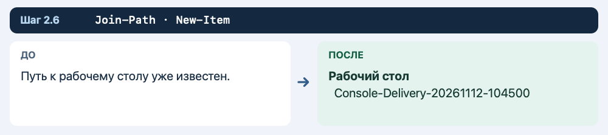

**Что должно получиться**

Виден полный путь к учебной папке рабочего стола.

**Если результат другой**

Если рабочий стол недоступен, выполните запасной вариант ниже.

**Что делает команда**

Отдельная папка отличает учебные файлы от остального рабочего стола.

**Запасной вариант шага.** Если рабочий стол недоступен, создайте папку получателя в «Документах» и продолжайте с ней.

```powershell
$delivery = Join-Path $docs "Console-Delivery-$stamp"
New-Item -ItemType Directory -Path $delivery
```

Укажите в сдаче, что использовали «Документы» вместо рабочего стола.

### 2.7. Проверьте папку назначения

Введите команды по очереди.

```powershell
Test-Path -LiteralPath $delivery -PathType Container
```

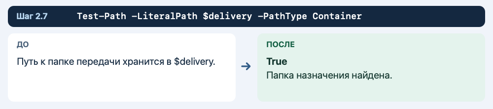

**Что должно получиться**

Ожидается `True`.

**Если результат другой**

При `False` не продолжайте перенос. Создайте папку назначения заново.

**Что делает команда**

Перенос удобнее делать в уже существующую папку.

### 2.8. Создайте исходник

Введите команды по очереди.

```powershell
Set-Content -LiteralPath 'ticket.txt' -Value 'Заявка: передать учебный комплект' -Encoding UTF8
Add-Content -LiteralPath 'ticket.txt' -Value 'Ответственный: учебная группа' -Encoding UTF8
```

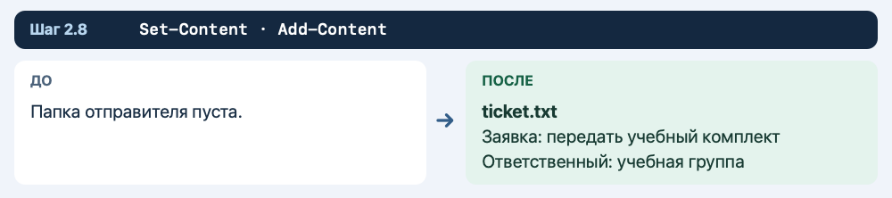

**Что должно получиться**

В текущей папке создан `ticket.txt`.

**Если результат другой**

Если команда ошиблась, проверьте текущую папку через `Get-Location`.

**Что делает команда**

Файл находится в «Документах», внутри учебной папки пары 2.

### 2.9. Сделайте копию в папке отправителя

Введите команды по очереди.

```powershell
Copy-Item -LiteralPath 'ticket.txt' -Destination 'ticket-delivery.txt'
Get-ChildItem -Name
```

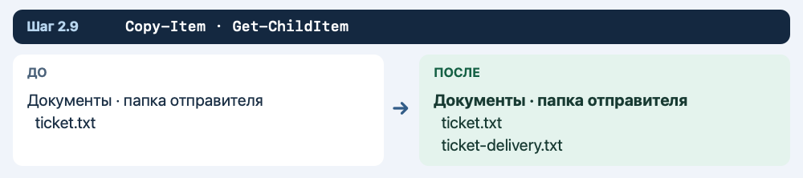

**Что должно получиться**

В списке видны `ticket.txt` и `ticket-delivery.txt`.

**Если результат другой**

Если исходник не найден, вернитесь к предыдущему шагу.

**Что делает команда**

Пока оба файла находятся в одной папке.

### 2.10. Перенесите копию на рабочий стол

Введите команды по очереди.

```powershell
Move-Item -LiteralPath 'ticket-delivery.txt' -Destination $delivery
```

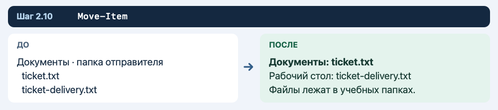

**Что должно получиться**

Команда обычно выполняется без сообщения.

**Если результат другой**

Если путь назначения недоступен, проверьте его командой предыдущего шага.

**Что делает команда**

Перемещается только копия с именем `ticket-delivery.txt`.

### 2.11. Проверьте папку отправителя

Введите команды по очереди.

```powershell
Get-ChildItem -LiteralPath $lab -Name
Test-Path -LiteralPath 'ticket-delivery.txt' -PathType Leaf
```

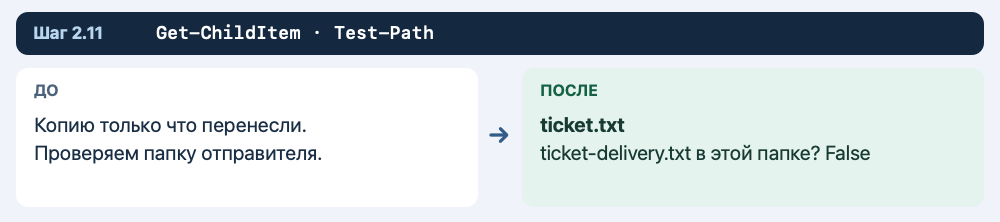

**Что должно получиться**

В списке есть `ticket.txt`, а проверка копии возвращает `False`.

**Если результат другой**

Если ответ `True`, убедитесь, что выполнили `Move-Item`, а не `Copy-Item`.

**Что делает команда**

Здесь `False` подтверждает, что копия ушла из текущей папки.

### 2.12. Проверьте папку получателя

Введите команды по очереди.

```powershell
Get-ChildItem -LiteralPath $delivery -Name
Get-Content -LiteralPath (Join-Path $delivery 'ticket-delivery.txt') -Encoding UTF8
```

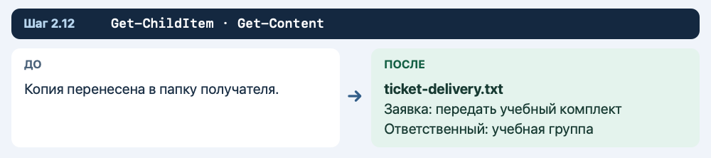

**Что должно получиться**

Видны имя копии и две строки из исходного документа.

**Если результат другой**

Если список пуст, сверьте путь в `$delivery`.

**Что делает команда**

Перенос не меняет содержимое файла.

### 2.13. Создайте записку о передаче

Введите команды по очереди.

```powershell
Set-Content -LiteralPath 'handoff.txt' -Value 'Передано: ticket-delivery.txt' -Encoding UTF8
Add-Content -LiteralPath 'handoff.txt' -Value 'Проверка: файл открывается' -Encoding UTF8
```

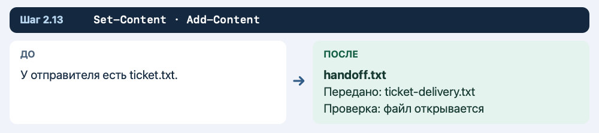

**Что должно получиться**

У отправителя есть `handoff.txt` с двумя строками.

**Если результат другой**

Если хотите прочитать результат, выполните `Get-Content -LiteralPath 'handoff.txt' -Encoding UTF8`.

**Что делает команда**

Записка помогает получателю сверить комплект.

### 2.14. Скопируйте записку получателю

Введите команды по очереди.

```powershell
Copy-Item -LiteralPath 'handoff.txt' -Destination $delivery
Get-ChildItem -LiteralPath $delivery -Name
```

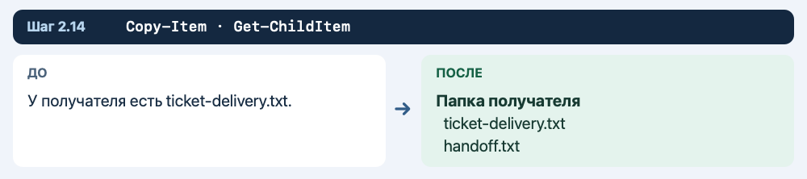

**Что должно получиться**

У получателя два файла: `handoff.txt` и `ticket-delivery.txt`.

**Если результат другой**

Проверьте, что оригинал записки остался у отправителя.

**Что делает команда**

Для записки нужно копирование, потому что она нужна обеим сторонам.

### 2.15. Откройте папку получателя из консоли

Введите команды по очереди.

```powershell
Invoke-Item -LiteralPath $delivery
```

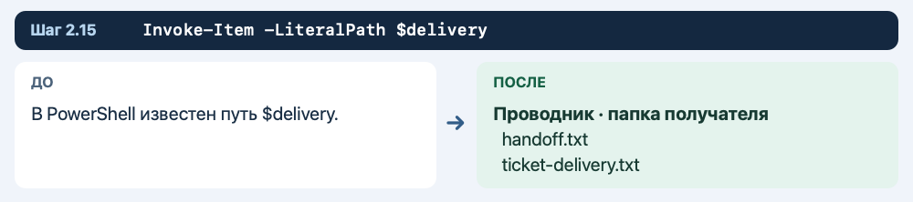

**Что должно получиться**

Папка открывается в Проводнике.

**Если результат другой**

Если запуск окна запрещён, выполните `Get-ChildItem -LiteralPath $delivery`.

**Что делает команда**

`Invoke-Item` открывает папку обычным для Windows способом.

## Самостоятельная часть и сдача

Создайте файл `receipt.txt` у отправителя. Впишите имя переданной заявки и название папки получателя. Скопируйте записку получателю. Проверьте, что она осталась в «Документах», а её копия открывается из папки передачи.

На снимке **Пара-2** покажите списки отправителя и получателя и вывод `Get-Content` для переданной заявки. В двух предложениях объясните разницу между переносом и копированием.

**Если закончили раньше.** Закройте окно Проводника, вернитесь в терминал и найдите любой созданный файл сначала по короткому пути, затем по полному. Запишите обе команды и объясните, какая из них зависит от текущей папки.

## Как быстро вернуться к работе после закрытия окна

1. Найдите учебную папку в Проводнике.
2. Нажмите на адресную строку и скопируйте полный путь.
3. Откройте Windows PowerShell.
4. Присвойте этот путь переменной `$lab` и выполните `Set-Location -LiteralPath $lab`.
5. Также присвойте полный путь папки получателя переменной `$delivery`.
6. Командой `Get-ChildItem -Recurse -Name` проверьте, на каком шаге остановились.

Пример записи переменной с вымышленным адресом:

```powershell
$lab = 'C:\Users\Student\Documents\Console-Lab-1-20261112-120000'
```

В примере путь замените адресом своей папки.


## Справка Microsoft

- [Windows PowerShell 5.1 — запись текста в файл](https://learn.microsoft.com/en-us/powershell/module/microsoft.powershell.management/set-content?view=powershell-5.1)
- [Добавление текста в файл](https://learn.microsoft.com/en-us/powershell/module/microsoft.powershell.management/add-content?view=powershell-5.1)
- [Копирование файлов](https://learn.microsoft.com/en-us/powershell/module/microsoft.powershell.management/copy-item?view=powershell-5.1)
- [Перемещение файлов](https://learn.microsoft.com/en-us/powershell/module/microsoft.powershell.management/move-item?view=powershell-5.1)

[К оглавлению](README.md) · [Назад — пара 1](01-folders-and-notepad.md) · [Дальше — пара 3](03-support-request.md)
