# Пара 3. Учебный заказ службы поддержки

[К оглавлению](README.md) · [Назад — пара 2](02-copy-and-move.md)

Соберите комплект файлов по учебной заявке службы поддержки и проверьте результат.

**Порядок работы.** 10 минут на запуск, 35 минут на команды по образцу, 30 минут на самостоятельную часть и 15 минут на проверку и сдачу.

## Шаг 0. Откройте PowerShell и введите первую команду

1. Оставьте этот документ открытым в браузере. Нажмите кнопку **«Пуск»** на панели задач Windows или клавишу **Win** на клавиатуре.
2. Напечатайте **Windows PowerShell**. В результатах поиска щёлкните приложение **«Windows PowerShell»**. Запускайте обычным щелчком.
3. Подождите, пока в новом окне появится приглашение, например `PS C:\Users\Student>`. Имя пользователя на вашем компьютере будет другим. Мигающий курсор сразу после знака **>** показывает, куда вводить команду.
4. Вернитесь в браузер. Скопируйте **только одну строку из блока ниже**. Можно выделить её мышью и нажать **Ctrl+C** или нажать значок копирования в правом верхнем углу блока.

```powershell
$PSVersionTable.PSVersion
```

5. Переключитесь в окно PowerShell, щёлкните внутри и нажмите **Ctrl+V**. Если вставка не сработала, напечатайте строку вручную, начиная со знака **$**. Затем нажмите **Enter**.
6. Посмотрите на вывод. В столбце **Major** должно быть **5**, в **Minor** — **1**. Под выводом появится новое приглашение `PS ...>`. В эту новую строку вставляйте следующую команду.

   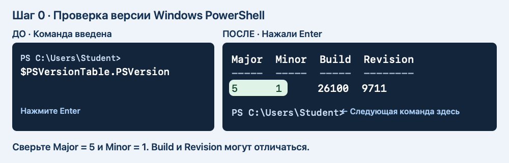

7. Если увидели **7** или вместо `PS ...>` открылась «Командная строка», нажмите **Win+R**, введите `powershell.exe` и нажмите **Enter**. Повторите проверку версии в открывшемся окне.

**Как работать дальше.** В каждом блоке вводите строки по одной. Вставили первую строку → нажали **Enter** → дождались нового приглашения → вставили следующую. Символы `PS ...>` уже есть в окне. Их вводить не надо. Если команда ничего не вывела, но появилась новая строка `PS ...>`, переходите дальше. Используйте одно и то же окно до конца пары.

Если открыли несколько окон, продолжайте в том, где уже вводили команды этой пары: в нём сохранены пути к учебным папкам.

## Работа по шагам

Схемы «До → После» показывают пример. Буква диска, имя пользователя и дата у вас могут отличаться. Если команда показала красную ошибку, остановитесь и прочитайте подсказку под этим шагом.

### 3.1. Найдите «Документы»

1. Вставьте **первую строку** блока в окно PowerShell и нажмите **Enter**. Она сохраняет адрес папки «Документы» под именем `$docs`. На этом этапе текст на экране может не появиться.
2. Дождитесь нового приглашения `PS ...>`. Вставьте **вторую строку** — только `$docs` — и нажмите **Enter**. Теперь PowerShell напечатает сохранённый адрес.
3. Сверьте, что на экране появился путь. Если вывода нет, воспользуйтесь подсказкой под рисунком.

```powershell
$docs = [Environment]::GetFolderPath('MyDocuments')
$docs
```

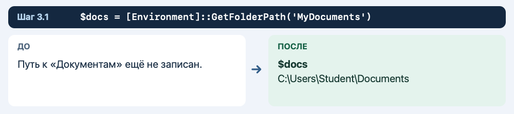

**Что должно получиться**

Показывается полный путь к «Документам». Он может вести в OneDrive.

**Если результат другой**

Если путь пустой, откройте «Документы» в Проводнике и скопируйте путь через адресную строку. Введите его вручную в команду вида `$docs = 'C:\путь\к\Документам'`.

**Что делает команда**

Windows сама сообщает, где находятся «Документы» этой учётной записи.

### 3.2. Проверьте папку

Введите команды по очереди.

```powershell
Test-Path -LiteralPath $docs -PathType Container
```

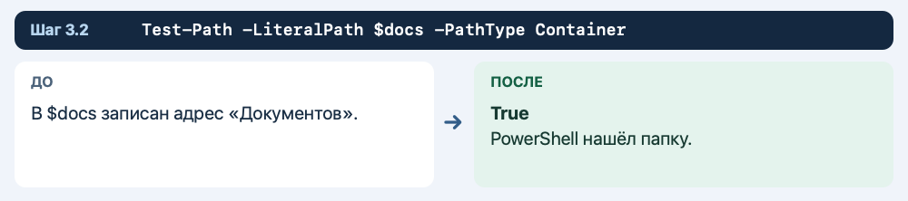

**Что должно получиться**

Должно быть `True`.

**Если результат другой**

Если ответ `False`, вернитесь к предыдущему шагу и проверьте адрес.

**Что делает команда**

`Container` означает, что проверяется папка.

### 3.3. Придумайте имя учебной папки

Введите команды по очереди.

```powershell
$stamp = Get-Date -Format 'yyyyMMdd-HHmmss'
$lab = Join-Path $docs "Console-Lab-3-$stamp"
$lab
```

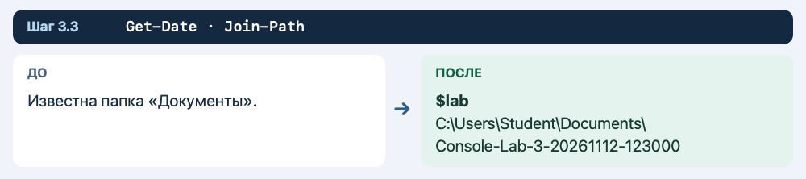

**Что должно получиться**

Путь заканчивается на `Console-Lab-3-` и дату со временем.

**Если результат другой**

Если путь получился без «Документов», сначала заново выполните первые два шага.

**Что делает команда**

`Join-Path` соединяет адрес папки и новое имя.

### 3.4. Создайте папку и войдите

Введите команды по очереди.

```powershell
New-Item -ItemType Directory -Path $lab
Set-Location -LiteralPath $lab
Get-Location
```

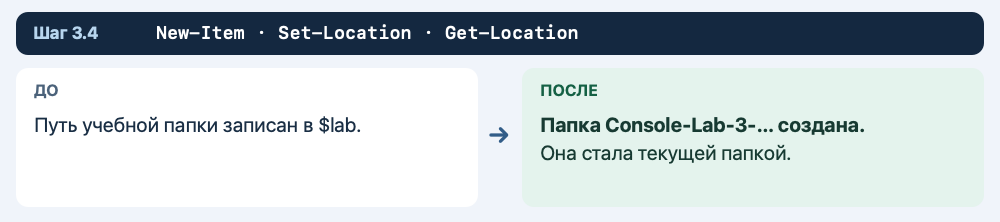

**Что должно получиться**

Последняя команда показывает путь к новой папке.

**Если результат другой**

Если запись запрещена, покажите преподавателю путь и текст ошибки.

**Что делает команда**

`New-Item` создаёт папку, а `Set-Location` делает её текущей.

### 3.5. Создайте входящую папку

Введите команды по очереди.

```powershell
New-Item -ItemType Directory -Path 'incoming'
```

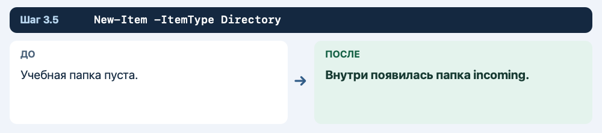

**Что должно получиться**

Появилась папка `incoming`.

**Если результат другой**

Если имя есть после повтора, проверьте, что это подпапка текущей учебной папки.

**Что делает команда**

Здесь будут храниться исходники.

### 3.6. Создайте папки работы и выдачи

Введите команды по очереди.

```powershell
New-Item -ItemType Directory -Path 'work'
New-Item -ItemType Directory -Path 'delivery'
Get-ChildItem -Name
```

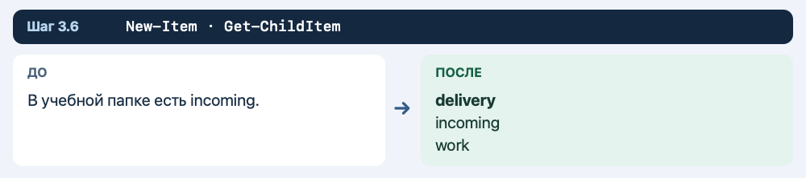

**Что должно получиться**

В списке три папки: `delivery`, `incoming`, `work`.

**Если результат другой**

Если папки появились не там, проверьте `Get-Location`.

**Что делает команда**

Разные папки показывают, где исходник, черновик и готовый комплект.

### 3.7. Создайте заявку

Введите команды по очереди.

```powershell
Set-Content -LiteralPath 'incoming\request.txt' -Value 'Обращение: пользователь не находит учебный файл' -Encoding UTF8
Add-Content -LiteralPath 'incoming\request.txt' -Value 'Задача: подготовить инструкцию' -Encoding UTF8
```

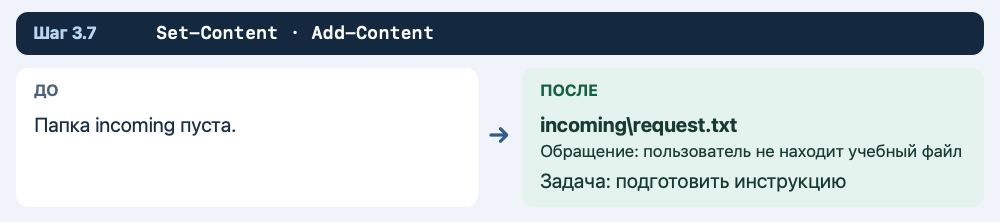

**Что должно получиться**

Заявка содержит две строки.

**Если результат другой**

Если папка `incoming` не найдена, сверьте шаг её создания.

**Что делает команда**

Заявка описывает проблему и ожидаемую работу.

### 3.8. Создайте исходную инструкцию

Введите команды по очереди.

```powershell
Set-Content -LiteralPath 'incoming\instructions.txt' -Value 'Откройте учебную папку' -Encoding UTF8
Add-Content -LiteralPath 'incoming\instructions.txt' -Value 'Проверьте имя файла в списке' -Encoding UTF8
```

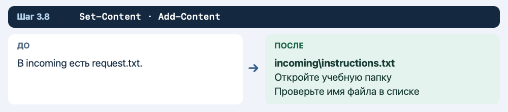

**Что должно получиться**

В `incoming` есть два исходника.

**Если результат другой**

Если случайно записали текст в заявку, восстановите её предыдущим шагом.

**Что делает команда**

Инструкция — отдельный документ.

### 3.9. Сделайте рабочую редакцию

Введите команды по очереди.

```powershell
Copy-Item -LiteralPath 'incoming\instructions.txt' -Destination 'work\instructions-ready.txt'
Add-Content -LiteralPath 'work\instructions-ready.txt' -Value 'Если файл не найден, проверьте текущую папку' -Encoding UTF8
```

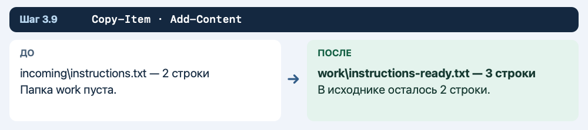

**Что должно получиться**

Рабочая инструкция содержит дополнительную строку.

**Если результат другой**

Проверьте, что правка записана в `work`.

**Что делает команда**

В исходнике остаётся текст, который вы получили.

### 3.10. Сравните обе редакции

Введите команды по очереди.

```powershell
Get-Content -LiteralPath 'incoming\instructions.txt' -Encoding UTF8
Get-Content -LiteralPath 'work\instructions-ready.txt' -Encoding UTF8
```

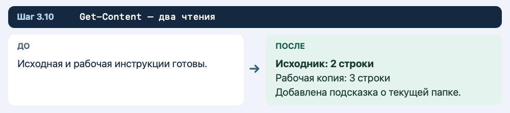

**Что должно получиться**

Сначала видны две строки, затем три.

**Если результат другой**

При лишней строке проверьте, не повторили ли вы запись.

**Что делает команда**

Разница — третья строка рабочей редакции.

### 3.11. Передайте копию заявки

Введите команды по очереди.

```powershell
Copy-Item -LiteralPath 'incoming\request.txt' -Destination 'delivery'
Get-ChildItem -LiteralPath 'delivery' -Name
```

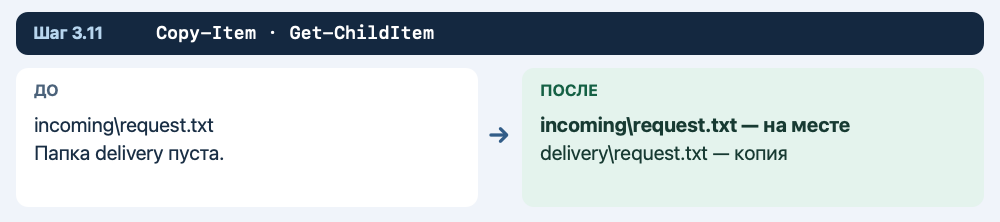

**Что должно получиться**

В `delivery` появился `request.txt`.

**Если результат другой**

Если папка пуста, проверьте исходное имя.

**Что делает команда**

Копирование сохраняет заявку во входящих.

### 3.12. Перенесите рабочую инструкцию

Введите команды по очереди.

```powershell
Move-Item -LiteralPath 'work\instructions-ready.txt' -Destination 'delivery'
Get-ChildItem -LiteralPath 'delivery' -Name
```

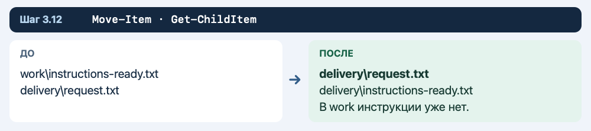

**Что должно получиться**

В папке выдачи уже два файла.

**Если результат другой**

Если перенос выполняли ранее, проверьте папку выдачи и не повторяйте операцию.

**Что делает команда**

Рабочая редакция теперь находится в комплекте.

### 3.13. Составьте отчёт

Введите команды по очереди.

```powershell
Set-Content -LiteralPath 'delivery\handoff.txt' -Value 'Комплект службы поддержки' -Encoding UTF8
Add-Content -LiteralPath 'delivery\handoff.txt' -Value 'В комплекте: request.txt и instructions-ready.txt' -Encoding UTF8
```

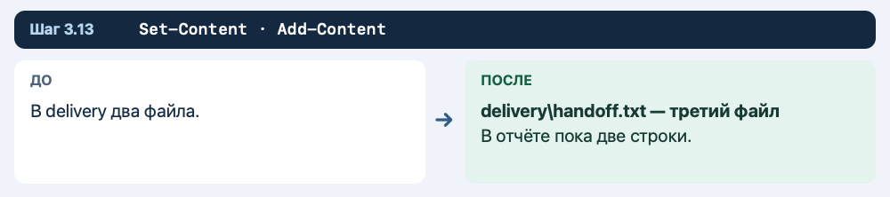

**Что должно получиться**

Третий файл комплекта — `handoff.txt`.

**Если результат другой**

Добавьте в отчёт результат проверки после следующих двух шагов.

**Что делает команда**

Отчёт объясняет, что передано.

### 3.14. Проверьте структуру

Введите команды по очереди.

```powershell
Get-ChildItem -Recurse -Name
Test-Path -LiteralPath 'incoming\instructions.txt' -PathType Leaf
Test-Path -LiteralPath 'work\instructions-ready.txt' -PathType Leaf
```

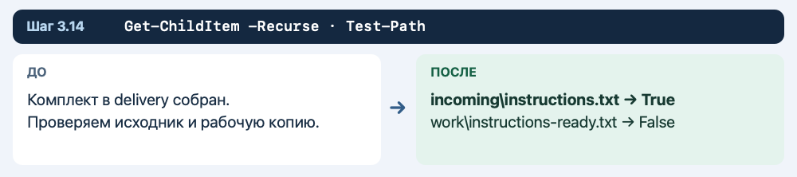

**Что должно получиться**

После списка ответ `True`, затем `False`.

**Если результат другой**

Если ответы другие, найдите файл по списку и сверьте предыдущие шаги.

**Что делает команда**

Первый ответ подтверждает наличие оригинала, второй — отсутствие перенесённой копии в `work`.

### 3.15. Прочитайте готовую инструкцию

Введите команды по очереди.

```powershell
Get-Content -LiteralPath 'delivery\instructions-ready.txt' -Encoding UTF8
```

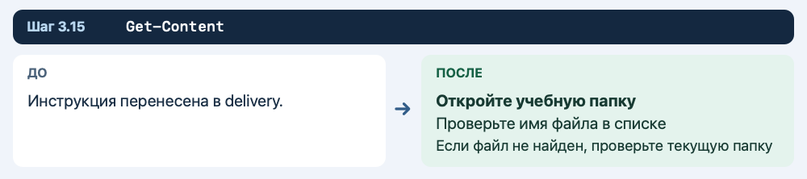

**Что должно получиться**

В инструкции три строки.

**Если результат другой**

Если текста нет, проверьте имя и путь файла.

**Что делает команда**

Получатель должен увидеть результат до передачи.

### 3.16. Отметьте результат проверки

Введите команды по очереди.

```powershell
Add-Content -LiteralPath 'delivery\handoff.txt' -Value 'Проверено: исходники сохранены, комплект открывается' -Encoding UTF8
Get-Content -LiteralPath 'delivery\handoff.txt' -Encoding UTF8
```

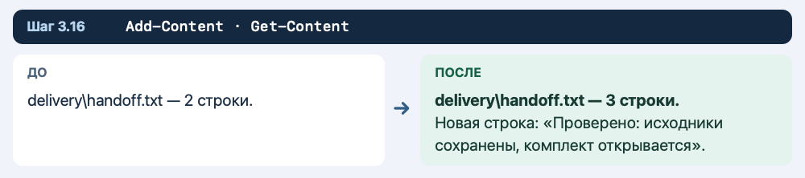

**Что должно получиться**

Отчёт состоит из трёх строк.

**Если результат другой**

Записывайте успешную проверку только после того, как получили ожидаемый результат.

**Что делает команда**

Отчёт связывает состав комплекта с выполненной проверкой.

## Самостоятельная часть и сдача

Создайте подпапку `second-delivery`. Скопируйте в неё три файла из `delivery` по одному. В копии отчёта допишите «Повторная передача проверена». Откройте оба отчёта и проверьте, что дополнительная строка есть только во втором.

На снимке **Пара-3** покажите дерево папок, текст готовой инструкции и два отчёта. Устно или письменно объясните, где сохранились исходники.

**Если закончили раньше.** Закройте окно Проводника, вернитесь в терминал и найдите любой созданный файл сначала по короткому пути, затем по полному. Запишите обе команды и объясните, какая из них зависит от текущей папки.

## Как быстро вернуться к работе после закрытия окна

1. Найдите учебную папку в Проводнике.
2. Нажмите на адресную строку и скопируйте полный путь.
3. Откройте Windows PowerShell.
4. Присвойте этот путь переменной `$lab` и выполните `Set-Location -LiteralPath $lab`.
5. Командой `Get-ChildItem -Recurse -Name` проверьте, на каком шаге остановились.

Пример записи переменной с вымышленным адресом:

```powershell
$lab = 'C:\Users\Student\Documents\Console-Lab-1-20261112-120000'
```

В примере путь замените адресом своей папки.


## Справка Microsoft

- [Windows PowerShell 5.1 — запись текста в файл](https://learn.microsoft.com/en-us/powershell/module/microsoft.powershell.management/set-content?view=powershell-5.1)
- [Добавление текста в файл](https://learn.microsoft.com/en-us/powershell/module/microsoft.powershell.management/add-content?view=powershell-5.1)
- [Копирование файлов](https://learn.microsoft.com/en-us/powershell/module/microsoft.powershell.management/copy-item?view=powershell-5.1)
- [Перемещение файлов](https://learn.microsoft.com/en-us/powershell/module/microsoft.powershell.management/move-item?view=powershell-5.1)

[К оглавлению](README.md) · [Назад — пара 2](02-copy-and-move.md)
