# Практикум Windows PowerShell — файлы и папки

Три самостоятельные пары по 90 минут. Понадобится обычная учётная запись Windows и встроенный **Windows PowerShell 5.1**. Команды вводятся в окне, где приглашение начинается с **PS**. Текстовые документы можно просматривать прямо в консоли или открывать в Блокноте.

## Как начать любую пару

1. Нажмите **Пуск** и напечатайте **Windows PowerShell**.
2. Откройте приложение **Windows PowerShell** обычным щелчком.
3. Введите команду ниже и нажмите Enter.

```powershell
$PSVersionTable.PSVersion
```

В выводе в столбцах Major и Minor должны быть **5** и **1**. Если открылась «Командная строка» или PowerShell 7, вернитесь к шагу 1.

Иллюстрации «До → После» показывают состояние файлов или пример вывода. На вашем ПК пути и дата будут своими.

Копируйте только команды из серых блоков. Вводите по одной строке. Ожидаемый вывод из текста под блоком вводить не нужно. Если команда завершилась красной ошибкой, сначала исправьте её, затем продолжайте.

Каждая пара создаёт новые папки с датой и временем в названии. Выполняйте работу в одном окне PowerShell. Если начинаете пару заново, пройдите её с первого шага, чтобы получить новую папку.

- **Пара 1.** Создание папок, запись текста, Блокнот, копии.
- **Пара 2.** Копирование и перенос из «Документов» на рабочий стол.
- **Пара 3.** Самостоятельный заказ службы поддержки и проверка комплектности.

### Словарь на полях

- **Путь** — адрес файла или папки.
- **Текущая папка** — место, откуда PowerShell отсчитывает короткие пути.
- **Подпапка** — папка внутри другой папки.
- **Переменная** — сохранённое значение. Например, в `$lab` хранится путь к папке упражнения.
- **Кавычки** помогают передавать путь или текст целиком, даже если в нём есть пробелы.
- **True** означает «да», **False** — «нет». Смысл ответа зависит от вопроса, который задали командой.

### Если сразу появился сбой

- Приглашение `>>` означает, что PowerShell ждёт продолжения строки. Нажмите **Ctrl+C** и скопируйте полную команду заново.
- Если путь не найден, сначала выполните `Get-Location`, затем `Get-ChildItem`. Сверьте папку и имена файлов.
- Если запись не разрешена, проверьте, что работаете в своей учебной папке. В паре 2 есть запасной вариант для рабочего стола.
- Если текст отображается странно, используйте чтение с `-Encoding UTF8` и проверьте, что скопировали обычные кавычки.

## Пара 1. Папки, текст и Блокнот

**Порядок работы.** 10 минут на запуск, 35 минут на команды по образцу, 30 минут на самостоятельную часть и 15 минут на проверку и сдачу.

### 1.1. Найдите «Документы»

Введите команды по очереди.

```powershell
$docs = [Environment]::GetFolderPath('MyDocuments')
$docs
```

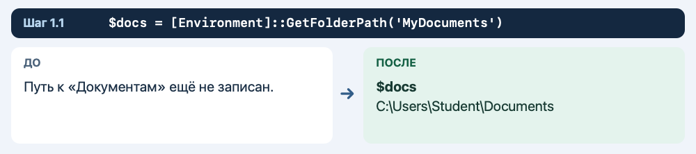

**Что должно получиться**

Показывается полный путь к «Документам». Он может вести в OneDrive.

**Если результат другой**

Если путь пустой, откройте «Документы» в Проводнике и скопируйте путь через адресную строку. Введите его вручную в команду вида `$docs = 'C:\путь\к\Документам'`.

**Что делает команда**

Windows сама сообщает, где находятся «Документы» этой учётной записи.

### 1.2. Проверьте папку

Введите команды по очереди.

```powershell
Test-Path -LiteralPath $docs -PathType Container
```


**Что должно получиться**

Должно быть `True`.

**Если результат другой**

Если ответ `False`, вернитесь к предыдущему шагу и проверьте адрес.

**Что делает команда**

`Container` означает, что проверяется папка.

### 1.3. Придумайте имя учебной папки

Введите команды по очереди.

```powershell
$stamp = Get-Date -Format 'yyyyMMdd-HHmmss'
$lab = Join-Path $docs "Console-Lab-1-$stamp"
$lab
```


**Что должно получиться**

Путь заканчивается на `Console-Lab-1-` и дату со временем.

**Если результат другой**

Если путь получился без «Документов», сначала заново выполните первые два шага.

**Что делает команда**

`Join-Path` соединяет адрес папки и новое имя.

### 1.4. Создайте папку и войдите

Введите команды по очереди.

```powershell
New-Item -ItemType Directory -Path $lab
Set-Location -LiteralPath $lab
Get-Location
```

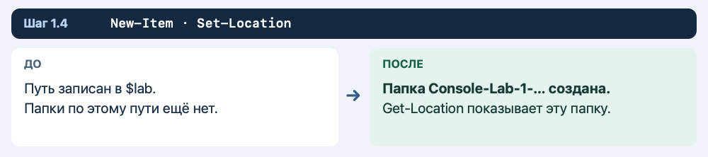

**Что должно получиться**

Последняя команда показывает путь к новой папке.

**Если результат другой**

Если запись запрещена, покажите преподавателю путь и текст ошибки.

**Что делает команда**

`New-Item` создаёт папку, а `Set-Location` делает её текущей.

### 1.5. Создайте подпапку

Введите команды по очереди.

```powershell
New-Item -ItemType Directory -Path 'original'
Get-ChildItem -Name
```

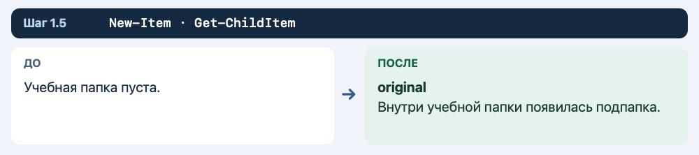

**Что должно получиться**

В списке есть `original`.

**Если результат другой**

Если не уверены в текущей папке, выполните `Get-Location`.

**Что делает команда**

`-Name` показывает только имена элементов.

### 1.6. Создайте пустой файл

Введите команды по очереди.

```powershell
New-Item -ItemType File -Path 'original\request.txt'
Test-Path -LiteralPath 'original\request.txt' -PathType Leaf
```

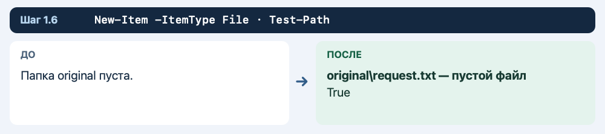

**Что должно получиться**

Проверка возвращает `True`.

**Если результат другой**

Если файл уже есть после повторного ввода, продолжайте со следующим шагом.

**Что делает команда**

`Leaf` проверяет, что по пути есть файл.

### 1.7. Запишите первую строку

Введите команды по очереди.

```powershell
Set-Content -LiteralPath 'original\request.txt' -Value 'Обращение: подготовить учебный отчёт' -Encoding UTF8
```

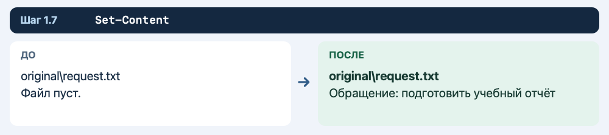

**Что должно получиться**

Команда обычно выполняется без сообщения.

**Если результат другой**

Если появляется `>>`, нажмите Ctrl+C и проверьте кавычки.

**Что делает команда**

`Set-Content` заменяет содержимое файла.

### 1.8. Добавьте вторую строку

Введите команды по очереди.

```powershell
Add-Content -LiteralPath 'original\request.txt' -Value 'Статус: принято' -Encoding UTF8
```

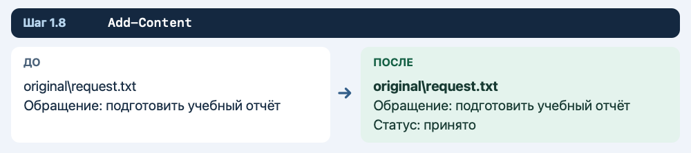

**Что должно получиться**

Первая строка сохраняется, вторая добавляется в конец.

**Если результат другой**

Если случайно повторили команду, повторите два шага записи в исходном порядке один раз.

**Что делает команда**

`Add-Content` дописывает текст.

### 1.9. Прочитайте файл

Введите команды по очереди.

```powershell
Get-Content -LiteralPath 'original\request.txt' -Encoding UTF8
```

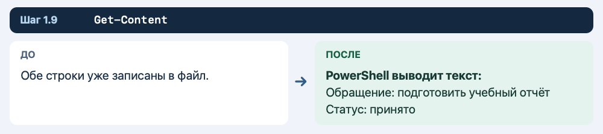

**Что должно получиться**

Видны две строки: обращение и статус.

**Если результат другой**

Если видна только одна строка, проверьте, выполняли ли вы `Add-Content`.

**Что делает команда**

`Get-Content` выводит содержимое в терминал.

### 1.10. Откройте файл из консоли в Блокноте

Сначала проверьте, доступен ли Блокнот:

```powershell
Get-Command notepad.exe -ErrorAction SilentlyContinue
```

Если команда показала `notepad.exe`, выполните следующие строки. Если вывода нет, пропустите запуск и перейдите к чтению файла в PowerShell.

```powershell
$file = Join-Path $lab 'original\request.txt'
notepad.exe "$file"
```

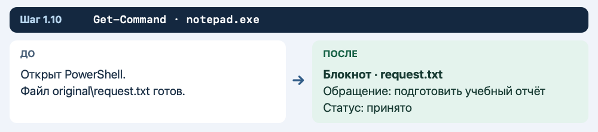

**Что должно получиться**

В Блокноте открывается файл request.txt с двумя строками.

**Если результат другой**

Если Блокнот отсутствует или заблокирован на учебном ПК, выполните `Get-Content -LiteralPath 'original\request.txt' -Encoding UTF8` и продолжайте.

**Что делает команда**

В кавычках полный путь передаётся как один аргумент, даже если в пути есть пробелы.

### 1.11. Сделайте отдельную копию

Введите команды по очереди.

```powershell
New-Item -ItemType Directory -Path 'review'
Copy-Item -LiteralPath 'original\request.txt' -Destination 'review\request-copy.txt'
Get-ChildItem -LiteralPath 'review' -Name
```

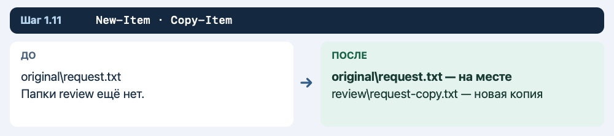

**Что должно получиться**

В `review` есть `request-copy.txt`.

**Если результат другой**

Если файл не скопировался, убедитесь, что обе папки существуют.

**Что делает команда**

`Copy-Item` сохраняет исходный файл.

### 1.12. Переименуйте копию

Введите команды по очереди.

```powershell
Rename-Item -LiteralPath 'review\request-copy.txt' -NewName 'request-review.txt'
Get-ChildItem -LiteralPath 'review' -Name
```

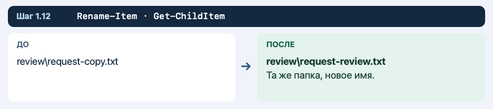

**Что должно получиться**

В списке новое имя `request-review.txt`.

**Если результат другой**

В `-NewName` указывайте имя файла, без адреса папки.

**Что делает команда**

Файл остаётся в `review`. Изменилось только имя.

### 1.13. Допишите комментарий в копию

Введите команды по очереди.

```powershell
Add-Content -LiteralPath 'review\request-review.txt' -Value 'Комментарий: передано на проверку' -Encoding UTF8
Get-Content -LiteralPath 'review\request-review.txt' -Encoding UTF8
```

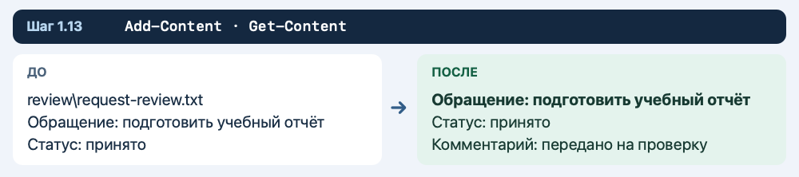

**Что должно получиться**

В копии видны три строки.

**Если результат другой**

Если третья строка появилась в исходнике, проверьте, какой путь вы указали при записи.

**Что делает команда**

Две копии одного документа можно изменять отдельно.

### 1.14. Проверьте исходник

Введите команды по очереди.

```powershell
Get-Content -LiteralPath 'original\request.txt' -Encoding UTF8
Get-ChildItem -Recurse -Name
```

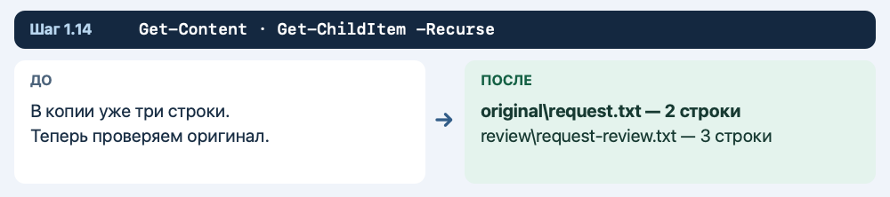

**Что должно получиться**

В исходнике две строки. В списке видны обе подпапки и два файла.

**Если результат другой**

Если вывелся список «Документов», вернитесь в учебную папку командой `Set-Location -LiteralPath $lab`.

**Что делает команда**

`-Recurse` показывает содержимое подпапок.

### Самостоятельная часть пары 1

В учебной папке создайте подпапку `notes` и файл `notes\how-to.txt`. Запишите заголовок «Как передать учебный файл» и два своих совета. Сделайте копию в `review` под именем `how-to-review.txt`. Допишите в неё «Проверено». Если на шаге 1.10 Блокнот открылся, откройте в нём копию тем же способом. Иначе прочитайте копию через `Get-Content`.

Проверьте, что у исходника три строки, а у копии четыре. На снимке терминала покажите оба текста и список файлов. Назовите снимок **Пара-1**.

**Если закончили раньше.** Закройте окно Проводника, вернитесь в терминал и найдите любой созданный файл сначала по короткому пути, затем по полному. Запишите обе команды и объясните, какая из них зависит от текущей папки.

## Пара 2. Передача файлов на рабочий стол

**Порядок работы.** 10 минут на запуск, 35 минут на команды по образцу, 30 минут на самостоятельную часть и 15 минут на проверку и сдачу.

### 2.1. Найдите «Документы»

Введите команды по очереди.

```powershell
$docs = [Environment]::GetFolderPath('MyDocuments')
$docs
```


**Что должно получиться**

Показывается полный путь к «Документам». Он может вести в OneDrive.

**Если результат другой**

Если путь пустой, откройте «Документы» в Проводнике и скопируйте путь через адресную строку. Введите его вручную в команду вида `$docs = 'C:\путь\к\Документам'`.

**Что делает команда**

Windows сама сообщает, где находятся «Документы» этой учётной записи.

### 2.2. Проверьте папку

Введите команды по очереди.

```powershell
Test-Path -LiteralPath $docs -PathType Container
```

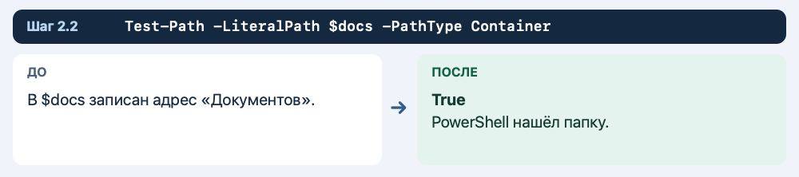

**Что должно получиться**

Должно быть `True`.

**Если результат другой**

Если ответ `False`, вернитесь к предыдущему шагу и проверьте адрес.

**Что делает команда**

`Container` означает, что проверяется папка.

### 2.3. Придумайте имя учебной папки

Введите команды по очереди.

```powershell
$stamp = Get-Date -Format 'yyyyMMdd-HHmmss'
$lab = Join-Path $docs "Console-Lab-2-$stamp"
$lab
```

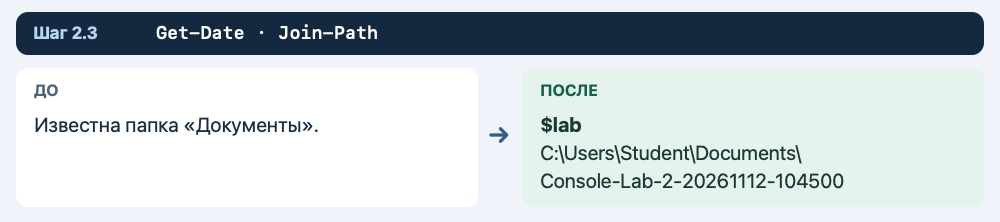

**Что должно получиться**

Путь заканчивается на `Console-Lab-2-` и дату со временем.

**Если результат другой**

Если путь получился без «Документов», сначала заново выполните первые два шага.

**Что делает команда**

`Join-Path` соединяет адрес папки и новое имя.

### 2.4. Создайте папку и войдите

Введите команды по очереди.

```powershell
New-Item -ItemType Directory -Path $lab
Set-Location -LiteralPath $lab
Get-Location
```

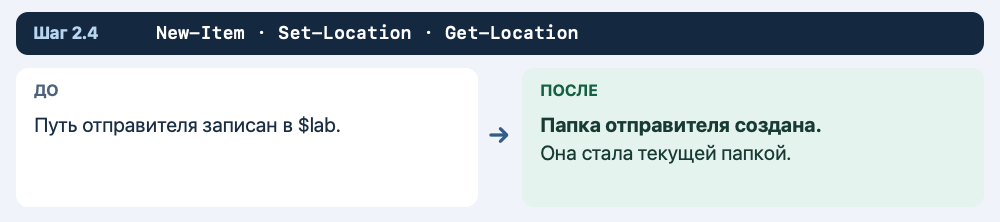

**Что должно получиться**

Последняя команда показывает путь к новой папке.

**Если результат другой**

Если запись запрещена, покажите преподавателю путь и текст ошибки.

**Что делает команда**

`New-Item` создаёт папку, а `Set-Location` делает её текущей.

### 2.5. Узнайте адрес рабочего стола

Введите команды по очереди.

```powershell
$desktop = [Environment]::GetFolderPath('DesktopDirectory')
$desktop
```


**Что должно получиться**

Показывается путь к рабочему столу вашей учётной записи.

**Если результат другой**

Если путь пустой, пропустите первый блок следующего шага и выполните запасной вариант под ним.

**Что делает команда**

На учебном ПК рабочий стол может находиться в папке OneDrive.

### 2.6. Создайте папку для передачи

Введите команды по очереди.

```powershell
$delivery = Join-Path $desktop "Console-Delivery-$stamp"
New-Item -ItemType Directory -Path $delivery
$delivery
```

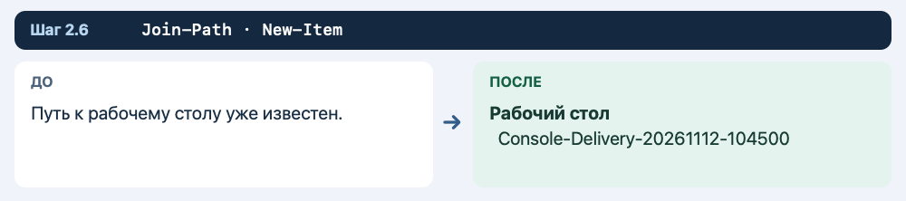

**Что должно получиться**

Виден полный путь к учебной папке рабочего стола.

**Если результат другой**

Если рабочий стол недоступен, выполните запасной вариант ниже.

**Что делает команда**

Отдельная папка отличает учебные файлы от остального рабочего стола.

**Запасной вариант шага.** Если рабочий стол недоступен, создайте папку получателя в «Документах» и продолжайте с ней.

```powershell
$delivery = Join-Path $docs "Console-Delivery-$stamp"
New-Item -ItemType Directory -Path $delivery
```

Укажите в сдаче, что использовали «Документы» вместо рабочего стола.

### 2.7. Проверьте папку назначения

Введите команды по очереди.

```powershell
Test-Path -LiteralPath $delivery -PathType Container
```

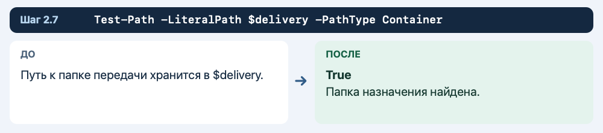

**Что должно получиться**

Ожидается `True`.

**Если результат другой**

При `False` не продолжайте перенос. Создайте папку назначения заново.

**Что делает команда**

Перенос удобнее делать в уже существующую папку.

### 2.8. Создайте исходник

Введите команды по очереди.

```powershell
Set-Content -LiteralPath 'ticket.txt' -Value 'Заявка: передать учебный комплект' -Encoding UTF8
Add-Content -LiteralPath 'ticket.txt' -Value 'Ответственный: учебная группа' -Encoding UTF8
```

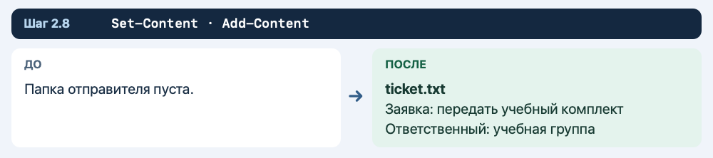

**Что должно получиться**

В текущей папке создан `ticket.txt`.

**Если результат другой**

Если команда ошиблась, проверьте текущую папку через `Get-Location`.

**Что делает команда**

Файл находится в «Документах», внутри учебной папки пары 2.

### 2.9. Сделайте копию в папке отправителя

Введите команды по очереди.

```powershell
Copy-Item -LiteralPath 'ticket.txt' -Destination 'ticket-delivery.txt'
Get-ChildItem -Name
```

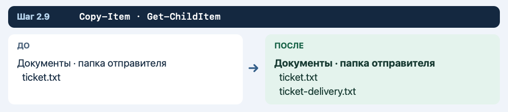

**Что должно получиться**

В списке видны `ticket.txt` и `ticket-delivery.txt`.

**Если результат другой**

Если исходник не найден, вернитесь к предыдущему шагу.

**Что делает команда**

Пока оба файла находятся в одной папке.

### 2.10. Перенесите копию на рабочий стол

Введите команды по очереди.

```powershell
Move-Item -LiteralPath 'ticket-delivery.txt' -Destination $delivery
```

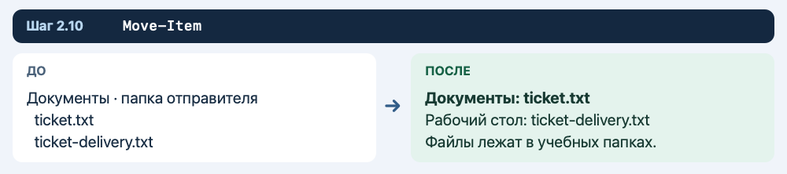

**Что должно получиться**

Команда обычно выполняется без сообщения.

**Если результат другой**

Если путь назначения недоступен, проверьте его командой предыдущего шага.

**Что делает команда**

Перемещается только копия с именем `ticket-delivery.txt`.

### 2.11. Проверьте папку отправителя

Введите команды по очереди.

```powershell
Get-ChildItem -LiteralPath $lab -Name
Test-Path -LiteralPath 'ticket-delivery.txt' -PathType Leaf
```

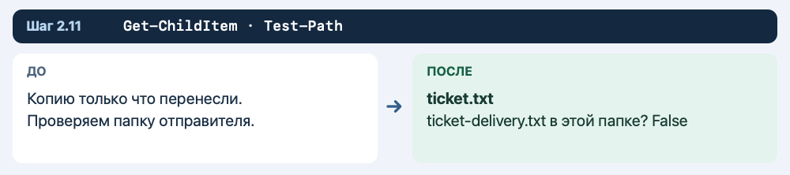

**Что должно получиться**

В списке есть `ticket.txt`, а проверка копии возвращает `False`.

**Если результат другой**

Если ответ `True`, убедитесь, что выполнили `Move-Item`, а не `Copy-Item`.

**Что делает команда**

Здесь `False` подтверждает, что копия ушла из текущей папки.

### 2.12. Проверьте папку получателя

Введите команды по очереди.

```powershell
Get-ChildItem -LiteralPath $delivery -Name
Get-Content -LiteralPath (Join-Path $delivery 'ticket-delivery.txt') -Encoding UTF8
```

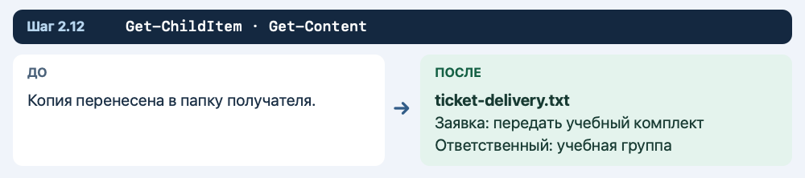

**Что должно получиться**

Видны имя копии и две строки из исходного документа.

**Если результат другой**

Если список пуст, сверьте путь в `$delivery`.

**Что делает команда**

Перенос не меняет содержимое файла.

### 2.13. Создайте записку о передаче

Введите команды по очереди.

```powershell
Set-Content -LiteralPath 'handoff.txt' -Value 'Передано: ticket-delivery.txt' -Encoding UTF8
Add-Content -LiteralPath 'handoff.txt' -Value 'Проверка: файл открывается' -Encoding UTF8
```

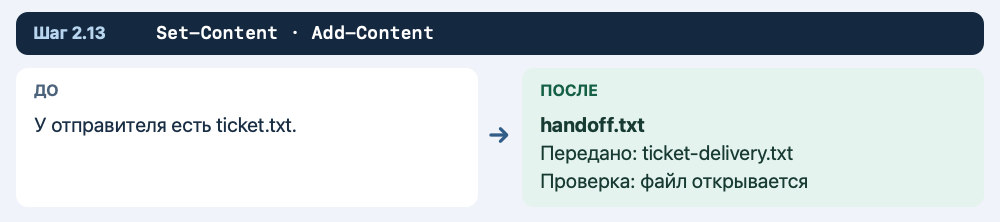

**Что должно получиться**

У отправителя есть `handoff.txt` с двумя строками.

**Если результат другой**

Если хотите прочитать результат, выполните `Get-Content -LiteralPath 'handoff.txt' -Encoding UTF8`.

**Что делает команда**

Записка помогает получателю сверить комплект.

### 2.14. Скопируйте записку получателю

Введите команды по очереди.

```powershell
Copy-Item -LiteralPath 'handoff.txt' -Destination $delivery
Get-ChildItem -LiteralPath $delivery -Name
```

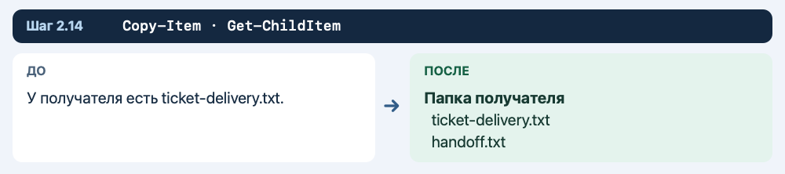

**Что должно получиться**

У получателя два файла: `handoff.txt` и `ticket-delivery.txt`.

**Если результат другой**

Проверьте, что оригинал записки остался у отправителя.

**Что делает команда**

Для записки нужно копирование, потому что она нужна обеим сторонам.

### 2.15. Откройте папку получателя из консоли

Введите команды по очереди.

```powershell
Invoke-Item -LiteralPath $delivery
```

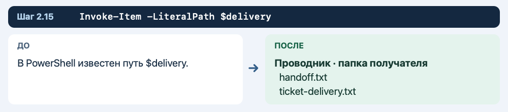

**Что должно получиться**

Папка открывается в Проводнике.

**Если результат другой**

Если запуск окна запрещён, выполните `Get-ChildItem -LiteralPath $delivery`.

**Что делает команда**

`Invoke-Item` открывает папку обычным для Windows способом.

### Самостоятельная часть пары 2

Создайте файл `receipt.txt` у отправителя. Впишите имя переданной заявки и название папки получателя. Скопируйте записку получателю. Проверьте, что она осталась в «Документах», а её копия открывается из папки передачи.

На снимке **Пара-2** покажите списки отправителя и получателя и вывод `Get-Content` для переданной заявки. В двух предложениях объясните разницу между переносом и копированием.

**Если закончили раньше.** Закройте окно Проводника, вернитесь в терминал и найдите любой созданный файл сначала по короткому пути, затем по полному. Запишите обе команды и объясните, какая из них зависит от текущей папки.

## Пара 3. Учебный заказ службы поддержки

**Порядок работы.** 10 минут на запуск, 35 минут на команды по образцу, 30 минут на самостоятельную часть и 15 минут на проверку и сдачу.

### 3.1. Найдите «Документы»

Введите команды по очереди.

```powershell
$docs = [Environment]::GetFolderPath('MyDocuments')
$docs
```

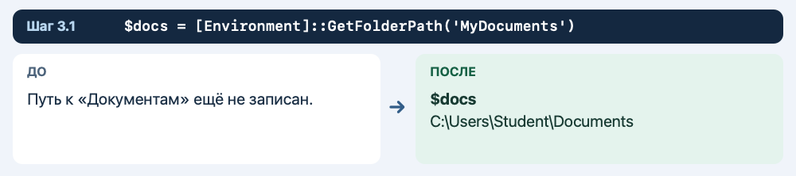

**Что должно получиться**

Показывается полный путь к «Документам». Он может вести в OneDrive.

**Если результат другой**

Если путь пустой, откройте «Документы» в Проводнике и скопируйте путь через адресную строку. Введите его вручную в команду вида `$docs = 'C:\путь\к\Документам'`.

**Что делает команда**

Windows сама сообщает, где находятся «Документы» этой учётной записи.

### 3.2. Проверьте папку

Введите команды по очереди.

```powershell
Test-Path -LiteralPath $docs -PathType Container
```


**Что должно получиться**

Должно быть `True`.

**Если результат другой**

Если ответ `False`, вернитесь к предыдущему шагу и проверьте адрес.

**Что делает команда**

`Container` означает, что проверяется папка.

### 3.3. Придумайте имя учебной папки

Введите команды по очереди.

```powershell
$stamp = Get-Date -Format 'yyyyMMdd-HHmmss'
$lab = Join-Path $docs "Console-Lab-3-$stamp"
$lab
```


**Что должно получиться**

Путь заканчивается на `Console-Lab-3-` и дату со временем.

**Если результат другой**

Если путь получился без «Документов», сначала заново выполните первые два шага.

**Что делает команда**

`Join-Path` соединяет адрес папки и новое имя.

### 3.4. Создайте папку и войдите

Введите команды по очереди.

```powershell
New-Item -ItemType Directory -Path $lab
Set-Location -LiteralPath $lab
Get-Location
```

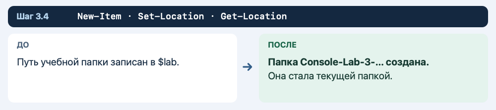

**Что должно получиться**

Последняя команда показывает путь к новой папке.

**Если результат другой**

Если запись запрещена, покажите преподавателю путь и текст ошибки.

**Что делает команда**

`New-Item` создаёт папку, а `Set-Location` делает её текущей.

### 3.5. Создайте входящую папку

Введите команды по очереди.

```powershell
New-Item -ItemType Directory -Path 'incoming'
```

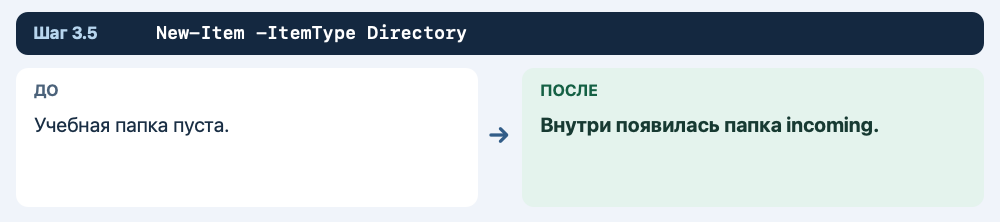

**Что должно получиться**

Появилась папка `incoming`.

**Если результат другой**

Если имя есть после повтора, проверьте, что это подпапка текущей учебной папки.

**Что делает команда**

Здесь будут храниться исходники.

### 3.6. Создайте папки работы и выдачи

Введите команды по очереди.

```powershell
New-Item -ItemType Directory -Path 'work'
New-Item -ItemType Directory -Path 'delivery'
Get-ChildItem -Name
```

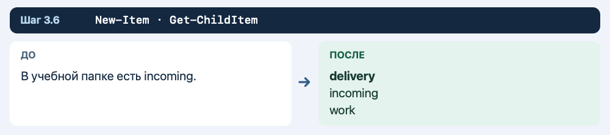

**Что должно получиться**

В списке три папки: `delivery`, `incoming`, `work`.

**Если результат другой**

Если папки появились не там, проверьте `Get-Location`.

**Что делает команда**

Разные папки показывают, где исходник, черновик и готовый комплект.

### 3.7. Создайте заявку

Введите команды по очереди.

```powershell
Set-Content -LiteralPath 'incoming\request.txt' -Value 'Обращение: пользователь не находит учебный файл' -Encoding UTF8
Add-Content -LiteralPath 'incoming\request.txt' -Value 'Задача: подготовить инструкцию' -Encoding UTF8
```

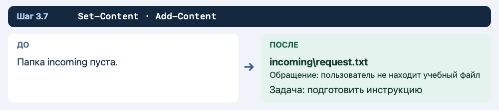

**Что должно получиться**

Заявка содержит две строки.

**Если результат другой**

Если папка `incoming` не найдена, сверьте шаг её создания.

**Что делает команда**

Заявка описывает проблему и ожидаемую работу.

### 3.8. Создайте исходную инструкцию

Введите команды по очереди.

```powershell
Set-Content -LiteralPath 'incoming\instructions.txt' -Value 'Откройте учебную папку' -Encoding UTF8
Add-Content -LiteralPath 'incoming\instructions.txt' -Value 'Проверьте имя файла в списке' -Encoding UTF8
```

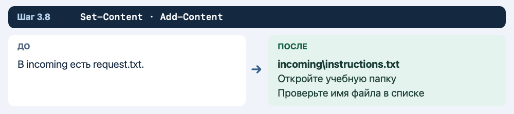

**Что должно получиться**

В `incoming` есть два исходника.

**Если результат другой**

Если случайно записали текст в заявку, восстановите её предыдущим шагом.

**Что делает команда**

Инструкция — отдельный документ.

### 3.9. Сделайте рабочую редакцию

Введите команды по очереди.

```powershell
Copy-Item -LiteralPath 'incoming\instructions.txt' -Destination 'work\instructions-ready.txt'
Add-Content -LiteralPath 'work\instructions-ready.txt' -Value 'Если файл не найден, проверьте текущую папку' -Encoding UTF8
```

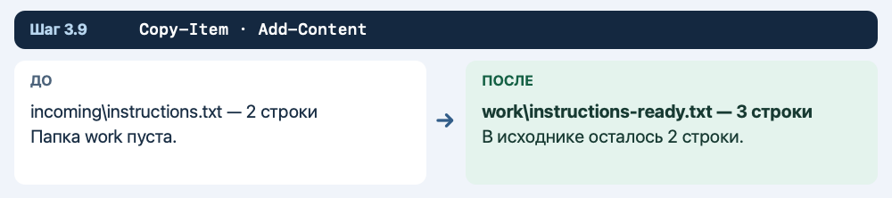

**Что должно получиться**

Рабочая инструкция содержит дополнительную строку.

**Если результат другой**

Проверьте, что правка записана в `work`.

**Что делает команда**

В исходнике остаётся текст, который вы получили.

### 3.10. Сравните обе редакции

Введите команды по очереди.

```powershell
Get-Content -LiteralPath 'incoming\instructions.txt' -Encoding UTF8
Get-Content -LiteralPath 'work\instructions-ready.txt' -Encoding UTF8
```

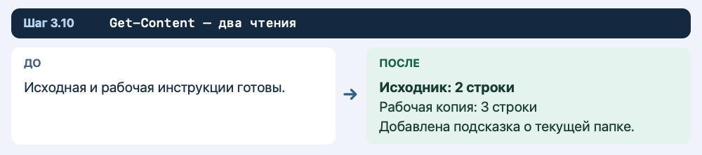

**Что должно получиться**

Сначала видны две строки, затем три.

**Если результат другой**

При лишней строке проверьте, не повторили ли вы запись.

**Что делает команда**

Разница — третья строка рабочей редакции.

### 3.11. Передайте копию заявки

Введите команды по очереди.

```powershell
Copy-Item -LiteralPath 'incoming\request.txt' -Destination 'delivery'
Get-ChildItem -LiteralPath 'delivery' -Name
```

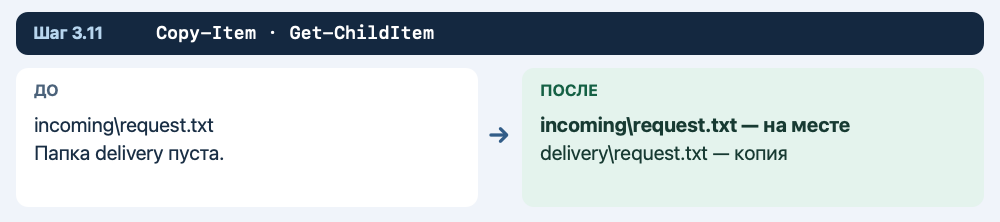

**Что должно получиться**

В `delivery` появился `request.txt`.

**Если результат другой**

Если папка пуста, проверьте исходное имя.

**Что делает команда**

Копирование сохраняет заявку во входящих.

### 3.12. Перенесите рабочую инструкцию

Введите команды по очереди.

```powershell
Move-Item -LiteralPath 'work\instructions-ready.txt' -Destination 'delivery'
Get-ChildItem -LiteralPath 'delivery' -Name
```

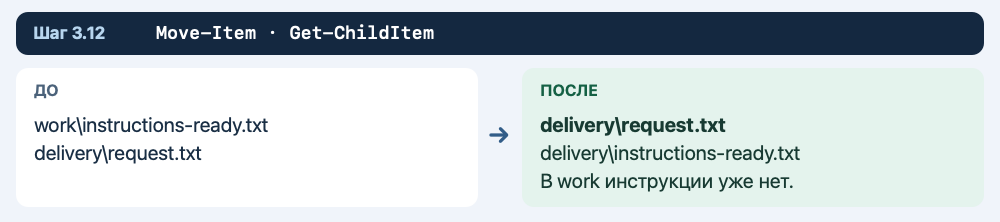

**Что должно получиться**

В папке выдачи уже два файла.

**Если результат другой**

Если перенос выполняли ранее, проверьте папку выдачи и не повторяйте операцию.

**Что делает команда**

Рабочая редакция теперь находится в комплекте.

### 3.13. Составьте отчёт

Введите команды по очереди.

```powershell
Set-Content -LiteralPath 'delivery\handoff.txt' -Value 'Комплект службы поддержки' -Encoding UTF8
Add-Content -LiteralPath 'delivery\handoff.txt' -Value 'В комплекте: request.txt и instructions-ready.txt' -Encoding UTF8
```

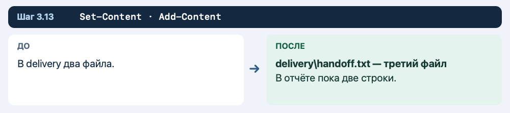

**Что должно получиться**

Третий файл комплекта — `handoff.txt`.

**Если результат другой**

Добавьте в отчёт результат проверки после следующих двух шагов.

**Что делает команда**

Отчёт объясняет, что передано.

### 3.14. Проверьте структуру

Введите команды по очереди.

```powershell
Get-ChildItem -Recurse -Name
Test-Path -LiteralPath 'incoming\instructions.txt' -PathType Leaf
Test-Path -LiteralPath 'work\instructions-ready.txt' -PathType Leaf
```

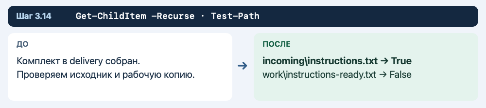

**Что должно получиться**

После списка ответ `True`, затем `False`.

**Если результат другой**

Если ответы другие, найдите файл по списку и сверьте предыдущие шаги.

**Что делает команда**

Первый ответ подтверждает наличие оригинала, второй — отсутствие перенесённой копии в `work`.

### 3.15. Прочитайте готовую инструкцию

Введите команды по очереди.

```powershell
Get-Content -LiteralPath 'delivery\instructions-ready.txt' -Encoding UTF8
```

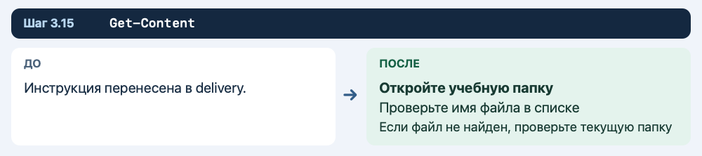

**Что должно получиться**

В инструкции три строки.

**Если результат другой**

Если текста нет, проверьте имя и путь файла.

**Что делает команда**

Получатель должен увидеть результат до передачи.

### 3.16. Отметьте результат проверки

Введите команды по очереди.

```powershell
Add-Content -LiteralPath 'delivery\handoff.txt' -Value 'Проверено: исходники сохранены, комплект открывается' -Encoding UTF8
Get-Content -LiteralPath 'delivery\handoff.txt' -Encoding UTF8
```

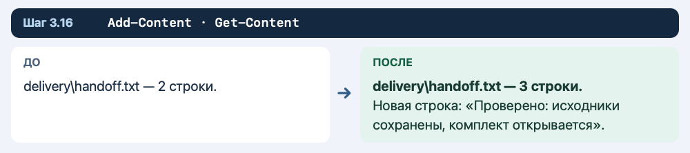

**Что должно получиться**

Отчёт состоит из трёх строк.

**Если результат другой**

Записывайте успешную проверку только после того, как получили ожидаемый результат.

**Что делает команда**

Отчёт связывает состав комплекта с выполненной проверкой.

### Самостоятельная часть пары 3

Создайте подпапку `second-delivery`. Скопируйте в неё три файла из `delivery` по одному. В копии отчёта допишите «Повторная передача проверена». Откройте оба отчёта и проверьте, что дополнительная строка есть только во втором.

На снимке **Пара-3** покажите дерево папок, текст готовой инструкции и два отчёта. Устно или письменно объясните, где сохранились исходники.

**Если закончили раньше.** Закройте окно Проводника, вернитесь в терминал и найдите любой созданный файл сначала по короткому пути, затем по полному. Запишите обе команды и объясните, какая из них зависит от текущей папки.

## Как быстро вернуться к работе после закрытия окна

1. Найдите учебную папку в Проводнике.
2. Нажмите на адресную строку и скопируйте полный путь.
3. Откройте Windows PowerShell.
4. Присвойте этот путь переменной `$lab` и выполните `Set-Location -LiteralPath $lab`.
5. Если продолжаете пару 2, также присвойте полный путь папки получателя переменной `$delivery`.
6. Командой `Get-ChildItem -Recurse -Name` проверьте, на каком шаге остановились.

Пример записи переменной с вымышленным адресом:

```powershell
$lab = 'C:\Users\Student\Documents\Console-Lab-1-20261112-120000'
```

В примере путь замените адресом своей папки.

## Справка Microsoft

- [Windows PowerShell 5.1 — запись текста в файл](https://learn.microsoft.com/en-us/powershell/module/microsoft.powershell.management/set-content?view=powershell-5.1)
- [Добавление текста в файл](https://learn.microsoft.com/en-us/powershell/module/microsoft.powershell.management/add-content?view=powershell-5.1)
- [Копирование файлов](https://learn.microsoft.com/en-us/powershell/module/microsoft.powershell.management/copy-item?view=powershell-5.1)
- [Перемещение файлов](https://learn.microsoft.com/en-us/powershell/module/microsoft.powershell.management/move-item?view=powershell-5.1)
