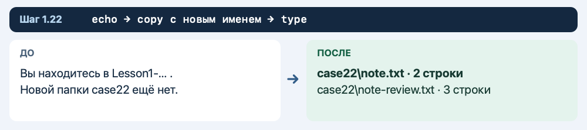
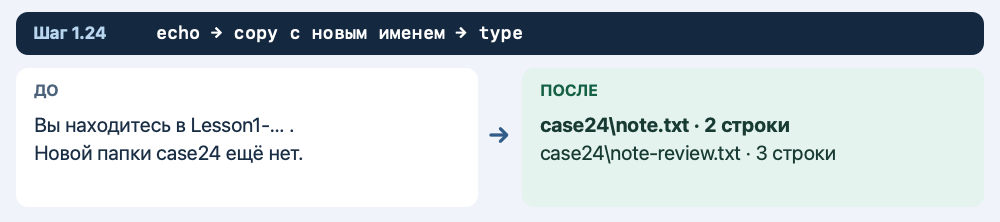

# Пара 1. Папки, текст и Блокнот

[К оглавлению](README.md)

**90 минут · 30 блоков · 360 действий.** Сначала создайте папки и запишите текст. Затем попробуйте открыть готовый файл в Блокноте.

В каждом блоке 12 коротких действий. Блоки 1–15 — основной маршрут на 90 минут. Если закончили раньше, продолжайте с блока 16. Блоки 16–30 также можно выполнить дома или на следующей паре. После каждой команды проверьте результат, затем переходите дальше. Оставьте эту страницу открытой и вводите команды в одном окне CMD.

**Перед началом.** Имена и тексты в командах подобраны так, чтобы их можно было копировать. Пояснения под блоками показывают, что можно поменять после тренировки. На первом проходе используйте предложенные имена. Все файлы создаются внутри отдельной учебной папки.

## Блок 1. Первая папка

**6 минут.** Выполняйте действия по одному.

### Действие 1

Нажмите **Пуск** на панели задач или клавишу **Win**.

### Действие 2

Наберите **cmd** и щёлкните **«Командная строка»**. Откроется окно с приглашением вроде `C:\Users\Student>`.

### Действие 3

Вернитесь в браузер. Скопируйте строку из следующего блока, щёлкните внутри CMD и вставьте через **Ctrl+V**. Если вставка недоступна, напечатайте строку вручную. После каждой команды нажимайте **Enter**. Текст приглашения до знака **>** уже есть в окне.

### Действие 4

Скопируйте строку в CMD. Нажмите **Enter**.

```cmd
set "LAB=%TEMP%\Lesson1-%RANDOM%-%RANDOM%"
```

Запоминает уникальный адрес папки. `set` задаёт переменную, `=` отделяет имя от значения, `%TEMP%` подставляет папку временных файлов, а каждое `%RANDOM%` — число. Кавычки охватывают всю запись. Можно изменить только начало имени после обратной косой черты, сохранив обе подстановки.

**Проверьте.** Появилась следующая строка приглашения.

### Действие 5

Скопируйте строку в CMD. Нажмите **Enter**.

```cmd
mkdir "%LAB%"
```

`mkdir` создаёт папку. `"%LAB%"` — её адрес или имя. Кавычки, если они есть, сохраняют путь с пробелами. Для своего варианта можно изменить имя, если затем использовать его в связанных командах.

**Проверьте.** Учебная папка создана. При успехе сообщение обычно не появляется.

### Действие 6

Скопируйте строку в CMD. Нажмите **Enter**.

```cmd
cd /d "%LAB%"
```

`cd` переходит в папку. Ключ `/d` разрешает одновременно сменить диск. `%LAB%` подставляет сохранённый адрес, кавычки сохраняют пробелы внутри пути.

**Проверьте.** В приглашении видно имя папки, начинающееся на Lesson1-.

### Действие 7

Скопируйте строку в CMD. Нажмите **Enter**.

```cmd
mkdir warmup
```

`mkdir` создаёт папку. `warmup` — её адрес или имя. Кавычки, если они есть, сохраняют путь с пробелами. Для своего варианта можно изменить имя, если затем использовать его в связанных командах.

**Проверьте.** В учебной папке создана подпапка warmup.

### Действие 8

Скопируйте строку в CMD. Нажмите **Enter**.

```cmd
cd warmup
```

`cd` переходит в папку `warmup`. Используйте имя, которое указали при её создании.

**Проверьте.** Приглашение заканчивается на warmup>.

### Действие 9

Скопируйте строку в CMD. Нажмите **Enter**.

```cmd
echo Hello Windows>hello.txt
```

`echo` выводит текст `Hello Windows`. Знак `>` отправляет вывод в `hello.txt` и записывает строку, заменяя прежний текст. Можно заменить текст до знака `>`, например написать `Training note`. Имя файла меняйте только вместе с последующими командами. Для своего текста используйте буквы, цифры и пробелы. Если число стоит в конце, допишите слово после него, чтобы CMD прочитал цифру как часть текста.

**Проверьте.** В текущей папке создан hello.txt.

### Действие 10

Скопируйте строку в CMD. Нажмите **Enter**.

```cmd
type hello.txt
```

`type` выводит текст файла `hello.txt`. Обратная косая черта, если она есть, отделяет папку от имени файла. Для другого файла подставьте его имя.

**Проверьте.** На экране видно Hello Windows.

### Действие 11

Скопируйте строку в CMD. Нажмите **Enter**.

```cmd
dir
```

`dir` показывает содержимое текущей папки. Команда только читает список.

**Проверьте.** В списке есть hello.txt.

### Действие 12

Скопируйте строку в CMD. Нажмите **Enter**.

```cmd
cd ..
```

`cd` меняет текущую папку. Две точки `..` означают папку на один уровень выше.

**Проверьте.** Вы вернулись в папку Lesson1-… .


## Блок 2. Заметка

**6 минут.** Выполняйте действия по одному.

### Действие 13

Скопируйте строку в CMD. Нажмите **Enter**.

```cmd
mkdir case02
```

`mkdir` создаёт папку. `case02` — её адрес или имя. Кавычки, если они есть, сохраняют путь с пробелами. Для своего варианта можно изменить имя, если затем использовать его в связанных командах.

**Проверьте.** Создана папка case02.

### Действие 14

Скопируйте строку в CMD. Нажмите **Enter**.

```cmd
cd case02
```

`cd` переходит в папку `case02`. Используйте имя, которое указали при её создании.

**Проверьте.** Приглашение заканчивается на case02>.

### Действие 15

Скопируйте строку в CMD. Нажмите **Enter**.

```cmd
dir
```

`dir` показывает содержимое текущей папки. Команда только читает список.

**Проверьте.** Найдите строку с количеством файлов. В новой папке пока нет ваших файлов.

### Действие 16

Скопируйте строку в CMD. Нажмите **Enter**.

```cmd
echo Classroom rules 02 note>note.txt
```

`echo` выводит текст `Classroom rules 02 note`. Знак `>` отправляет вывод в `note.txt` и записывает строку, заменяя прежний текст. Можно заменить текст до знака `>`, например написать `Training note`. Имя файла меняйте только вместе с последующими командами. Для своего текста используйте буквы, цифры и пробелы. Если число стоит в конце, допишите слово после него, чтобы CMD прочитал цифру как часть текста.

**Проверьте.** Создан note.txt с первой строкой.

### Действие 17

Скопируйте строку в CMD. Нажмите **Enter**.

```cmd
echo Prepare a copy>>note.txt
```

`echo` выводит текст `Prepare a copy`. Знак `>>` отправляет вывод в `note.txt` и добавляет строку в конец. Можно заменить текст до знака `>>`, например написать `Training note`. Имя файла меняйте только вместе с последующими командами. Для своего текста используйте буквы, цифры и пробелы. Если число стоит в конце, допишите слово после него, чтобы CMD прочитал цифру как часть текста.

**Проверьте.** В note.txt добавлена вторая строка.

### Действие 18

Скопируйте строку в CMD. Нажмите **Enter**.

```cmd
type note.txt
```

`type` выводит текст файла `note.txt`. Обратная косая черта, если она есть, отделяет папку от имени файла. Для другого файла подставьте его имя.

**Проверьте.** На экране две записанные строки.

### Действие 19

Скопируйте строку в CMD. Нажмите **Enter**.

```cmd
copy note.txt note-copy.txt
```

`copy` копирует, исходник остаётся на месте. Первый путь `note.txt` указывает, с чем работаем, второй `note-copy.txt` задаёт назначение или новое имя. Если подставляете свои имена, используйте их и в следующих командах.

**Проверьте.** CMD сообщает о копировании одного файла.

### Действие 20

Скопируйте строку в CMD. Нажмите **Enter**.

```cmd
ren note-copy.txt note-review.txt
```

`ren` переименовывает в той же папке. Первый путь `note-copy.txt` указывает, с чем работаем, второй `note-review.txt` задаёт назначение или новое имя. Если подставляете свои имена, используйте их и в следующих командах.

**Проверьте.** У копии новое имя note-review.txt.

### Действие 21

Скопируйте строку в CMD. Нажмите **Enter**.

```cmd
where notepad
```

`where` ищет программу. `notepad` — имя Блокнота. Если поиск не показал путь, пропустите открытие Блокнота.

**Проверьте.** Если в выводе есть путь к notepad.exe, выполните следующее действие. Иначе пропустите его.

### Действие 22

Скопируйте строку в CMD. Нажмите **Enter**.

```cmd
notepad note-review.txt
```

`notepad` открывает файл в Блокноте. После пробела стоит имя файла. Когда увидите текст, закройте окно Блокнота, чтобы продолжить. Если приложение недоступно, пропустите команду и прочитайте файл через `type`.

**Проверьте.** Появилось окно с копией и двумя строками. Посмотрите текст и закройте Блокнот.

### Действие 23

Скопируйте строку в CMD. Нажмите **Enter**.

```cmd
dir
```

`dir` показывает содержимое текущей папки. Команда только читает список.

**Проверьте.** В списке два файла: note.txt и note-review.txt.

### Действие 24

Скопируйте строку в CMD. Нажмите **Enter**.

```cmd
cd ..
```

`cd` меняет текущую папку. Две точки `..` означают папку на один уровень выше.

**Проверьте.** Вы вернулись в Lesson1-… . Следующий блок начинайте отсюда.


## Блок 3. Приветствие

**6 минут.** Выполняйте действия по одному.

### Действие 25

Скопируйте строку в CMD. Нажмите **Enter**.

```cmd
mkdir case03
```

`mkdir` создаёт папку. `case03` — её адрес или имя. Кавычки, если они есть, сохраняют путь с пробелами. Для своего варианта можно изменить имя, если затем использовать его в связанных командах.

**Проверьте.** Создана папка case03.

### Действие 26

Скопируйте строку в CMD. Нажмите **Enter**.

```cmd
cd case03
```

`cd` переходит в папку `case03`. Используйте имя, которое указали при её создании.

**Проверьте.** Приглашение заканчивается на case03>.

### Действие 27

Скопируйте строку в CMD. Нажмите **Enter**.

```cmd
dir
```

`dir` показывает содержимое текущей папки. Команда только читает список.

**Проверьте.** Найдите строку с количеством файлов. В новой папке пока нет ваших файлов.

### Действие 28

Скопируйте строку в CMD. Нажмите **Enter**.

```cmd
echo Delivery report 03 note>note.txt
```

`echo` выводит текст `Delivery report 03 note`. Знак `>` отправляет вывод в `note.txt` и записывает строку, заменяя прежний текст. Можно заменить текст до знака `>`, например написать `Training note`. Имя файла меняйте только вместе с последующими командами. Для своего текста используйте буквы, цифры и пробелы. Если число стоит в конце, допишите слово после него, чтобы CMD прочитал цифру как часть текста.

**Проверьте.** Создан note.txt с первой строкой.

### Действие 29

Скопируйте строку в CMD. Нажмите **Enter**.

```cmd
echo Review the text>>note.txt
```

`echo` выводит текст `Review the text`. Знак `>>` отправляет вывод в `note.txt` и добавляет строку в конец. Можно заменить текст до знака `>>`, например написать `Training note`. Имя файла меняйте только вместе с последующими командами. Для своего текста используйте буквы, цифры и пробелы. Если число стоит в конце, допишите слово после него, чтобы CMD прочитал цифру как часть текста.

**Проверьте.** В note.txt добавлена вторая строка.

### Действие 30

Скопируйте строку в CMD. Нажмите **Enter**.

```cmd
type note.txt
```

`type` выводит текст файла `note.txt`. Обратная косая черта, если она есть, отделяет папку от имени файла. Для другого файла подставьте его имя.

**Проверьте.** На экране две записанные строки.

### Действие 31

Скопируйте строку в CMD. Нажмите **Enter**.

```cmd
copy note.txt note-copy.txt
```

`copy` копирует, исходник остаётся на месте. Первый путь `note.txt` указывает, с чем работаем, второй `note-copy.txt` задаёт назначение или новое имя. Если подставляете свои имена, используйте их и в следующих командах.

**Проверьте.** CMD сообщает о копировании одного файла.

### Действие 32

Скопируйте строку в CMD. Нажмите **Enter**.

```cmd
ren note-copy.txt note-review.txt
```

`ren` переименовывает в той же папке. Первый путь `note-copy.txt` указывает, с чем работаем, второй `note-review.txt` задаёт назначение или новое имя. Если подставляете свои имена, используйте их и в следующих командах.

**Проверьте.** У копии новое имя note-review.txt.

### Действие 33

Скопируйте строку в CMD. Нажмите **Enter**.

```cmd
echo Ready for review>>note-review.txt
```

`echo` выводит текст `Ready for review`. Знак `>>` отправляет вывод в `note-review.txt` и добавляет строку в конец. Можно заменить текст до знака `>>`, например написать `Training note`. Имя файла меняйте только вместе с последующими командами. Для своего текста используйте буквы, цифры и пробелы. Если число стоит в конце, допишите слово после него, чтобы CMD прочитал цифру как часть текста.

**Проверьте.** В копии появилась третья строка.

### Действие 34

Скопируйте строку в CMD. Нажмите **Enter**.

```cmd
type note-review.txt
```

`type` выводит текст файла `note-review.txt`. Обратная косая черта, если она есть, отделяет папку от имени файла. Для другого файла подставьте его имя.

**Проверьте.** В конце копии видно Ready for review.

### Действие 35

Скопируйте строку в CMD. Нажмите **Enter**.

```cmd
dir
```

`dir` показывает содержимое текущей папки. Команда только читает список.

**Проверьте.** В списке два файла: note.txt и note-review.txt.

### Действие 36

Скопируйте строку в CMD. Нажмите **Enter**.

```cmd
cd ..
```

`cd` меняет текущую папку. Две точки `..` означают папку на один уровень выше.

**Проверьте.** Вы вернулись в Lesson1-… . Следующий блок начинайте отсюда.


## Блок 4. Расписание

**6 минут.** Выполняйте действия по одному.

### Действие 37

Скопируйте строку в CMD. Нажмите **Enter**.

```cmd
mkdir case04
```

`mkdir` создаёт папку. `case04` — её адрес или имя. Кавычки, если они есть, сохраняют путь с пробелами. Для своего варианта можно изменить имя, если затем использовать его в связанных командах.

**Проверьте.** Создана папка case04.

### Действие 38

Скопируйте строку в CMD. Нажмите **Enter**.

```cmd
cd case04
```

`cd` переходит в папку `case04`. Используйте имя, которое указали при её создании.

**Проверьте.** Приглашение заканчивается на case04>.

### Действие 39

Скопируйте строку в CMD. Нажмите **Enter**.

```cmd
dir
```

`dir` показывает содержимое текущей папки. Команда только читает список.

**Проверьте.** Найдите строку с количеством файлов. В новой папке пока нет ваших файлов.

### Действие 40

Скопируйте строку в CMD. Нажмите **Enter**.

```cmd
echo Review request 04 note>note.txt
```

`echo` выводит текст `Review request 04 note`. Знак `>` отправляет вывод в `note.txt` и записывает строку, заменяя прежний текст. Можно заменить текст до знака `>`, например написать `Training note`. Имя файла меняйте только вместе с последующими командами. Для своего текста используйте буквы, цифры и пробелы. Если число стоит в конце, допишите слово после него, чтобы CMD прочитал цифру как часть текста.

**Проверьте.** Создан note.txt с первой строкой.

### Действие 41

Скопируйте строку в CMD. Нажмите **Enter**.

```cmd
echo Check the folder>>note.txt
```

`echo` выводит текст `Check the folder`. Знак `>>` отправляет вывод в `note.txt` и добавляет строку в конец. Можно заменить текст до знака `>>`, например написать `Training note`. Имя файла меняйте только вместе с последующими командами. Для своего текста используйте буквы, цифры и пробелы. Если число стоит в конце, допишите слово после него, чтобы CMD прочитал цифру как часть текста.

**Проверьте.** В note.txt добавлена вторая строка.

### Действие 42

Скопируйте строку в CMD. Нажмите **Enter**.

```cmd
type note.txt
```

`type` выводит текст файла `note.txt`. Обратная косая черта, если она есть, отделяет папку от имени файла. Для другого файла подставьте его имя.

**Проверьте.** На экране две записанные строки.

### Действие 43

Скопируйте строку в CMD. Нажмите **Enter**.

```cmd
copy note.txt note-copy.txt
```

`copy` копирует, исходник остаётся на месте. Первый путь `note.txt` указывает, с чем работаем, второй `note-copy.txt` задаёт назначение или новое имя. Если подставляете свои имена, используйте их и в следующих командах.

**Проверьте.** CMD сообщает о копировании одного файла.

### Действие 44

Скопируйте строку в CMD. Нажмите **Enter**.

```cmd
ren note-copy.txt note-review.txt
```

`ren` переименовывает в той же папке. Первый путь `note-copy.txt` указывает, с чем работаем, второй `note-review.txt` задаёт назначение или новое имя. Если подставляете свои имена, используйте их и в следующих командах.

**Проверьте.** У копии новое имя note-review.txt.

### Действие 45

Скопируйте строку в CMD. Нажмите **Enter**.

```cmd
echo Ready for review>>note-review.txt
```

`echo` выводит текст `Ready for review`. Знак `>>` отправляет вывод в `note-review.txt` и добавляет строку в конец. Можно заменить текст до знака `>>`, например написать `Training note`. Имя файла меняйте только вместе с последующими командами. Для своего текста используйте буквы, цифры и пробелы. Если число стоит в конце, допишите слово после него, чтобы CMD прочитал цифру как часть текста.

**Проверьте.** В копии появилась третья строка.

### Действие 46

Скопируйте строку в CMD. Нажмите **Enter**.

```cmd
type note-review.txt
```

`type` выводит текст файла `note-review.txt`. Обратная косая черта, если она есть, отделяет папку от имени файла. Для другого файла подставьте его имя.

**Проверьте.** В конце копии видно Ready for review.

### Действие 47

Скопируйте строку в CMD. Нажмите **Enter**.

```cmd
dir
```

`dir` показывает содержимое текущей папки. Команда только читает список.

**Проверьте.** В списке два файла: note.txt и note-review.txt.

### Действие 48

Скопируйте строку в CMD. Нажмите **Enter**.

```cmd
cd ..
```

`cd` меняет текущую папку. Две точки `..` означают папку на один уровень выше.

**Проверьте.** Вы вернулись в Lesson1-… . Следующий блок начинайте отсюда.


## Блок 5. Правила кабинета

**6 минут.** Выполняйте действия по одному.

### Действие 49

Скопируйте строку в CMD. Нажмите **Enter**.

```cmd
mkdir case05
```

`mkdir` создаёт папку. `case05` — её адрес или имя. Кавычки, если они есть, сохраняют путь с пробелами. Для своего варианта можно изменить имя, если затем использовать его в связанных командах.

**Проверьте.** Создана папка case05.

### Действие 50

Скопируйте строку в CMD. Нажмите **Enter**.

```cmd
cd case05
```

`cd` переходит в папку `case05`. Используйте имя, которое указали при её создании.

**Проверьте.** Приглашение заканчивается на case05>.

### Действие 51

Скопируйте строку в CMD. Нажмите **Enter**.

```cmd
dir
```

`dir` показывает содержимое текущей папки. Команда только читает список.

**Проверьте.** Найдите строку с количеством файлов. В новой папке пока нет ваших файлов.

### Действие 52

Скопируйте строку в CMD. Нажмите **Enter**.

```cmd
echo Schedule 05 note>note.txt
```

`echo` выводит текст `Schedule 05 note`. Знак `>` отправляет вывод в `note.txt` и записывает строку, заменяя прежний текст. Можно заменить текст до знака `>`, например написать `Training note`. Имя файла меняйте только вместе с последующими командами. Для своего текста используйте буквы, цифры и пробелы. Если число стоит в конце, допишите слово после него, чтобы CMD прочитал цифру как часть текста.

**Проверьте.** Создан note.txt с первой строкой.

### Действие 53

Скопируйте строку в CMD. Нажмите **Enter**.

```cmd
echo Check the file name>>note.txt
```

`echo` выводит текст `Check the file name`. Знак `>>` отправляет вывод в `note.txt` и добавляет строку в конец. Можно заменить текст до знака `>>`, например написать `Training note`. Имя файла меняйте только вместе с последующими командами. Для своего текста используйте буквы, цифры и пробелы. Если число стоит в конце, допишите слово после него, чтобы CMD прочитал цифру как часть текста.

**Проверьте.** В note.txt добавлена вторая строка.

### Действие 54

Скопируйте строку в CMD. Нажмите **Enter**.

```cmd
type note.txt
```

`type` выводит текст файла `note.txt`. Обратная косая черта, если она есть, отделяет папку от имени файла. Для другого файла подставьте его имя.

**Проверьте.** На экране две записанные строки.

### Действие 55

Скопируйте строку в CMD. Нажмите **Enter**.

```cmd
copy note.txt note-copy.txt
```

`copy` копирует, исходник остаётся на месте. Первый путь `note.txt` указывает, с чем работаем, второй `note-copy.txt` задаёт назначение или новое имя. Если подставляете свои имена, используйте их и в следующих командах.

**Проверьте.** CMD сообщает о копировании одного файла.

### Действие 56

Скопируйте строку в CMD. Нажмите **Enter**.

```cmd
ren note-copy.txt note-final.txt
```

`ren` переименовывает в той же папке. Первый путь `note-copy.txt` указывает, с чем работаем, второй `note-final.txt` задаёт назначение или новое имя. Если подставляете свои имена, используйте их и в следующих командах.

**Проверьте.** Копия теперь называется note-final.txt.

### Действие 57

Скопируйте строку в CMD. Нажмите **Enter**.

```cmd
echo Ready for review>>note-final.txt
```

`echo` выводит текст `Ready for review`. Знак `>>` отправляет вывод в `note-final.txt` и добавляет строку в конец. Можно заменить текст до знака `>>`, например написать `Training note`. Имя файла меняйте только вместе с последующими командами. Для своего текста используйте буквы, цифры и пробелы. Если число стоит в конце, допишите слово после него, чтобы CMD прочитал цифру как часть текста.

**Проверьте.** В копии появилась третья строка.

### Действие 58

Скопируйте строку в CMD. Нажмите **Enter**.

```cmd
type note-final.txt
```

`type` выводит текст файла `note-final.txt`. Обратная косая черта, если она есть, отделяет папку от имени файла. Для другого файла подставьте его имя.

**Проверьте.** В конце копии видно Ready for review.

### Действие 59

Скопируйте строку в CMD. Нажмите **Enter**.

```cmd
dir
```

`dir` показывает содержимое текущей папки. Команда только читает список.

**Проверьте.** В списке note.txt и note-final.txt.

### Действие 60

Скопируйте строку в CMD. Нажмите **Enter**.

```cmd
cd ..
```

`cd` меняет текущую папку. Две точки `..` означают папку на один уровень выше.

**Проверьте.** Вы вернулись в Lesson1-… . Следующий блок начинайте отсюда.


## Блок 6. Памятка

**6 минут.** Выполняйте действия по одному.

### Действие 61

Скопируйте строку в CMD. Нажмите **Enter**.

```cmd
mkdir case06
```

`mkdir` создаёт папку. `case06` — её адрес или имя. Кавычки, если они есть, сохраняют путь с пробелами. Для своего варианта можно изменить имя, если затем использовать его в связанных командах.

**Проверьте.** Создана папка case06.

### Действие 62

Скопируйте строку в CMD. Нажмите **Enter**.

```cmd
cd case06
```

`cd` переходит в папку `case06`. Используйте имя, которое указали при её создании.

**Проверьте.** Приглашение заканчивается на case06>.

### Действие 63

Скопируйте строку в CMD. Нажмите **Enter**.

```cmd
dir
```

`dir` показывает содержимое текущей папки. Команда только читает список.

**Проверьте.** Найдите строку с количеством файлов. В новой папке пока нет ваших файлов.

### Действие 64

Скопируйте строку в CMD. Нажмите **Enter**.

```cmd
echo Support note 06 note>note.txt
```

`echo` выводит текст `Support note 06 note`. Знак `>` отправляет вывод в `note.txt` и записывает строку, заменяя прежний текст. Можно заменить текст до знака `>`, например написать `Training note`. Имя файла меняйте только вместе с последующими командами. Для своего текста используйте буквы, цифры и пробелы. Если число стоит в конце, допишите слово после него, чтобы CMD прочитал цифру как часть текста.

**Проверьте.** Создан note.txt с первой строкой.

### Действие 65

Скопируйте строку в CMD. Нажмите **Enter**.

```cmd
echo Keep the original>>note.txt
```

`echo` выводит текст `Keep the original`. Знак `>>` отправляет вывод в `note.txt` и добавляет строку в конец. Можно заменить текст до знака `>>`, например написать `Training note`. Имя файла меняйте только вместе с последующими командами. Для своего текста используйте буквы, цифры и пробелы. Если число стоит в конце, допишите слово после него, чтобы CMD прочитал цифру как часть текста.

**Проверьте.** В note.txt добавлена вторая строка.

### Действие 66

Скопируйте строку в CMD. Нажмите **Enter**.

```cmd
type note.txt
```

`type` выводит текст файла `note.txt`. Обратная косая черта, если она есть, отделяет папку от имени файла. Для другого файла подставьте его имя.

**Проверьте.** На экране две записанные строки.

### Действие 67

Скопируйте строку в CMD. Нажмите **Enter**.

```cmd
copy note.txt note-review.txt
```

`copy` копирует, исходник остаётся на месте. Первый путь `note.txt` указывает, с чем работаем, второй `note-review.txt` задаёт назначение или новое имя. Если подставляете свои имена, используйте их и в следующих командах.

**Проверьте.** Копия сразу получила нужное имя.

### Действие 68

Скопируйте строку в CMD. Нажмите **Enter**.

```cmd
type note-review.txt
```

`type` выводит текст файла `note-review.txt`. Обратная косая черта, если она есть, отделяет папку от имени файла. Для другого файла подставьте его имя.

**Проверьте.** Копия пока содержит те же две строки.

### Действие 69

Скопируйте строку в CMD. Нажмите **Enter**.

```cmd
echo Ready for review>>note-review.txt
```

`echo` выводит текст `Ready for review`. Знак `>>` отправляет вывод в `note-review.txt` и добавляет строку в конец. Можно заменить текст до знака `>>`, например написать `Training note`. Имя файла меняйте только вместе с последующими командами. Для своего текста используйте буквы, цифры и пробелы. Если число стоит в конце, допишите слово после него, чтобы CMD прочитал цифру как часть текста.

**Проверьте.** В копии появилась третья строка.

### Действие 70

Скопируйте строку в CMD. Нажмите **Enter**.

```cmd
type note-review.txt
```

`type` выводит текст файла `note-review.txt`. Обратная косая черта, если она есть, отделяет папку от имени файла. Для другого файла подставьте его имя.

**Проверьте.** В конце копии видно Ready for review.

### Действие 71

Скопируйте строку в CMD. Нажмите **Enter**.

```cmd
dir
```

`dir` показывает содержимое текущей папки. Команда только читает список.

**Проверьте.** В списке два файла: note.txt и note-review.txt.

### Действие 72

Скопируйте строку в CMD. Нажмите **Enter**.

```cmd
cd ..
```

`cd` меняет текущую папку. Две точки `..` означают папку на один уровень выше.

**Проверьте.** Вы вернулись в Lesson1-… . Следующий блок начинайте отсюда.


## Блок 7. Список материалов

**6 минут.** Выполняйте действия по одному.

### Действие 73

Скопируйте строку в CMD. Нажмите **Enter**.

```cmd
mkdir case07
```

`mkdir` создаёт папку. `case07` — её адрес или имя. Кавычки, если они есть, сохраняют путь с пробелами. Для своего варианта можно изменить имя, если затем использовать его в связанных командах.

**Проверьте.** Создана папка case07.

### Действие 74

Скопируйте строку в CMD. Нажмите **Enter**.

```cmd
cd case07
```

`cd` переходит в папку `case07`. Используйте имя, которое указали при её создании.

**Проверьте.** Приглашение заканчивается на case07>.

### Действие 75

Скопируйте строку в CMD. Нажмите **Enter**.

```cmd
dir
```

`dir` показывает содержимое текущей папки. Команда только читает список.

**Проверьте.** Найдите строку с количеством файлов. В новой папке пока нет ваших файлов.

### Действие 76

Скопируйте строку в CMD. Нажмите **Enter**.

```cmd
echo Classroom rules 07 note>note.txt
```

`echo` выводит текст `Classroom rules 07 note`. Знак `>` отправляет вывод в `note.txt` и записывает строку, заменяя прежний текст. Можно заменить текст до знака `>`, например написать `Training note`. Имя файла меняйте только вместе с последующими командами. Для своего текста используйте буквы, цифры и пробелы. Если число стоит в конце, допишите слово после него, чтобы CMD прочитал цифру как часть текста.

**Проверьте.** Создан note.txt с первой строкой.

### Действие 77

Скопируйте строку в CMD. Нажмите **Enter**.

```cmd
echo Prepare a copy>>note.txt
```

`echo` выводит текст `Prepare a copy`. Знак `>>` отправляет вывод в `note.txt` и добавляет строку в конец. Можно заменить текст до знака `>>`, например написать `Training note`. Имя файла меняйте только вместе с последующими командами. Для своего текста используйте буквы, цифры и пробелы. Если число стоит в конце, допишите слово после него, чтобы CMD прочитал цифру как часть текста.

**Проверьте.** В note.txt добавлена вторая строка.

### Действие 78

Скопируйте строку в CMD. Нажмите **Enter**.

```cmd
type note.txt
```

`type` выводит текст файла `note.txt`. Обратная косая черта, если она есть, отделяет папку от имени файла. Для другого файла подставьте его имя.

**Проверьте.** На экране две записанные строки.

### Действие 79

Скопируйте строку в CMD. Нажмите **Enter**.

```cmd
copy note.txt note-copy.txt
```

`copy` копирует, исходник остаётся на месте. Первый путь `note.txt` указывает, с чем работаем, второй `note-copy.txt` задаёт назначение или новое имя. Если подставляете свои имена, используйте их и в следующих командах.

**Проверьте.** CMD сообщает о копировании одного файла.

### Действие 80

Скопируйте строку в CMD. Нажмите **Enter**.

```cmd
ren note-copy.txt note-review.txt
```

`ren` переименовывает в той же папке. Первый путь `note-copy.txt` указывает, с чем работаем, второй `note-review.txt` задаёт назначение или новое имя. Если подставляете свои имена, используйте их и в следующих командах.

**Проверьте.** У копии новое имя note-review.txt.

### Действие 81

Скопируйте строку в CMD. Нажмите **Enter**.

```cmd
echo Ready for review>>note-review.txt
```

`echo` выводит текст `Ready for review`. Знак `>>` отправляет вывод в `note-review.txt` и добавляет строку в конец. Можно заменить текст до знака `>>`, например написать `Training note`. Имя файла меняйте только вместе с последующими командами. Для своего текста используйте буквы, цифры и пробелы. Если число стоит в конце, допишите слово после него, чтобы CMD прочитал цифру как часть текста.

**Проверьте.** В копии появилась третья строка.

### Действие 82

Скопируйте строку в CMD. Нажмите **Enter**.

```cmd
type note-review.txt
```

`type` выводит текст файла `note-review.txt`. Обратная косая черта, если она есть, отделяет папку от имени файла. Для другого файла подставьте его имя.

**Проверьте.** В конце копии видно Ready for review.

### Действие 83

Скопируйте строку в CMD. Нажмите **Enter**.

```cmd
dir
```

`dir` показывает содержимое текущей папки. Команда только читает список.

**Проверьте.** В списке два файла: note.txt и note-review.txt.

### Действие 84

Скопируйте строку в CMD. Нажмите **Enter**.

```cmd
cd ..
```

`cd` меняет текущую папку. Две точки `..` означают папку на один уровень выше.

**Проверьте.** Вы вернулись в Lesson1-… . Следующий блок начинайте отсюда.


## Блок 8. Заметка о занятии

**6 минут.** Выполняйте действия по одному.

### Действие 85

Скопируйте строку в CMD. Нажмите **Enter**.

```cmd
mkdir case08
```

`mkdir` создаёт папку. `case08` — её адрес или имя. Кавычки, если они есть, сохраняют путь с пробелами. Для своего варианта можно изменить имя, если затем использовать его в связанных командах.

**Проверьте.** Создана папка case08.

### Действие 86

Скопируйте строку в CMD. Нажмите **Enter**.

```cmd
cd case08
```

`cd` переходит в папку `case08`. Используйте имя, которое указали при её создании.

**Проверьте.** Приглашение заканчивается на case08>.

### Действие 87

Скопируйте строку в CMD. Нажмите **Enter**.

```cmd
dir
```

`dir` показывает содержимое текущей папки. Команда только читает список.

**Проверьте.** Найдите строку с количеством файлов. В новой папке пока нет ваших файлов.

### Действие 88

Скопируйте строку в CMD. Нажмите **Enter**.

```cmd
echo Delivery report 08 note>note.txt
```

`echo` выводит текст `Delivery report 08 note`. Знак `>` отправляет вывод в `note.txt` и записывает строку, заменяя прежний текст. Можно заменить текст до знака `>`, например написать `Training note`. Имя файла меняйте только вместе с последующими командами. Для своего текста используйте буквы, цифры и пробелы. Если число стоит в конце, допишите слово после него, чтобы CMD прочитал цифру как часть текста.

**Проверьте.** Создан note.txt с первой строкой.

### Действие 89

Скопируйте строку в CMD. Нажмите **Enter**.

```cmd
echo Review the text>>note.txt
```

`echo` выводит текст `Review the text`. Знак `>>` отправляет вывод в `note.txt` и добавляет строку в конец. Можно заменить текст до знака `>>`, например написать `Training note`. Имя файла меняйте только вместе с последующими командами. Для своего текста используйте буквы, цифры и пробелы. Если число стоит в конце, допишите слово после него, чтобы CMD прочитал цифру как часть текста.

**Проверьте.** В note.txt добавлена вторая строка.

### Действие 90

Скопируйте строку в CMD. Нажмите **Enter**.

```cmd
type note.txt
```

`type` выводит текст файла `note.txt`. Обратная косая черта, если она есть, отделяет папку от имени файла. Для другого файла подставьте его имя.

**Проверьте.** На экране две записанные строки.

### Действие 91

Скопируйте строку в CMD. Нажмите **Enter**.

```cmd
copy note.txt note-copy.txt
```

`copy` копирует, исходник остаётся на месте. Первый путь `note.txt` указывает, с чем работаем, второй `note-copy.txt` задаёт назначение или новое имя. Если подставляете свои имена, используйте их и в следующих командах.

**Проверьте.** CMD сообщает о копировании одного файла.

### Действие 92

Скопируйте строку в CMD. Нажмите **Enter**.

```cmd
ren note-copy.txt note-review.txt
```

`ren` переименовывает в той же папке. Первый путь `note-copy.txt` указывает, с чем работаем, второй `note-review.txt` задаёт назначение или новое имя. Если подставляете свои имена, используйте их и в следующих командах.

**Проверьте.** У копии новое имя note-review.txt.

### Действие 93

Скопируйте строку в CMD. Нажмите **Enter**.

```cmd
echo Ready for review>>note-review.txt
```

`echo` выводит текст `Ready for review`. Знак `>>` отправляет вывод в `note-review.txt` и добавляет строку в конец. Можно заменить текст до знака `>>`, например написать `Training note`. Имя файла меняйте только вместе с последующими командами. Для своего текста используйте буквы, цифры и пробелы. Если число стоит в конце, допишите слово после него, чтобы CMD прочитал цифру как часть текста.

**Проверьте.** В копии появилась третья строка.

### Действие 94

Скопируйте строку в CMD. Нажмите **Enter**.

```cmd
type note-review.txt
```

`type` выводит текст файла `note-review.txt`. Обратная косая черта, если она есть, отделяет папку от имени файла. Для другого файла подставьте его имя.

**Проверьте.** В конце копии видно Ready for review.

### Действие 95

Скопируйте строку в CMD. Нажмите **Enter**.

```cmd
dir
```

`dir` показывает содержимое текущей папки. Команда только читает список.

**Проверьте.** В списке два файла: note.txt и note-review.txt.

### Действие 96

Скопируйте строку в CMD. Нажмите **Enter**.

```cmd
cd ..
```

`cd` меняет текущую папку. Две точки `..` означают папку на один уровень выше.

**Проверьте.** Вы вернулись в Lesson1-… . Следующий блок начинайте отсюда.


## Блок 9. План на день

**6 минут.** Выполняйте действия по одному.

### Действие 97

Скопируйте строку в CMD. Нажмите **Enter**.

```cmd
mkdir case09
```

`mkdir` создаёт папку. `case09` — её адрес или имя. Кавычки, если они есть, сохраняют путь с пробелами. Для своего варианта можно изменить имя, если затем использовать его в связанных командах.

**Проверьте.** Создана папка case09.

### Действие 98

Скопируйте строку в CMD. Нажмите **Enter**.

```cmd
cd case09
```

`cd` переходит в папку `case09`. Используйте имя, которое указали при её создании.

**Проверьте.** Приглашение заканчивается на case09>.

### Действие 99

Скопируйте строку в CMD. Нажмите **Enter**.

```cmd
dir
```

`dir` показывает содержимое текущей папки. Команда только читает список.

**Проверьте.** Найдите строку с количеством файлов. В новой папке пока нет ваших файлов.

### Действие 100

Скопируйте строку в CMD. Нажмите **Enter**.

```cmd
echo Review request 09 note>note.txt
```

`echo` выводит текст `Review request 09 note`. Знак `>` отправляет вывод в `note.txt` и записывает строку, заменяя прежний текст. Можно заменить текст до знака `>`, например написать `Training note`. Имя файла меняйте только вместе с последующими командами. Для своего текста используйте буквы, цифры и пробелы. Если число стоит в конце, допишите слово после него, чтобы CMD прочитал цифру как часть текста.

**Проверьте.** Создан note.txt с первой строкой.

### Действие 101

Скопируйте строку в CMD. Нажмите **Enter**.

```cmd
echo Check the folder>>note.txt
```

`echo` выводит текст `Check the folder`. Знак `>>` отправляет вывод в `note.txt` и добавляет строку в конец. Можно заменить текст до знака `>>`, например написать `Training note`. Имя файла меняйте только вместе с последующими командами. Для своего текста используйте буквы, цифры и пробелы. Если число стоит в конце, допишите слово после него, чтобы CMD прочитал цифру как часть текста.

**Проверьте.** В note.txt добавлена вторая строка.

### Действие 102

Скопируйте строку в CMD. Нажмите **Enter**.

```cmd
type note.txt
```

`type` выводит текст файла `note.txt`. Обратная косая черта, если она есть, отделяет папку от имени файла. Для другого файла подставьте его имя.

**Проверьте.** На экране две записанные строки.

### Действие 103

Скопируйте строку в CMD. Нажмите **Enter**.

```cmd
copy note.txt note-copy.txt
```

`copy` копирует, исходник остаётся на месте. Первый путь `note.txt` указывает, с чем работаем, второй `note-copy.txt` задаёт назначение или новое имя. Если подставляете свои имена, используйте их и в следующих командах.

**Проверьте.** CMD сообщает о копировании одного файла.

### Действие 104

Скопируйте строку в CMD. Нажмите **Enter**.

```cmd
ren note-copy.txt note-final.txt
```

`ren` переименовывает в той же папке. Первый путь `note-copy.txt` указывает, с чем работаем, второй `note-final.txt` задаёт назначение или новое имя. Если подставляете свои имена, используйте их и в следующих командах.

**Проверьте.** Копия теперь называется note-final.txt.

### Действие 105

Скопируйте строку в CMD. Нажмите **Enter**.

```cmd
echo Ready for review>>note-final.txt
```

`echo` выводит текст `Ready for review`. Знак `>>` отправляет вывод в `note-final.txt` и добавляет строку в конец. Можно заменить текст до знака `>>`, например написать `Training note`. Имя файла меняйте только вместе с последующими командами. Для своего текста используйте буквы, цифры и пробелы. Если число стоит в конце, допишите слово после него, чтобы CMD прочитал цифру как часть текста.

**Проверьте.** В копии появилась третья строка.

### Действие 106

Скопируйте строку в CMD. Нажмите **Enter**.

```cmd
type note-final.txt
```

`type` выводит текст файла `note-final.txt`. Обратная косая черта, если она есть, отделяет папку от имени файла. Для другого файла подставьте его имя.

**Проверьте.** В конце копии видно Ready for review.

### Действие 107

Скопируйте строку в CMD. Нажмите **Enter**.

```cmd
dir
```

`dir` показывает содержимое текущей папки. Команда только читает список.

**Проверьте.** В списке note.txt и note-final.txt.

### Действие 108

Скопируйте строку в CMD. Нажмите **Enter**.

```cmd
cd ..
```

`cd` меняет текущую папку. Две точки `..` означают папку на один уровень выше.

**Проверьте.** Вы вернулись в Lesson1-… . Следующий блок начинайте отсюда.


## Блок 10. Дежурство

**6 минут.** Выполняйте действия по одному.

### Действие 109

Скопируйте строку в CMD. Нажмите **Enter**.

```cmd
mkdir case10
```

`mkdir` создаёт папку. `case10` — её адрес или имя. Кавычки, если они есть, сохраняют путь с пробелами. Для своего варианта можно изменить имя, если затем использовать его в связанных командах.

**Проверьте.** Создана папка case10.

### Действие 110

Скопируйте строку в CMD. Нажмите **Enter**.

```cmd
cd case10
```

`cd` переходит в папку `case10`. Используйте имя, которое указали при её создании.

**Проверьте.** Приглашение заканчивается на case10>.

### Действие 111

Скопируйте строку в CMD. Нажмите **Enter**.

```cmd
dir
```

`dir` показывает содержимое текущей папки. Команда только читает список.

**Проверьте.** Найдите строку с количеством файлов. В новой папке пока нет ваших файлов.

### Действие 112

Скопируйте строку в CMD. Нажмите **Enter**.

```cmd
echo Schedule 10 note>note.txt
```

`echo` выводит текст `Schedule 10 note`. Знак `>` отправляет вывод в `note.txt` и записывает строку, заменяя прежний текст. Можно заменить текст до знака `>`, например написать `Training note`. Имя файла меняйте только вместе с последующими командами. Для своего текста используйте буквы, цифры и пробелы. Если число стоит в конце, допишите слово после него, чтобы CMD прочитал цифру как часть текста.

**Проверьте.** Создан note.txt с первой строкой.

### Действие 113

Скопируйте строку в CMD. Нажмите **Enter**.

```cmd
echo Check the file name>>note.txt
```

`echo` выводит текст `Check the file name`. Знак `>>` отправляет вывод в `note.txt` и добавляет строку в конец. Можно заменить текст до знака `>>`, например написать `Training note`. Имя файла меняйте только вместе с последующими командами. Для своего текста используйте буквы, цифры и пробелы. Если число стоит в конце, допишите слово после него, чтобы CMD прочитал цифру как часть текста.

**Проверьте.** В note.txt добавлена вторая строка.

### Действие 114

Скопируйте строку в CMD. Нажмите **Enter**.

```cmd
type note.txt
```

`type` выводит текст файла `note.txt`. Обратная косая черта, если она есть, отделяет папку от имени файла. Для другого файла подставьте его имя.

**Проверьте.** На экране две записанные строки.

### Действие 115

Скопируйте строку в CMD. Нажмите **Enter**.

```cmd
copy note.txt note-review.txt
```

`copy` копирует, исходник остаётся на месте. Первый путь `note.txt` указывает, с чем работаем, второй `note-review.txt` задаёт назначение или новое имя. Если подставляете свои имена, используйте их и в следующих командах.

**Проверьте.** Копия сразу получила нужное имя.

### Действие 116

Скопируйте строку в CMD. Нажмите **Enter**.

```cmd
type note-review.txt
```

`type` выводит текст файла `note-review.txt`. Обратная косая черта, если она есть, отделяет папку от имени файла. Для другого файла подставьте его имя.

**Проверьте.** Копия пока содержит те же две строки.

### Действие 117

Скопируйте строку в CMD. Нажмите **Enter**.

```cmd
echo Ready for review>>note-review.txt
```

`echo` выводит текст `Ready for review`. Знак `>>` отправляет вывод в `note-review.txt` и добавляет строку в конец. Можно заменить текст до знака `>>`, например написать `Training note`. Имя файла меняйте только вместе с последующими командами. Для своего текста используйте буквы, цифры и пробелы. Если число стоит в конце, допишите слово после него, чтобы CMD прочитал цифру как часть текста.

**Проверьте.** В копии появилась третья строка.

### Действие 118

Скопируйте строку в CMD. Нажмите **Enter**.

```cmd
type note-review.txt
```

`type` выводит текст файла `note-review.txt`. Обратная косая черта, если она есть, отделяет папку от имени файла. Для другого файла подставьте его имя.

**Проверьте.** В конце копии видно Ready for review.

### Действие 119

Скопируйте строку в CMD. Нажмите **Enter**.

```cmd
dir
```

`dir` показывает содержимое текущей папки. Команда только читает список.

**Проверьте.** В списке два файла: note.txt и note-review.txt.

### Действие 120

Скопируйте строку в CMD. Нажмите **Enter**.

```cmd
cd ..
```

`cd` меняет текущую папку. Две точки `..` означают папку на один уровень выше.

**Проверьте.** Вы вернулись в Lesson1-… . Следующий блок начинайте отсюда.


## Блок 11. Версия инструкции

**6 минут.** Выполняйте действия по одному.

### Действие 121

Скопируйте строку в CMD. Нажмите **Enter**.

```cmd
mkdir case11
```

`mkdir` создаёт папку. `case11` — её адрес или имя. Кавычки, если они есть, сохраняют путь с пробелами. Для своего варианта можно изменить имя, если затем использовать его в связанных командах.

**Проверьте.** Создана папка case11.

### Действие 122

Скопируйте строку в CMD. Нажмите **Enter**.

```cmd
cd case11
```

`cd` переходит в папку `case11`. Используйте имя, которое указали при её создании.

**Проверьте.** Приглашение заканчивается на case11>.

### Действие 123

Скопируйте строку в CMD. Нажмите **Enter**.

```cmd
dir
```

`dir` показывает содержимое текущей папки. Команда только читает список.

**Проверьте.** Найдите строку с количеством файлов. В новой папке пока нет ваших файлов.

### Действие 124

Скопируйте строку в CMD. Нажмите **Enter**.

```cmd
echo Support note 11 note>note.txt
```

`echo` выводит текст `Support note 11 note`. Знак `>` отправляет вывод в `note.txt` и записывает строку, заменяя прежний текст. Можно заменить текст до знака `>`, например написать `Training note`. Имя файла меняйте только вместе с последующими командами. Для своего текста используйте буквы, цифры и пробелы. Если число стоит в конце, допишите слово после него, чтобы CMD прочитал цифру как часть текста.

**Проверьте.** Создан note.txt с первой строкой.

### Действие 125

Скопируйте строку в CMD. Нажмите **Enter**.

```cmd
echo Keep the original>>note.txt
```

`echo` выводит текст `Keep the original`. Знак `>>` отправляет вывод в `note.txt` и добавляет строку в конец. Можно заменить текст до знака `>>`, например написать `Training note`. Имя файла меняйте только вместе с последующими командами. Для своего текста используйте буквы, цифры и пробелы. Если число стоит в конце, допишите слово после него, чтобы CMD прочитал цифру как часть текста.

**Проверьте.** В note.txt добавлена вторая строка.

### Действие 126

Скопируйте строку в CMD. Нажмите **Enter**.

```cmd
type note.txt
```

`type` выводит текст файла `note.txt`. Обратная косая черта, если она есть, отделяет папку от имени файла. Для другого файла подставьте его имя.

**Проверьте.** На экране две записанные строки.

### Действие 127

Скопируйте строку в CMD. Нажмите **Enter**.

```cmd
copy note.txt note-copy.txt
```

`copy` копирует, исходник остаётся на месте. Первый путь `note.txt` указывает, с чем работаем, второй `note-copy.txt` задаёт назначение или новое имя. Если подставляете свои имена, используйте их и в следующих командах.

**Проверьте.** CMD сообщает о копировании одного файла.

### Действие 128

Скопируйте строку в CMD. Нажмите **Enter**.

```cmd
ren note-copy.txt note-review.txt
```

`ren` переименовывает в той же папке. Первый путь `note-copy.txt` указывает, с чем работаем, второй `note-review.txt` задаёт назначение или новое имя. Если подставляете свои имена, используйте их и в следующих командах.

**Проверьте.** У копии новое имя note-review.txt.

### Действие 129

Скопируйте строку в CMD. Нажмите **Enter**.

```cmd
echo Ready for review>>note-review.txt
```

`echo` выводит текст `Ready for review`. Знак `>>` отправляет вывод в `note-review.txt` и добавляет строку в конец. Можно заменить текст до знака `>>`, например написать `Training note`. Имя файла меняйте только вместе с последующими командами. Для своего текста используйте буквы, цифры и пробелы. Если число стоит в конце, допишите слово после него, чтобы CMD прочитал цифру как часть текста.

**Проверьте.** В копии появилась третья строка.

### Действие 130

Скопируйте строку в CMD. Нажмите **Enter**.

```cmd
type note-review.txt
```

`type` выводит текст файла `note-review.txt`. Обратная косая черта, если она есть, отделяет папку от имени файла. Для другого файла подставьте его имя.

**Проверьте.** В конце копии видно Ready for review.

### Действие 131

Скопируйте строку в CMD. Нажмите **Enter**.

```cmd
dir
```

`dir` показывает содержимое текущей папки. Команда только читает список.

**Проверьте.** В списке два файла: note.txt и note-review.txt.

### Действие 132

Скопируйте строку в CMD. Нажмите **Enter**.

```cmd
cd ..
```

`cd` меняет текущую папку. Две точки `..` означают папку на один уровень выше.

**Проверьте.** Вы вернулись в Lesson1-… . Следующий блок начинайте отсюда.


## Блок 12. Проверка имён

**6 минут.** Выполняйте действия по одному.

### Действие 133

Скопируйте строку в CMD. Нажмите **Enter**.

```cmd
mkdir case12
```

`mkdir` создаёт папку. `case12` — её адрес или имя. Кавычки, если они есть, сохраняют путь с пробелами. Для своего варианта можно изменить имя, если затем использовать его в связанных командах.

**Проверьте.** Создана папка case12.

### Действие 134

Скопируйте строку в CMD. Нажмите **Enter**.

```cmd
cd case12
```

`cd` переходит в папку `case12`. Используйте имя, которое указали при её создании.

**Проверьте.** Приглашение заканчивается на case12>.

### Действие 135

Скопируйте строку в CMD. Нажмите **Enter**.

```cmd
dir
```

`dir` показывает содержимое текущей папки. Команда только читает список.

**Проверьте.** Найдите строку с количеством файлов. В новой папке пока нет ваших файлов.

### Действие 136

Скопируйте строку в CMD. Нажмите **Enter**.

```cmd
echo Classroom rules 12 note>note.txt
```

`echo` выводит текст `Classroom rules 12 note`. Знак `>` отправляет вывод в `note.txt` и записывает строку, заменяя прежний текст. Можно заменить текст до знака `>`, например написать `Training note`. Имя файла меняйте только вместе с последующими командами. Для своего текста используйте буквы, цифры и пробелы. Если число стоит в конце, допишите слово после него, чтобы CMD прочитал цифру как часть текста.

**Проверьте.** Создан note.txt с первой строкой.

### Действие 137

Скопируйте строку в CMD. Нажмите **Enter**.

```cmd
echo Prepare a copy>>note.txt
```

`echo` выводит текст `Prepare a copy`. Знак `>>` отправляет вывод в `note.txt` и добавляет строку в конец. Можно заменить текст до знака `>>`, например написать `Training note`. Имя файла меняйте только вместе с последующими командами. Для своего текста используйте буквы, цифры и пробелы. Если число стоит в конце, допишите слово после него, чтобы CMD прочитал цифру как часть текста.

**Проверьте.** В note.txt добавлена вторая строка.

### Действие 138

Скопируйте строку в CMD. Нажмите **Enter**.

```cmd
type note.txt
```

`type` выводит текст файла `note.txt`. Обратная косая черта, если она есть, отделяет папку от имени файла. Для другого файла подставьте его имя.

**Проверьте.** На экране две записанные строки.

### Действие 139

Скопируйте строку в CMD. Нажмите **Enter**.

```cmd
copy note.txt note-copy.txt
```

`copy` копирует, исходник остаётся на месте. Первый путь `note.txt` указывает, с чем работаем, второй `note-copy.txt` задаёт назначение или новое имя. Если подставляете свои имена, используйте их и в следующих командах.

**Проверьте.** CMD сообщает о копировании одного файла.

### Действие 140

Скопируйте строку в CMD. Нажмите **Enter**.

```cmd
ren note-copy.txt note-review.txt
```

`ren` переименовывает в той же папке. Первый путь `note-copy.txt` указывает, с чем работаем, второй `note-review.txt` задаёт назначение или новое имя. Если подставляете свои имена, используйте их и в следующих командах.

**Проверьте.** У копии новое имя note-review.txt.

### Действие 141

Скопируйте строку в CMD. Нажмите **Enter**.

```cmd
echo Ready for review>>note-review.txt
```

`echo` выводит текст `Ready for review`. Знак `>>` отправляет вывод в `note-review.txt` и добавляет строку в конец. Можно заменить текст до знака `>>`, например написать `Training note`. Имя файла меняйте только вместе с последующими командами. Для своего текста используйте буквы, цифры и пробелы. Если число стоит в конце, допишите слово после него, чтобы CMD прочитал цифру как часть текста.

**Проверьте.** В копии появилась третья строка.

### Действие 142

Скопируйте строку в CMD. Нажмите **Enter**.

```cmd
type note-review.txt
```

`type` выводит текст файла `note-review.txt`. Обратная косая черта, если она есть, отделяет папку от имени файла. Для другого файла подставьте его имя.

**Проверьте.** В конце копии видно Ready for review.

### Действие 143

Скопируйте строку в CMD. Нажмите **Enter**.

```cmd
dir
```

`dir` показывает содержимое текущей папки. Команда только читает список.

**Проверьте.** В списке два файла: note.txt и note-review.txt.

### Действие 144

Скопируйте строку в CMD. Нажмите **Enter**.

```cmd
cd ..
```

`cd` меняет текущую папку. Две точки `..` означают папку на один уровень выше.

**Проверьте.** Вы вернулись в Lesson1-… . Следующий блок начинайте отсюда.


## Блок 13. Заметка для коллеги

**6 минут.** Выполняйте действия по одному.

### Действие 145

Скопируйте строку в CMD. Нажмите **Enter**.

```cmd
mkdir case13
```

`mkdir` создаёт папку. `case13` — её адрес или имя. Кавычки, если они есть, сохраняют путь с пробелами. Для своего варианта можно изменить имя, если затем использовать его в связанных командах.

**Проверьте.** Создана папка case13.

### Действие 146

Скопируйте строку в CMD. Нажмите **Enter**.

```cmd
cd case13
```

`cd` переходит в папку `case13`. Используйте имя, которое указали при её создании.

**Проверьте.** Приглашение заканчивается на case13>.

### Действие 147

Скопируйте строку в CMD. Нажмите **Enter**.

```cmd
dir
```

`dir` показывает содержимое текущей папки. Команда только читает список.

**Проверьте.** Найдите строку с количеством файлов. В новой папке пока нет ваших файлов.

### Действие 148

Скопируйте строку в CMD. Нажмите **Enter**.

```cmd
echo Delivery report 13 note>note.txt
```

`echo` выводит текст `Delivery report 13 note`. Знак `>` отправляет вывод в `note.txt` и записывает строку, заменяя прежний текст. Можно заменить текст до знака `>`, например написать `Training note`. Имя файла меняйте только вместе с последующими командами. Для своего текста используйте буквы, цифры и пробелы. Если число стоит в конце, допишите слово после него, чтобы CMD прочитал цифру как часть текста.

**Проверьте.** Создан note.txt с первой строкой.

### Действие 149

Скопируйте строку в CMD. Нажмите **Enter**.

```cmd
echo Review the text>>note.txt
```

`echo` выводит текст `Review the text`. Знак `>>` отправляет вывод в `note.txt` и добавляет строку в конец. Можно заменить текст до знака `>>`, например написать `Training note`. Имя файла меняйте только вместе с последующими командами. Для своего текста используйте буквы, цифры и пробелы. Если число стоит в конце, допишите слово после него, чтобы CMD прочитал цифру как часть текста.

**Проверьте.** В note.txt добавлена вторая строка.

### Действие 150

Скопируйте строку в CMD. Нажмите **Enter**.

```cmd
type note.txt
```

`type` выводит текст файла `note.txt`. Обратная косая черта, если она есть, отделяет папку от имени файла. Для другого файла подставьте его имя.

**Проверьте.** На экране две записанные строки.

### Действие 151

Скопируйте строку в CMD. Нажмите **Enter**.

```cmd
copy note.txt note-copy.txt
```

`copy` копирует, исходник остаётся на месте. Первый путь `note.txt` указывает, с чем работаем, второй `note-copy.txt` задаёт назначение или новое имя. Если подставляете свои имена, используйте их и в следующих командах.

**Проверьте.** CMD сообщает о копировании одного файла.

### Действие 152

Скопируйте строку в CMD. Нажмите **Enter**.

```cmd
ren note-copy.txt note-final.txt
```

`ren` переименовывает в той же папке. Первый путь `note-copy.txt` указывает, с чем работаем, второй `note-final.txt` задаёт назначение или новое имя. Если подставляете свои имена, используйте их и в следующих командах.

**Проверьте.** Копия теперь называется note-final.txt.

### Действие 153

Скопируйте строку в CMD. Нажмите **Enter**.

```cmd
echo Ready for review>>note-final.txt
```

`echo` выводит текст `Ready for review`. Знак `>>` отправляет вывод в `note-final.txt` и добавляет строку в конец. Можно заменить текст до знака `>>`, например написать `Training note`. Имя файла меняйте только вместе с последующими командами. Для своего текста используйте буквы, цифры и пробелы. Если число стоит в конце, допишите слово после него, чтобы CMD прочитал цифру как часть текста.

**Проверьте.** В копии появилась третья строка.

### Действие 154

Скопируйте строку в CMD. Нажмите **Enter**.

```cmd
type note-final.txt
```

`type` выводит текст файла `note-final.txt`. Обратная косая черта, если она есть, отделяет папку от имени файла. Для другого файла подставьте его имя.

**Проверьте.** В конце копии видно Ready for review.

### Действие 155

Скопируйте строку в CMD. Нажмите **Enter**.

```cmd
dir
```

`dir` показывает содержимое текущей папки. Команда только читает список.

**Проверьте.** В списке note.txt и note-final.txt.

### Действие 156

Скопируйте строку в CMD. Нажмите **Enter**.

```cmd
cd ..
```

`cd` меняет текущую папку. Две точки `..` означают папку на один уровень выше.

**Проверьте.** Вы вернулись в Lesson1-… . Следующий блок начинайте отсюда.


## Блок 14. Перенос файла и удаление учебной папки

**6 минут.** Выполняйте действия по одному. В начале блока в приглашении CMD должна быть основная учебная папка `Lesson1-…`. Если вы открыли этот блок отдельно, сначала выполните блок 1.

### Действие 157

Скопируйте строку в CMD. Нажмите **Enter**.

```cmd
mkdir case14
```

Создаёт папку `case14`. После пробела указывается её имя. Если выберете своё имя, подставьте его и в следующую команду.

**Проверьте.** При успехе CMD обычно ничего не выводит.

### Действие 158

Скопируйте строку в CMD. Нажмите **Enter**.

```cmd
cd case14
```

Открывает папку `case14` в CMD. Имя должно совпадать с тем, которое вы использовали в предыдущем действии.

**Проверьте.** Приглашение заканчивается на `\case14>`.

### Действие 159

Скопируйте строку в CMD. Нажмите **Enter**.

```cmd
echo Hello World>file_1.txt
```

Записывает строку `Hello World` в `file_1.txt`. Текст слева от `>` можно заменить. Знак `>` направляет текст в файл и перезаписывает его, если он уже есть. Если меняете имя файла, сохраните расширение `.txt` и используйте новое имя в команде `move`.

**Проверьте.** Сразу появится новое приглашение. Имя файла будет видно после переноса и проверки.

### Действие 160

Скопируйте строку в CMD. Нажмите **Enter**.

```cmd
mkdir Data_Folder
```

Создаёт подпапку `Data_Folder`. Нижнее подчёркивание `_` входит в имя. Если выберете своё имя, поменяйте его во всех следующих командах этого блока.

**Проверьте.** Приглашение всё ещё заканчивается на `\case14>`.

### Действие 161

Скопируйте строку в CMD. Нажмите **Enter**.

```cmd
cd Data_Folder
```

Переходит в только что созданную подпапку. После пробела указывается её имя.

**Проверьте.** Приглашение заканчивается на `\case14\Data_Folder>`.

### Действие 162

Скопируйте строку в CMD. Нажмите **Enter**.

```cmd
dir
```

Показывает содержимое текущей папки. После команды ничего дописывать не нужно.

**Проверьте.** Файлов пока нет. Строки `.` и `..`, если они показаны, обозначают текущую и родительскую папки.

### Действие 163

Скопируйте строку в CMD. Нажмите **Enter**.

```cmd
cd ..
```

Поднимается на один уровень. После `cd` поставьте пробел и две точки `..`.

**Проверьте.** Приглашение снова заканчивается на `\case14>`.

### Действие 164

Скопируйте строку в CMD. Нажмите **Enter**.

```cmd
move file_1.txt Data_Folder
```

Переносит файл. Первое имя после `move` обозначает файл, второе — папку назначения. Пробел разделяет эти имена.

**Проверьте.** CMD сообщает, что перенесён один файл.

### Действие 165

Скопируйте строку в CMD. Нажмите **Enter**.

```cmd
dir Data_Folder
```

Показывает содержимое `Data_Folder`, оставляя вас в `case14`.

**Проверьте.** В списке есть `file_1.txt`. Сохраните снимок команды и результата для сдачи.

### Действие 166

Перед вводом убедитесь, что приглашение заканчивается на `\case14>` и в предыдущем выводе вы видите только свой учебный файл в `Data_Folder`. Если там есть другие файлы, остановитесь.

Скопируйте строку в CMD. Нажмите **Enter**.

```cmd
rmdir Data_Folder /s
```

Удаляет учебную подпапку `Data_Folder`. Ключ `/s` удаляет также её содержимое, включая `file_1.txt`. Косая черта входит в ключ.

**Проверьте.** Когда CMD попросит подтверждение, введите букву «да», указанную в приглашении. Например, при `(Y/N)` введите `Y` и нажмите **Enter**. Если адрес отличается от `\case14>`, отмените удаление.

### Действие 167

Скопируйте строку в CMD. Нажмите **Enter**.

```cmd
dir
```

Показывает, что осталось в `case14`.

**Проверьте.** В списке нет `Data_Folder` и `file_1.txt`. Папка `case14` осталась пустой. Сохраните второй снимок для сдачи.

### Действие 168

Скопируйте строку в CMD. Нажмите **Enter**.

```cmd
cd ..
```

Возвращает вас из `case14` в основную учебную папку. Две точки означают один уровень вверх.

**Проверьте.** Приглашение заканчивается именем папки `Lesson1-…`. Отсюда начинайте блок 15.


## Блок 15. Итоговый комплект

**6 минут.** Выполняйте действия по одному.

### Действие 169

Скопируйте строку в CMD. Нажмите **Enter**.

```cmd
mkdir case15
```

`mkdir` создаёт папку. `case15` — её адрес или имя. Кавычки, если они есть, сохраняют путь с пробелами. Для своего варианта можно изменить имя, если затем использовать его в связанных командах.

**Проверьте.** Создана папка case15.

### Действие 170

Скопируйте строку в CMD. Нажмите **Enter**.

```cmd
cd case15
```

`cd` переходит в папку `case15`. Используйте имя, которое указали при её создании.

**Проверьте.** Приглашение заканчивается на case15>.

### Действие 171

Скопируйте строку в CMD. Нажмите **Enter**.

```cmd
dir
```

`dir` показывает содержимое текущей папки. Команда только читает список.

**Проверьте.** Найдите строку с количеством файлов. В новой папке пока нет ваших файлов.

### Действие 172

Скопируйте строку в CMD. Нажмите **Enter**.

```cmd
echo Schedule 15 note>note.txt
```

`echo` выводит текст `Schedule 15 note`. Знак `>` отправляет вывод в `note.txt` и записывает строку, заменяя прежний текст. Можно заменить текст до знака `>`, например написать `Training note`. Имя файла меняйте только вместе с последующими командами. Для своего текста используйте буквы, цифры и пробелы. Если число стоит в конце, допишите слово после него, чтобы CMD прочитал цифру как часть текста.

**Проверьте.** Создан note.txt с первой строкой.

### Действие 173

Скопируйте строку в CMD. Нажмите **Enter**.

```cmd
echo Check the file name>>note.txt
```

`echo` выводит текст `Check the file name`. Знак `>>` отправляет вывод в `note.txt` и добавляет строку в конец. Можно заменить текст до знака `>>`, например написать `Training note`. Имя файла меняйте только вместе с последующими командами. Для своего текста используйте буквы, цифры и пробелы. Если число стоит в конце, допишите слово после него, чтобы CMD прочитал цифру как часть текста.

**Проверьте.** В note.txt добавлена вторая строка.

### Действие 174

Скопируйте строку в CMD. Нажмите **Enter**.

```cmd
type note.txt
```

`type` выводит текст файла `note.txt`. Обратная косая черта, если она есть, отделяет папку от имени файла. Для другого файла подставьте его имя.

**Проверьте.** На экране две записанные строки.

### Действие 175

Скопируйте строку в CMD. Нажмите **Enter**.

```cmd
copy note.txt note-copy.txt
```

`copy` копирует, исходник остаётся на месте. Первый путь `note.txt` указывает, с чем работаем, второй `note-copy.txt` задаёт назначение или новое имя. Если подставляете свои имена, используйте их и в следующих командах.

**Проверьте.** CMD сообщает о копировании одного файла.

### Действие 176

Скопируйте строку в CMD. Нажмите **Enter**.

```cmd
ren note-copy.txt note-review.txt
```

`ren` переименовывает в той же папке. Первый путь `note-copy.txt` указывает, с чем работаем, второй `note-review.txt` задаёт назначение или новое имя. Если подставляете свои имена, используйте их и в следующих командах.

**Проверьте.** У копии новое имя note-review.txt.

### Действие 177

Скопируйте строку в CMD. Нажмите **Enter**.

```cmd
echo Ready for review>>note-review.txt
```

`echo` выводит текст `Ready for review`. Знак `>>` отправляет вывод в `note-review.txt` и добавляет строку в конец. Можно заменить текст до знака `>>`, например написать `Training note`. Имя файла меняйте только вместе с последующими командами. Для своего текста используйте буквы, цифры и пробелы. Если число стоит в конце, допишите слово после него, чтобы CMD прочитал цифру как часть текста.

**Проверьте.** В копии появилась третья строка.

### Действие 178

Скопируйте строку в CMD. Нажмите **Enter**.

```cmd
type note-review.txt
```

`type` выводит текст файла `note-review.txt`. Обратная косая черта, если она есть, отделяет папку от имени файла. Для другого файла подставьте его имя.

**Проверьте.** В конце копии видно Ready for review.

### Действие 179

Скопируйте строку в CMD. Нажмите **Enter**.

```cmd
dir
```

`dir` показывает содержимое текущей папки. Команда только читает список.

**Проверьте.** В списке два файла: note.txt и note-review.txt.

### Действие 180

Скопируйте строку в CMD. Нажмите **Enter**.

```cmd
cd ..
```

`cd` меняет текущую папку. Две точки `..` означают папку на один уровень выше.

**Проверьте.** Вы вернулись в Lesson1-… . Следующий блок начинайте отсюда.


[Дополнительные задания начинаются с блока 16](#блок-16-черновик-памятки).

## Блок 16. Черновик памятки

**Дополнительная практика.** Выполняйте действия по одному.

### Действие 181

Скопируйте строку в CMD. Нажмите **Enter**.

```cmd
mkdir case16
```

`mkdir` создаёт папку. `case16` — её адрес или имя. Кавычки, если они есть, сохраняют путь с пробелами. Для своего варианта можно изменить имя, если затем использовать его в связанных командах.

**Проверьте.** Создана папка case16.

### Действие 182

Скопируйте строку в CMD. Нажмите **Enter**.

```cmd
cd case16
```

`cd` переходит в папку `case16`. Используйте имя, которое указали при её создании.

**Проверьте.** Приглашение заканчивается на case16>.

### Действие 183

Скопируйте строку в CMD. Нажмите **Enter**.

```cmd
dir
```

`dir` показывает содержимое текущей папки. Команда только читает список.

**Проверьте.** Найдите строку с количеством файлов. В новой папке пока нет ваших файлов.

### Действие 184

Скопируйте строку в CMD. Нажмите **Enter**.

```cmd
echo Support note 16 note>note.txt
```

`echo` выводит текст `Support note 16 note`. Знак `>` отправляет вывод в `note.txt` и записывает строку, заменяя прежний текст. Можно заменить текст до знака `>`, например написать `Training note`. Имя файла меняйте только вместе с последующими командами. Для своего текста используйте буквы, цифры и пробелы. Если число стоит в конце, допишите слово после него, чтобы CMD прочитал цифру как часть текста.

**Проверьте.** Создан note.txt с первой строкой.

### Действие 185

Скопируйте строку в CMD. Нажмите **Enter**.

```cmd
echo Keep the original>>note.txt
```

`echo` выводит текст `Keep the original`. Знак `>>` отправляет вывод в `note.txt` и добавляет строку в конец. Можно заменить текст до знака `>>`, например написать `Training note`. Имя файла меняйте только вместе с последующими командами. Для своего текста используйте буквы, цифры и пробелы. Если число стоит в конце, допишите слово после него, чтобы CMD прочитал цифру как часть текста.

**Проверьте.** В note.txt добавлена вторая строка.

### Действие 186

Скопируйте строку в CMD. Нажмите **Enter**.

```cmd
type note.txt
```

`type` выводит текст файла `note.txt`. Обратная косая черта, если она есть, отделяет папку от имени файла. Для другого файла подставьте его имя.

**Проверьте.** На экране две записанные строки.

### Действие 187

Скопируйте строку в CMD. Нажмите **Enter**.

```cmd
copy note.txt note-review.txt
```

`copy` копирует, исходник остаётся на месте. Первый путь `note.txt` указывает, с чем работаем, второй `note-review.txt` задаёт назначение или новое имя. Если подставляете свои имена, используйте их и в следующих командах.

**Проверьте.** Копия сразу получила нужное имя.

### Действие 188

Скопируйте строку в CMD. Нажмите **Enter**.

```cmd
type note-review.txt
```

`type` выводит текст файла `note-review.txt`. Обратная косая черта, если она есть, отделяет папку от имени файла. Для другого файла подставьте его имя.

**Проверьте.** Копия пока содержит те же две строки.

### Действие 189

Скопируйте строку в CMD. Нажмите **Enter**.

```cmd
echo Ready for review>>note-review.txt
```

`echo` выводит текст `Ready for review`. Знак `>>` отправляет вывод в `note-review.txt` и добавляет строку в конец. Можно заменить текст до знака `>>`, например написать `Training note`. Имя файла меняйте только вместе с последующими командами. Для своего текста используйте буквы, цифры и пробелы. Если число стоит в конце, допишите слово после него, чтобы CMD прочитал цифру как часть текста.

**Проверьте.** В копии появилась третья строка.

### Действие 190

Скопируйте строку в CMD. Нажмите **Enter**.

```cmd
type note-review.txt
```

`type` выводит текст файла `note-review.txt`. Обратная косая черта, если она есть, отделяет папку от имени файла. Для другого файла подставьте его имя.

**Проверьте.** В конце копии видно Ready for review.

### Действие 191

Скопируйте строку в CMD. Нажмите **Enter**.

```cmd
dir
```

`dir` показывает содержимое текущей папки. Команда только читает список.

**Проверьте.** В списке два файла: note.txt и note-review.txt.

### Действие 192

Скопируйте строку в CMD. Нажмите **Enter**.

```cmd
cd ..
```

`cd` меняет текущую папку. Две точки `..` означают папку на один уровень выше.

**Проверьте.** Вы вернулись в Lesson1-… . Следующий блок начинайте отсюда.


## Блок 17. Правка заметки

**Дополнительная практика.** Выполняйте действия по одному.

### Действие 193

Скопируйте строку в CMD. Нажмите **Enter**.

```cmd
mkdir case17
```

`mkdir` создаёт папку. `case17` — её адрес или имя. Кавычки, если они есть, сохраняют путь с пробелами. Для своего варианта можно изменить имя, если затем использовать его в связанных командах.

**Проверьте.** Создана папка case17.

### Действие 194

Скопируйте строку в CMD. Нажмите **Enter**.

```cmd
cd case17
```

`cd` переходит в папку `case17`. Используйте имя, которое указали при её создании.

**Проверьте.** Приглашение заканчивается на case17>.

### Действие 195

Скопируйте строку в CMD. Нажмите **Enter**.

```cmd
dir
```

`dir` показывает содержимое текущей папки. Команда только читает список.

**Проверьте.** Найдите строку с количеством файлов. В новой папке пока нет ваших файлов.

### Действие 196

Скопируйте строку в CMD. Нажмите **Enter**.

```cmd
echo Classroom rules 17 note>note.txt
```

`echo` выводит текст `Classroom rules 17 note`. Знак `>` отправляет вывод в `note.txt` и записывает строку, заменяя прежний текст. Можно заменить текст до знака `>`, например написать `Training note`. Имя файла меняйте только вместе с последующими командами. Для своего текста используйте буквы, цифры и пробелы. Если число стоит в конце, допишите слово после него, чтобы CMD прочитал цифру как часть текста.

**Проверьте.** Создан note.txt с первой строкой.

### Действие 197

Скопируйте строку в CMD. Нажмите **Enter**.

```cmd
echo Prepare a copy>>note.txt
```

`echo` выводит текст `Prepare a copy`. Знак `>>` отправляет вывод в `note.txt` и добавляет строку в конец. Можно заменить текст до знака `>>`, например написать `Training note`. Имя файла меняйте только вместе с последующими командами. Для своего текста используйте буквы, цифры и пробелы. Если число стоит в конце, допишите слово после него, чтобы CMD прочитал цифру как часть текста.

**Проверьте.** В note.txt добавлена вторая строка.

### Действие 198

Скопируйте строку в CMD. Нажмите **Enter**.

```cmd
type note.txt
```

`type` выводит текст файла `note.txt`. Обратная косая черта, если она есть, отделяет папку от имени файла. Для другого файла подставьте его имя.

**Проверьте.** На экране две записанные строки.

### Действие 199

Скопируйте строку в CMD. Нажмите **Enter**.

```cmd
copy note.txt note-copy.txt
```

`copy` копирует, исходник остаётся на месте. Первый путь `note.txt` указывает, с чем работаем, второй `note-copy.txt` задаёт назначение или новое имя. Если подставляете свои имена, используйте их и в следующих командах.

**Проверьте.** CMD сообщает о копировании одного файла.

### Действие 200

Скопируйте строку в CMD. Нажмите **Enter**.

```cmd
ren note-copy.txt note-final.txt
```

`ren` переименовывает в той же папке. Первый путь `note-copy.txt` указывает, с чем работаем, второй `note-final.txt` задаёт назначение или новое имя. Если подставляете свои имена, используйте их и в следующих командах.

**Проверьте.** Копия теперь называется note-final.txt.

### Действие 201

Скопируйте строку в CMD. Нажмите **Enter**.

```cmd
echo Ready for review>>note-final.txt
```

`echo` выводит текст `Ready for review`. Знак `>>` отправляет вывод в `note-final.txt` и добавляет строку в конец. Можно заменить текст до знака `>>`, например написать `Training note`. Имя файла меняйте только вместе с последующими командами. Для своего текста используйте буквы, цифры и пробелы. Если число стоит в конце, допишите слово после него, чтобы CMD прочитал цифру как часть текста.

**Проверьте.** В копии появилась третья строка.

### Действие 202

Скопируйте строку в CMD. Нажмите **Enter**.

```cmd
type note-final.txt
```

`type` выводит текст файла `note-final.txt`. Обратная косая черта, если она есть, отделяет папку от имени файла. Для другого файла подставьте его имя.

**Проверьте.** В конце копии видно Ready for review.

### Действие 203

Скопируйте строку в CMD. Нажмите **Enter**.

```cmd
dir
```

`dir` показывает содержимое текущей папки. Команда только читает список.

**Проверьте.** В списке note.txt и note-final.txt.

### Действие 204

Скопируйте строку в CMD. Нажмите **Enter**.

```cmd
cd ..
```

`cd` меняет текущую папку. Две точки `..` означают папку на один уровень выше.

**Проверьте.** Вы вернулись в Lesson1-… . Следующий блок начинайте отсюда.


## Блок 18. Чтение исходника

**Дополнительная практика.** Выполняйте действия по одному.

### Действие 205

Скопируйте строку в CMD. Нажмите **Enter**.

```cmd
mkdir case18
```

`mkdir` создаёт папку. `case18` — её адрес или имя. Кавычки, если они есть, сохраняют путь с пробелами. Для своего варианта можно изменить имя, если затем использовать его в связанных командах.

**Проверьте.** Создана папка case18.

### Действие 206

Скопируйте строку в CMD. Нажмите **Enter**.

```cmd
cd case18
```

`cd` переходит в папку `case18`. Используйте имя, которое указали при её создании.

**Проверьте.** Приглашение заканчивается на case18>.

### Действие 207

Скопируйте строку в CMD. Нажмите **Enter**.

```cmd
dir
```

`dir` показывает содержимое текущей папки. Команда только читает список.

**Проверьте.** Найдите строку с количеством файлов. В новой папке пока нет ваших файлов.

### Действие 208

Скопируйте строку в CMD. Нажмите **Enter**.

```cmd
echo Delivery report 18 note>note.txt
```

`echo` выводит текст `Delivery report 18 note`. Знак `>` отправляет вывод в `note.txt` и записывает строку, заменяя прежний текст. Можно заменить текст до знака `>`, например написать `Training note`. Имя файла меняйте только вместе с последующими командами. Для своего текста используйте буквы, цифры и пробелы. Если число стоит в конце, допишите слово после него, чтобы CMD прочитал цифру как часть текста.

**Проверьте.** Создан note.txt с первой строкой.

### Действие 209

Скопируйте строку в CMD. Нажмите **Enter**.

```cmd
echo Review the text>>note.txt
```

`echo` выводит текст `Review the text`. Знак `>>` отправляет вывод в `note.txt` и добавляет строку в конец. Можно заменить текст до знака `>>`, например написать `Training note`. Имя файла меняйте только вместе с последующими командами. Для своего текста используйте буквы, цифры и пробелы. Если число стоит в конце, допишите слово после него, чтобы CMD прочитал цифру как часть текста.

**Проверьте.** В note.txt добавлена вторая строка.

### Действие 210

Скопируйте строку в CMD. Нажмите **Enter**.

```cmd
type note.txt
```

`type` выводит текст файла `note.txt`. Обратная косая черта, если она есть, отделяет папку от имени файла. Для другого файла подставьте его имя.

**Проверьте.** На экране две записанные строки.

### Действие 211

Скопируйте строку в CMD. Нажмите **Enter**.

```cmd
copy note.txt note-copy.txt
```

`copy` копирует, исходник остаётся на месте. Первый путь `note.txt` указывает, с чем работаем, второй `note-copy.txt` задаёт назначение или новое имя. Если подставляете свои имена, используйте их и в следующих командах.

**Проверьте.** CMD сообщает о копировании одного файла.

### Действие 212

Скопируйте строку в CMD. Нажмите **Enter**.

```cmd
ren note-copy.txt note-review.txt
```

`ren` переименовывает в той же папке. Первый путь `note-copy.txt` указывает, с чем работаем, второй `note-review.txt` задаёт назначение или новое имя. Если подставляете свои имена, используйте их и в следующих командах.

**Проверьте.** У копии новое имя note-review.txt.

### Действие 213

Скопируйте строку в CMD. Нажмите **Enter**.

```cmd
echo Ready for review>>note-review.txt
```

`echo` выводит текст `Ready for review`. Знак `>>` отправляет вывод в `note-review.txt` и добавляет строку в конец. Можно заменить текст до знака `>>`, например написать `Training note`. Имя файла меняйте только вместе с последующими командами. Для своего текста используйте буквы, цифры и пробелы. Если число стоит в конце, допишите слово после него, чтобы CMD прочитал цифру как часть текста.

**Проверьте.** В копии появилась третья строка.

### Действие 214

Скопируйте строку в CMD. Нажмите **Enter**.

```cmd
type note-review.txt
```

`type` выводит текст файла `note-review.txt`. Обратная косая черта, если она есть, отделяет папку от имени файла. Для другого файла подставьте его имя.

**Проверьте.** В конце копии видно Ready for review.

### Действие 215

Скопируйте строку в CMD. Нажмите **Enter**.

```cmd
dir
```

`dir` показывает содержимое текущей папки. Команда только читает список.

**Проверьте.** В списке два файла: note.txt и note-review.txt.

### Действие 216

Скопируйте строку в CMD. Нажмите **Enter**.

```cmd
cd ..
```

`cd` меняет текущую папку. Две точки `..` означают папку на один уровень выше.

**Проверьте.** Вы вернулись в Lesson1-… . Следующий блок начинайте отсюда.


## Блок 19. Копия для проверки

**Дополнительная практика.** Выполняйте действия по одному.

### Действие 217

Скопируйте строку в CMD. Нажмите **Enter**.

```cmd
mkdir case19
```

`mkdir` создаёт папку. `case19` — её адрес или имя. Кавычки, если они есть, сохраняют путь с пробелами. Для своего варианта можно изменить имя, если затем использовать его в связанных командах.

**Проверьте.** Создана папка case19.

### Действие 218

Скопируйте строку в CMD. Нажмите **Enter**.

```cmd
cd case19
```

`cd` переходит в папку `case19`. Используйте имя, которое указали при её создании.

**Проверьте.** Приглашение заканчивается на case19>.

### Действие 219

Скопируйте строку в CMD. Нажмите **Enter**.

```cmd
dir
```

`dir` показывает содержимое текущей папки. Команда только читает список.

**Проверьте.** Найдите строку с количеством файлов. В новой папке пока нет ваших файлов.

### Действие 220

Скопируйте строку в CMD. Нажмите **Enter**.

```cmd
echo Review request 19 note>note.txt
```

`echo` выводит текст `Review request 19 note`. Знак `>` отправляет вывод в `note.txt` и записывает строку, заменяя прежний текст. Можно заменить текст до знака `>`, например написать `Training note`. Имя файла меняйте только вместе с последующими командами. Для своего текста используйте буквы, цифры и пробелы. Если число стоит в конце, допишите слово после него, чтобы CMD прочитал цифру как часть текста.

**Проверьте.** Создан note.txt с первой строкой.

### Действие 221

Скопируйте строку в CMD. Нажмите **Enter**.

```cmd
echo Check the folder>>note.txt
```

`echo` выводит текст `Check the folder`. Знак `>>` отправляет вывод в `note.txt` и добавляет строку в конец. Можно заменить текст до знака `>>`, например написать `Training note`. Имя файла меняйте только вместе с последующими командами. Для своего текста используйте буквы, цифры и пробелы. Если число стоит в конце, допишите слово после него, чтобы CMD прочитал цифру как часть текста.

**Проверьте.** В note.txt добавлена вторая строка.

### Действие 222

Скопируйте строку в CMD. Нажмите **Enter**.

```cmd
type note.txt
```

`type` выводит текст файла `note.txt`. Обратная косая черта, если она есть, отделяет папку от имени файла. Для другого файла подставьте его имя.

**Проверьте.** На экране две записанные строки.

### Действие 223

Скопируйте строку в CMD. Нажмите **Enter**.

```cmd
copy note.txt note-review.txt
```

`copy` копирует, исходник остаётся на месте. Первый путь `note.txt` указывает, с чем работаем, второй `note-review.txt` задаёт назначение или новое имя. Если подставляете свои имена, используйте их и в следующих командах.

**Проверьте.** Копия сразу получила нужное имя.

### Действие 224

Скопируйте строку в CMD. Нажмите **Enter**.

```cmd
type note-review.txt
```

`type` выводит текст файла `note-review.txt`. Обратная косая черта, если она есть, отделяет папку от имени файла. Для другого файла подставьте его имя.

**Проверьте.** Копия пока содержит те же две строки.

### Действие 225

Скопируйте строку в CMD. Нажмите **Enter**.

```cmd
echo Ready for review>>note-review.txt
```

`echo` выводит текст `Ready for review`. Знак `>>` отправляет вывод в `note-review.txt` и добавляет строку в конец. Можно заменить текст до знака `>>`, например написать `Training note`. Имя файла меняйте только вместе с последующими командами. Для своего текста используйте буквы, цифры и пробелы. Если число стоит в конце, допишите слово после него, чтобы CMD прочитал цифру как часть текста.

**Проверьте.** В копии появилась третья строка.

### Действие 226

Скопируйте строку в CMD. Нажмите **Enter**.

```cmd
type note-review.txt
```

`type` выводит текст файла `note-review.txt`. Обратная косая черта, если она есть, отделяет папку от имени файла. Для другого файла подставьте его имя.

**Проверьте.** В конце копии видно Ready for review.

### Действие 227

Скопируйте строку в CMD. Нажмите **Enter**.

```cmd
dir
```

`dir` показывает содержимое текущей папки. Команда только читает список.

**Проверьте.** В списке два файла: note.txt и note-review.txt.

### Действие 228

Скопируйте строку в CMD. Нажмите **Enter**.

```cmd
cd ..
```

`cd` меняет текущую папку. Две точки `..` означают папку на один уровень выше.

**Проверьте.** Вы вернулись в Lesson1-… . Следующий блок начинайте отсюда.


## Блок 20. Новое имя файла

**Дополнительная практика.** Выполняйте действия по одному.

### Действие 229

Скопируйте строку в CMD. Нажмите **Enter**.

```cmd
mkdir case20
```

`mkdir` создаёт папку. `case20` — её адрес или имя. Кавычки, если они есть, сохраняют путь с пробелами. Для своего варианта можно изменить имя, если затем использовать его в связанных командах.

**Проверьте.** Создана папка case20.

### Действие 230

Скопируйте строку в CMD. Нажмите **Enter**.

```cmd
cd case20
```

`cd` переходит в папку `case20`. Используйте имя, которое указали при её создании.

**Проверьте.** Приглашение заканчивается на case20>.

### Действие 231

Скопируйте строку в CMD. Нажмите **Enter**.

```cmd
dir
```

`dir` показывает содержимое текущей папки. Команда только читает список.

**Проверьте.** Найдите строку с количеством файлов. В новой папке пока нет ваших файлов.

### Действие 232

Скопируйте строку в CMD. Нажмите **Enter**.

```cmd
echo Schedule 20 note>note.txt
```

`echo` выводит текст `Schedule 20 note`. Знак `>` отправляет вывод в `note.txt` и записывает строку, заменяя прежний текст. Можно заменить текст до знака `>`, например написать `Training note`. Имя файла меняйте только вместе с последующими командами. Для своего текста используйте буквы, цифры и пробелы. Если число стоит в конце, допишите слово после него, чтобы CMD прочитал цифру как часть текста.

**Проверьте.** Создан note.txt с первой строкой.

### Действие 233

Скопируйте строку в CMD. Нажмите **Enter**.

```cmd
echo Check the file name>>note.txt
```

`echo` выводит текст `Check the file name`. Знак `>>` отправляет вывод в `note.txt` и добавляет строку в конец. Можно заменить текст до знака `>>`, например написать `Training note`. Имя файла меняйте только вместе с последующими командами. Для своего текста используйте буквы, цифры и пробелы. Если число стоит в конце, допишите слово после него, чтобы CMD прочитал цифру как часть текста.

**Проверьте.** В note.txt добавлена вторая строка.

### Действие 234

Скопируйте строку в CMD. Нажмите **Enter**.

```cmd
type note.txt
```

`type` выводит текст файла `note.txt`. Обратная косая черта, если она есть, отделяет папку от имени файла. Для другого файла подставьте его имя.

**Проверьте.** На экране две записанные строки.

### Действие 235

Скопируйте строку в CMD. Нажмите **Enter**.

```cmd
copy note.txt note-copy.txt
```

`copy` копирует, исходник остаётся на месте. Первый путь `note.txt` указывает, с чем работаем, второй `note-copy.txt` задаёт назначение или новое имя. Если подставляете свои имена, используйте их и в следующих командах.

**Проверьте.** CMD сообщает о копировании одного файла.

### Действие 236

Скопируйте строку в CMD. Нажмите **Enter**.

```cmd
ren note-copy.txt note-final.txt
```

`ren` переименовывает в той же папке. Первый путь `note-copy.txt` указывает, с чем работаем, второй `note-final.txt` задаёт назначение или новое имя. Если подставляете свои имена, используйте их и в следующих командах.

**Проверьте.** Копия теперь называется note-final.txt.

### Действие 237

Скопируйте строку в CMD. Нажмите **Enter**.

```cmd
echo Ready for review>>note-final.txt
```

`echo` выводит текст `Ready for review`. Знак `>>` отправляет вывод в `note-final.txt` и добавляет строку в конец. Можно заменить текст до знака `>>`, например написать `Training note`. Имя файла меняйте только вместе с последующими командами. Для своего текста используйте буквы, цифры и пробелы. Если число стоит в конце, допишите слово после него, чтобы CMD прочитал цифру как часть текста.

**Проверьте.** В копии появилась третья строка.

### Действие 238

Скопируйте строку в CMD. Нажмите **Enter**.

```cmd
type note-final.txt
```

`type` выводит текст файла `note-final.txt`. Обратная косая черта, если она есть, отделяет папку от имени файла. Для другого файла подставьте его имя.

**Проверьте.** В конце копии видно Ready for review.

### Действие 239

Скопируйте строку в CMD. Нажмите **Enter**.

```cmd
dir
```

`dir` показывает содержимое текущей папки. Команда только читает список.

**Проверьте.** В списке note.txt и note-final.txt.

### Действие 240

Скопируйте строку в CMD. Нажмите **Enter**.

```cmd
cd ..
```

`cd` меняет текущую папку. Две точки `..` означают папку на один уровень выше.

**Проверьте.** Вы вернулись в Lesson1-… . Следующий блок начинайте отсюда.


## Блок 21. Файл для преподавателя

**Дополнительная практика.** Выполняйте действия по одному.

### Действие 241

Скопируйте строку в CMD. Нажмите **Enter**.

```cmd
mkdir case21
```

`mkdir` создаёт папку. `case21` — её адрес или имя. Кавычки, если они есть, сохраняют путь с пробелами. Для своего варианта можно изменить имя, если затем использовать его в связанных командах.

**Проверьте.** Создана папка case21.

### Действие 242

Скопируйте строку в CMD. Нажмите **Enter**.

```cmd
cd case21
```

`cd` переходит в папку `case21`. Используйте имя, которое указали при её создании.

**Проверьте.** Приглашение заканчивается на case21>.

### Действие 243

Скопируйте строку в CMD. Нажмите **Enter**.

```cmd
dir
```

`dir` показывает содержимое текущей папки. Команда только читает список.

**Проверьте.** Найдите строку с количеством файлов. В новой папке пока нет ваших файлов.

### Действие 244

Скопируйте строку в CMD. Нажмите **Enter**.

```cmd
echo Support note 21 note>note.txt
```

`echo` выводит текст `Support note 21 note`. Знак `>` отправляет вывод в `note.txt` и записывает строку, заменяя прежний текст. Можно заменить текст до знака `>`, например написать `Training note`. Имя файла меняйте только вместе с последующими командами. Для своего текста используйте буквы, цифры и пробелы. Если число стоит в конце, допишите слово после него, чтобы CMD прочитал цифру как часть текста.

**Проверьте.** Создан note.txt с первой строкой.

### Действие 245

Скопируйте строку в CMD. Нажмите **Enter**.

```cmd
echo Keep the original>>note.txt
```

`echo` выводит текст `Keep the original`. Знак `>>` отправляет вывод в `note.txt` и добавляет строку в конец. Можно заменить текст до знака `>>`, например написать `Training note`. Имя файла меняйте только вместе с последующими командами. Для своего текста используйте буквы, цифры и пробелы. Если число стоит в конце, допишите слово после него, чтобы CMD прочитал цифру как часть текста.

**Проверьте.** В note.txt добавлена вторая строка.

### Действие 246

Скопируйте строку в CMD. Нажмите **Enter**.

```cmd
type note.txt
```

`type` выводит текст файла `note.txt`. Обратная косая черта, если она есть, отделяет папку от имени файла. Для другого файла подставьте его имя.

**Проверьте.** На экране две записанные строки.

### Действие 247

Скопируйте строку в CMD. Нажмите **Enter**.

```cmd
copy note.txt note-copy.txt
```

`copy` копирует, исходник остаётся на месте. Первый путь `note.txt` указывает, с чем работаем, второй `note-copy.txt` задаёт назначение или новое имя. Если подставляете свои имена, используйте их и в следующих командах.

**Проверьте.** CMD сообщает о копировании одного файла.

### Действие 248

Скопируйте строку в CMD. Нажмите **Enter**.

```cmd
ren note-copy.txt note-review.txt
```

`ren` переименовывает в той же папке. Первый путь `note-copy.txt` указывает, с чем работаем, второй `note-review.txt` задаёт назначение или новое имя. Если подставляете свои имена, используйте их и в следующих командах.

**Проверьте.** У копии новое имя note-review.txt.

### Действие 249

Скопируйте строку в CMD. Нажмите **Enter**.

```cmd
echo Ready for review>>note-review.txt
```

`echo` выводит текст `Ready for review`. Знак `>>` отправляет вывод в `note-review.txt` и добавляет строку в конец. Можно заменить текст до знака `>>`, например написать `Training note`. Имя файла меняйте только вместе с последующими командами. Для своего текста используйте буквы, цифры и пробелы. Если число стоит в конце, допишите слово после него, чтобы CMD прочитал цифру как часть текста.

**Проверьте.** В копии появилась третья строка.

### Действие 250

Скопируйте строку в CMD. Нажмите **Enter**.

```cmd
type note-review.txt
```

`type` выводит текст файла `note-review.txt`. Обратная косая черта, если она есть, отделяет папку от имени файла. Для другого файла подставьте его имя.

**Проверьте.** В конце копии видно Ready for review.

### Действие 251

Скопируйте строку в CMD. Нажмите **Enter**.

```cmd
dir
```

`dir` показывает содержимое текущей папки. Команда только читает список.

**Проверьте.** В списке два файла: note.txt и note-review.txt.

### Действие 252

Скопируйте строку в CMD. Нажмите **Enter**.

```cmd
cd ..
```

`cd` меняет текущую папку. Две точки `..` означают папку на один уровень выше.

**Проверьте.** Вы вернулись в Lesson1-… . Следующий блок начинайте отсюда.


## Блок 22. Памятка группы

**Дополнительная практика.** Выполняйте действия по одному.

### Действие 253

Скопируйте строку в CMD. Нажмите **Enter**.

```cmd
mkdir case22
```

`mkdir` создаёт папку. `case22` — её адрес или имя. Кавычки, если они есть, сохраняют путь с пробелами. Для своего варианта можно изменить имя, если затем использовать его в связанных командах.

**Проверьте.** Создана папка case22.

### Действие 254

Скопируйте строку в CMD. Нажмите **Enter**.

```cmd
cd case22
```

`cd` переходит в папку `case22`. Используйте имя, которое указали при её создании.

**Проверьте.** Приглашение заканчивается на case22>.

### Действие 255

Скопируйте строку в CMD. Нажмите **Enter**.

```cmd
dir
```

`dir` показывает содержимое текущей папки. Команда только читает список.

**Проверьте.** Найдите строку с количеством файлов. В новой папке пока нет ваших файлов.

### Действие 256

Скопируйте строку в CMD. Нажмите **Enter**.

```cmd
echo Classroom rules 22 note>note.txt
```

`echo` выводит текст `Classroom rules 22 note`. Знак `>` отправляет вывод в `note.txt` и записывает строку, заменяя прежний текст. Можно заменить текст до знака `>`, например написать `Training note`. Имя файла меняйте только вместе с последующими командами. Для своего текста используйте буквы, цифры и пробелы. Если число стоит в конце, допишите слово после него, чтобы CMD прочитал цифру как часть текста.

**Проверьте.** Создан note.txt с первой строкой.

### Действие 257

Скопируйте строку в CMD. Нажмите **Enter**.

```cmd
echo Prepare a copy>>note.txt
```

`echo` выводит текст `Prepare a copy`. Знак `>>` отправляет вывод в `note.txt` и добавляет строку в конец. Можно заменить текст до знака `>>`, например написать `Training note`. Имя файла меняйте только вместе с последующими командами. Для своего текста используйте буквы, цифры и пробелы. Если число стоит в конце, допишите слово после него, чтобы CMD прочитал цифру как часть текста.

**Проверьте.** В note.txt добавлена вторая строка.

### Действие 258

Скопируйте строку в CMD. Нажмите **Enter**.

```cmd
type note.txt
```

`type` выводит текст файла `note.txt`. Обратная косая черта, если она есть, отделяет папку от имени файла. Для другого файла подставьте его имя.

**Проверьте.** На экране две записанные строки.

### Действие 259

Скопируйте строку в CMD. Нажмите **Enter**.

```cmd
copy note.txt note-review.txt
```

`copy` копирует, исходник остаётся на месте. Первый путь `note.txt` указывает, с чем работаем, второй `note-review.txt` задаёт назначение или новое имя. Если подставляете свои имена, используйте их и в следующих командах.

**Проверьте.** Копия сразу получила нужное имя.

### Действие 260

Скопируйте строку в CMD. Нажмите **Enter**.

```cmd
type note-review.txt
```

`type` выводит текст файла `note-review.txt`. Обратная косая черта, если она есть, отделяет папку от имени файла. Для другого файла подставьте его имя.

**Проверьте.** Копия пока содержит те же две строки.

### Действие 261

Скопируйте строку в CMD. Нажмите **Enter**.

```cmd
echo Ready for review>>note-review.txt
```

`echo` выводит текст `Ready for review`. Знак `>>` отправляет вывод в `note-review.txt` и добавляет строку в конец. Можно заменить текст до знака `>>`, например написать `Training note`. Имя файла меняйте только вместе с последующими командами. Для своего текста используйте буквы, цифры и пробелы. Если число стоит в конце, допишите слово после него, чтобы CMD прочитал цифру как часть текста.

**Проверьте.** В копии появилась третья строка.

### Действие 262

Скопируйте строку в CMD. Нажмите **Enter**.

```cmd
type note-review.txt
```

`type` выводит текст файла `note-review.txt`. Обратная косая черта, если она есть, отделяет папку от имени файла. Для другого файла подставьте его имя.

**Проверьте.** В конце копии видно Ready for review.

### Действие 263

Скопируйте строку в CMD. Нажмите **Enter**.

```cmd
dir
```

`dir` показывает содержимое текущей папки. Команда только читает список.

**Проверьте.** В списке два файла: note.txt и note-review.txt.

### Действие 264

Скопируйте строку в CMD. Нажмите **Enter**.

```cmd
cd ..
```

`cd` меняет текущую папку. Две точки `..` означают папку на один уровень выше.

**Проверьте.** Вы вернулись в Lesson1-… . Следующий блок начинайте отсюда.



## Блок 23. Проверка двух версий

**Дополнительная практика.** Выполняйте действия по одному.

### Действие 265

Скопируйте строку в CMD. Нажмите **Enter**.

```cmd
mkdir case23
```

`mkdir` создаёт папку. `case23` — её адрес или имя. Кавычки, если они есть, сохраняют путь с пробелами. Для своего варианта можно изменить имя, если затем использовать его в связанных командах.

**Проверьте.** Создана папка case23.

### Действие 266

Скопируйте строку в CMD. Нажмите **Enter**.

```cmd
cd case23
```

`cd` переходит в папку `case23`. Используйте имя, которое указали при её создании.

**Проверьте.** Приглашение заканчивается на case23>.

### Действие 267

Скопируйте строку в CMD. Нажмите **Enter**.

```cmd
dir
```

`dir` показывает содержимое текущей папки. Команда только читает список.

**Проверьте.** Найдите строку с количеством файлов. В новой папке пока нет ваших файлов.

### Действие 268

Скопируйте строку в CMD. Нажмите **Enter**.

```cmd
echo Delivery report 23 note>note.txt
```

`echo` выводит текст `Delivery report 23 note`. Знак `>` отправляет вывод в `note.txt` и записывает строку, заменяя прежний текст. Можно заменить текст до знака `>`, например написать `Training note`. Имя файла меняйте только вместе с последующими командами. Для своего текста используйте буквы, цифры и пробелы. Если число стоит в конце, допишите слово после него, чтобы CMD прочитал цифру как часть текста.

**Проверьте.** Создан note.txt с первой строкой.

### Действие 269

Скопируйте строку в CMD. Нажмите **Enter**.

```cmd
echo Review the text>>note.txt
```

`echo` выводит текст `Review the text`. Знак `>>` отправляет вывод в `note.txt` и добавляет строку в конец. Можно заменить текст до знака `>>`, например написать `Training note`. Имя файла меняйте только вместе с последующими командами. Для своего текста используйте буквы, цифры и пробелы. Если число стоит в конце, допишите слово после него, чтобы CMD прочитал цифру как часть текста.

**Проверьте.** В note.txt добавлена вторая строка.

### Действие 270

Скопируйте строку в CMD. Нажмите **Enter**.

```cmd
type note.txt
```

`type` выводит текст файла `note.txt`. Обратная косая черта, если она есть, отделяет папку от имени файла. Для другого файла подставьте его имя.

**Проверьте.** На экране две записанные строки.

### Действие 271

Скопируйте строку в CMD. Нажмите **Enter**.

```cmd
copy note.txt note-copy.txt
```

`copy` копирует, исходник остаётся на месте. Первый путь `note.txt` указывает, с чем работаем, второй `note-copy.txt` задаёт назначение или новое имя. Если подставляете свои имена, используйте их и в следующих командах.

**Проверьте.** CMD сообщает о копировании одного файла.

### Действие 272

Скопируйте строку в CMD. Нажмите **Enter**.

```cmd
ren note-copy.txt note-review.txt
```

`ren` переименовывает в той же папке. Первый путь `note-copy.txt` указывает, с чем работаем, второй `note-review.txt` задаёт назначение или новое имя. Если подставляете свои имена, используйте их и в следующих командах.

**Проверьте.** У копии новое имя note-review.txt.

### Действие 273

Скопируйте строку в CMD. Нажмите **Enter**.

```cmd
echo Ready for review>>note-review.txt
```

`echo` выводит текст `Ready for review`. Знак `>>` отправляет вывод в `note-review.txt` и добавляет строку в конец. Можно заменить текст до знака `>>`, например написать `Training note`. Имя файла меняйте только вместе с последующими командами. Для своего текста используйте буквы, цифры и пробелы. Если число стоит в конце, допишите слово после него, чтобы CMD прочитал цифру как часть текста.

**Проверьте.** В копии появилась третья строка.

### Действие 274

Скопируйте строку в CMD. Нажмите **Enter**.

```cmd
type note-review.txt
```

`type` выводит текст файла `note-review.txt`. Обратная косая черта, если она есть, отделяет папку от имени файла. Для другого файла подставьте его имя.

**Проверьте.** В конце копии видно Ready for review.

### Действие 275

Скопируйте строку в CMD. Нажмите **Enter**.

```cmd
dir
```

`dir` показывает содержимое текущей папки. Команда только читает список.

**Проверьте.** В списке два файла: note.txt и note-review.txt.

### Действие 276

Скопируйте строку в CMD. Нажмите **Enter**.

```cmd
cd ..
```

`cd` меняет текущую папку. Две точки `..` означают папку на один уровень выше.

**Проверьте.** Вы вернулись в Lesson1-… . Следующий блок начинайте отсюда.


## Блок 24. Подготовка инструкции

**Дополнительная практика.** Выполняйте действия по одному.

### Действие 277

Скопируйте строку в CMD. Нажмите **Enter**.

```cmd
mkdir case24
```

`mkdir` создаёт папку. `case24` — её адрес или имя. Кавычки, если они есть, сохраняют путь с пробелами. Для своего варианта можно изменить имя, если затем использовать его в связанных командах.

**Проверьте.** Создана папка case24.

### Действие 278

Скопируйте строку в CMD. Нажмите **Enter**.

```cmd
cd case24
```

`cd` переходит в папку `case24`. Используйте имя, которое указали при её создании.

**Проверьте.** Приглашение заканчивается на case24>.

### Действие 279

Скопируйте строку в CMD. Нажмите **Enter**.

```cmd
dir
```

`dir` показывает содержимое текущей папки. Команда только читает список.

**Проверьте.** Найдите строку с количеством файлов. В новой папке пока нет ваших файлов.

### Действие 280

Скопируйте строку в CMD. Нажмите **Enter**.

```cmd
echo Review request 24 note>note.txt
```

`echo` выводит текст `Review request 24 note`. Знак `>` отправляет вывод в `note.txt` и записывает строку, заменяя прежний текст. Можно заменить текст до знака `>`, например написать `Training note`. Имя файла меняйте только вместе с последующими командами. Для своего текста используйте буквы, цифры и пробелы. Если число стоит в конце, допишите слово после него, чтобы CMD прочитал цифру как часть текста.

**Проверьте.** Создан note.txt с первой строкой.

### Действие 281

Скопируйте строку в CMD. Нажмите **Enter**.

```cmd
echo Check the folder>>note.txt
```

`echo` выводит текст `Check the folder`. Знак `>>` отправляет вывод в `note.txt` и добавляет строку в конец. Можно заменить текст до знака `>>`, например написать `Training note`. Имя файла меняйте только вместе с последующими командами. Для своего текста используйте буквы, цифры и пробелы. Если число стоит в конце, допишите слово после него, чтобы CMD прочитал цифру как часть текста.

**Проверьте.** В note.txt добавлена вторая строка.

### Действие 282

Скопируйте строку в CMD. Нажмите **Enter**.

```cmd
type note.txt
```

`type` выводит текст файла `note.txt`. Обратная косая черта, если она есть, отделяет папку от имени файла. Для другого файла подставьте его имя.

**Проверьте.** На экране две записанные строки.

### Действие 283

Скопируйте строку в CMD. Нажмите **Enter**.

```cmd
copy note.txt note-review.txt
```

`copy` копирует, исходник остаётся на месте. Первый путь `note.txt` указывает, с чем работаем, второй `note-review.txt` задаёт назначение или новое имя. Если подставляете свои имена, используйте их и в следующих командах.

**Проверьте.** Копия сразу получила нужное имя.

### Действие 284

Скопируйте строку в CMD. Нажмите **Enter**.

```cmd
type note-review.txt
```

`type` выводит текст файла `note-review.txt`. Обратная косая черта, если она есть, отделяет папку от имени файла. Для другого файла подставьте его имя.

**Проверьте.** Копия пока содержит те же две строки.

### Действие 285

Скопируйте строку в CMD. Нажмите **Enter**.

```cmd
echo Ready for review>>note-review.txt
```

`echo` выводит текст `Ready for review`. Знак `>>` отправляет вывод в `note-review.txt` и добавляет строку в конец. Можно заменить текст до знака `>>`, например написать `Training note`. Имя файла меняйте только вместе с последующими командами. Для своего текста используйте буквы, цифры и пробелы. Если число стоит в конце, допишите слово после него, чтобы CMD прочитал цифру как часть текста.

**Проверьте.** В копии появилась третья строка.

### Действие 286

Скопируйте строку в CMD. Нажмите **Enter**.

```cmd
type note-review.txt
```

`type` выводит текст файла `note-review.txt`. Обратная косая черта, если она есть, отделяет папку от имени файла. Для другого файла подставьте его имя.

**Проверьте.** В конце копии видно Ready for review.

### Действие 287

Скопируйте строку в CMD. Нажмите **Enter**.

```cmd
dir
```

`dir` показывает содержимое текущей папки. Команда только читает список.

**Проверьте.** В списке два файла: note.txt и note-review.txt.

### Действие 288

Скопируйте строку в CMD. Нажмите **Enter**.

```cmd
cd ..
```

`cd` меняет текущую папку. Две точки `..` означают папку на один уровень выше.

**Проверьте.** Вы вернулись в Lesson1-… . Следующий блок начинайте отсюда.



## Блок 25. Редакция объявления

**Дополнительная практика.** Выполняйте действия по одному.

### Действие 289

Скопируйте строку в CMD. Нажмите **Enter**.

```cmd
mkdir case25
```

`mkdir` создаёт папку. `case25` — её адрес или имя. Кавычки, если они есть, сохраняют путь с пробелами. Для своего варианта можно изменить имя, если затем использовать его в связанных командах.

**Проверьте.** Создана папка case25.

### Действие 290

Скопируйте строку в CMD. Нажмите **Enter**.

```cmd
cd case25
```

`cd` переходит в папку `case25`. Используйте имя, которое указали при её создании.

**Проверьте.** Приглашение заканчивается на case25>.

### Действие 291

Скопируйте строку в CMD. Нажмите **Enter**.

```cmd
dir
```

`dir` показывает содержимое текущей папки. Команда только читает список.

**Проверьте.** Найдите строку с количеством файлов. В новой папке пока нет ваших файлов.

### Действие 292

Скопируйте строку в CMD. Нажмите **Enter**.

```cmd
echo Schedule 25 note>note.txt
```

`echo` выводит текст `Schedule 25 note`. Знак `>` отправляет вывод в `note.txt` и записывает строку, заменяя прежний текст. Можно заменить текст до знака `>`, например написать `Training note`. Имя файла меняйте только вместе с последующими командами. Для своего текста используйте буквы, цифры и пробелы. Если число стоит в конце, допишите слово после него, чтобы CMD прочитал цифру как часть текста.

**Проверьте.** Создан note.txt с первой строкой.

### Действие 293

Скопируйте строку в CMD. Нажмите **Enter**.

```cmd
echo Check the file name>>note.txt
```

`echo` выводит текст `Check the file name`. Знак `>>` отправляет вывод в `note.txt` и добавляет строку в конец. Можно заменить текст до знака `>>`, например написать `Training note`. Имя файла меняйте только вместе с последующими командами. Для своего текста используйте буквы, цифры и пробелы. Если число стоит в конце, допишите слово после него, чтобы CMD прочитал цифру как часть текста.

**Проверьте.** В note.txt добавлена вторая строка.

### Действие 294

Скопируйте строку в CMD. Нажмите **Enter**.

```cmd
type note.txt
```

`type` выводит текст файла `note.txt`. Обратная косая черта, если она есть, отделяет папку от имени файла. Для другого файла подставьте его имя.

**Проверьте.** На экране две записанные строки.

### Действие 295

Скопируйте строку в CMD. Нажмите **Enter**.

```cmd
copy note.txt note-copy.txt
```

`copy` копирует, исходник остаётся на месте. Первый путь `note.txt` указывает, с чем работаем, второй `note-copy.txt` задаёт назначение или новое имя. Если подставляете свои имена, используйте их и в следующих командах.

**Проверьте.** CMD сообщает о копировании одного файла.

### Действие 296

Скопируйте строку в CMD. Нажмите **Enter**.

```cmd
ren note-copy.txt note-final.txt
```

`ren` переименовывает в той же папке. Первый путь `note-copy.txt` указывает, с чем работаем, второй `note-final.txt` задаёт назначение или новое имя. Если подставляете свои имена, используйте их и в следующих командах.

**Проверьте.** Копия теперь называется note-final.txt.

### Действие 297

Скопируйте строку в CMD. Нажмите **Enter**.

```cmd
echo Ready for review>>note-final.txt
```

`echo` выводит текст `Ready for review`. Знак `>>` отправляет вывод в `note-final.txt` и добавляет строку в конец. Можно заменить текст до знака `>>`, например написать `Training note`. Имя файла меняйте только вместе с последующими командами. Для своего текста используйте буквы, цифры и пробелы. Если число стоит в конце, допишите слово после него, чтобы CMD прочитал цифру как часть текста.

**Проверьте.** В копии появилась третья строка.

### Действие 298

Скопируйте строку в CMD. Нажмите **Enter**.

```cmd
type note-final.txt
```

`type` выводит текст файла `note-final.txt`. Обратная косая черта, если она есть, отделяет папку от имени файла. Для другого файла подставьте его имя.

**Проверьте.** В конце копии видно Ready for review.

### Действие 299

Скопируйте строку в CMD. Нажмите **Enter**.

```cmd
dir
```

`dir` показывает содержимое текущей папки. Команда только читает список.

**Проверьте.** В списке note.txt и note-final.txt.

### Действие 300

Скопируйте строку в CMD. Нажмите **Enter**.

```cmd
cd ..
```

`cd` меняет текущую папку. Две точки `..` означают папку на один уровень выше.

**Проверьте.** Вы вернулись в Lesson1-… . Следующий блок начинайте отсюда.


## Блок 26. Проверка текста

**Дополнительная практика.** Выполняйте действия по одному.

### Действие 301

Скопируйте строку в CMD. Нажмите **Enter**.

```cmd
mkdir case26
```

`mkdir` создаёт папку. `case26` — её адрес или имя. Кавычки, если они есть, сохраняют путь с пробелами. Для своего варианта можно изменить имя, если затем использовать его в связанных командах.

**Проверьте.** Создана папка case26.

### Действие 302

Скопируйте строку в CMD. Нажмите **Enter**.

```cmd
cd case26
```

`cd` переходит в папку `case26`. Используйте имя, которое указали при её создании.

**Проверьте.** Приглашение заканчивается на case26>.

### Действие 303

Скопируйте строку в CMD. Нажмите **Enter**.

```cmd
dir
```

`dir` показывает содержимое текущей папки. Команда только читает список.

**Проверьте.** Найдите строку с количеством файлов. В новой папке пока нет ваших файлов.

### Действие 304

Скопируйте строку в CMD. Нажмите **Enter**.

```cmd
echo Support note 26 note>note.txt
```

`echo` выводит текст `Support note 26 note`. Знак `>` отправляет вывод в `note.txt` и записывает строку, заменяя прежний текст. Можно заменить текст до знака `>`, например написать `Training note`. Имя файла меняйте только вместе с последующими командами. Для своего текста используйте буквы, цифры и пробелы. Если число стоит в конце, допишите слово после него, чтобы CMD прочитал цифру как часть текста.

**Проверьте.** Создан note.txt с первой строкой.

### Действие 305

Скопируйте строку в CMD. Нажмите **Enter**.

```cmd
echo Keep the original>>note.txt
```

`echo` выводит текст `Keep the original`. Знак `>>` отправляет вывод в `note.txt` и добавляет строку в конец. Можно заменить текст до знака `>>`, например написать `Training note`. Имя файла меняйте только вместе с последующими командами. Для своего текста используйте буквы, цифры и пробелы. Если число стоит в конце, допишите слово после него, чтобы CMD прочитал цифру как часть текста.

**Проверьте.** В note.txt добавлена вторая строка.

### Действие 306

Скопируйте строку в CMD. Нажмите **Enter**.

```cmd
type note.txt
```

`type` выводит текст файла `note.txt`. Обратная косая черта, если она есть, отделяет папку от имени файла. Для другого файла подставьте его имя.

**Проверьте.** На экране две записанные строки.

### Действие 307

Скопируйте строку в CMD. Нажмите **Enter**.

```cmd
copy note.txt note-copy.txt
```

`copy` копирует, исходник остаётся на месте. Первый путь `note.txt` указывает, с чем работаем, второй `note-copy.txt` задаёт назначение или новое имя. Если подставляете свои имена, используйте их и в следующих командах.

**Проверьте.** CMD сообщает о копировании одного файла.

### Действие 308

Скопируйте строку в CMD. Нажмите **Enter**.

```cmd
ren note-copy.txt note-review.txt
```

`ren` переименовывает в той же папке. Первый путь `note-copy.txt` указывает, с чем работаем, второй `note-review.txt` задаёт назначение или новое имя. Если подставляете свои имена, используйте их и в следующих командах.

**Проверьте.** У копии новое имя note-review.txt.

### Действие 309

Скопируйте строку в CMD. Нажмите **Enter**.

```cmd
echo Ready for review>>note-review.txt
```

`echo` выводит текст `Ready for review`. Знак `>>` отправляет вывод в `note-review.txt` и добавляет строку в конец. Можно заменить текст до знака `>>`, например написать `Training note`. Имя файла меняйте только вместе с последующими командами. Для своего текста используйте буквы, цифры и пробелы. Если число стоит в конце, допишите слово после него, чтобы CMD прочитал цифру как часть текста.

**Проверьте.** В копии появилась третья строка.

### Действие 310

Скопируйте строку в CMD. Нажмите **Enter**.

```cmd
type note-review.txt
```

`type` выводит текст файла `note-review.txt`. Обратная косая черта, если она есть, отделяет папку от имени файла. Для другого файла подставьте его имя.

**Проверьте.** В конце копии видно Ready for review.

### Действие 311

Скопируйте строку в CMD. Нажмите **Enter**.

```cmd
dir
```

`dir` показывает содержимое текущей папки. Команда только читает список.

**Проверьте.** В списке два файла: note.txt и note-review.txt.

### Действие 312

Скопируйте строку в CMD. Нажмите **Enter**.

```cmd
cd ..
```

`cd` меняет текущую папку. Две точки `..` означают папку на один уровень выше.

**Проверьте.** Вы вернулись в Lesson1-… . Следующий блок начинайте отсюда.


## Блок 27. Чистовая копия

**Дополнительная практика.** Выполняйте действия по одному.

### Действие 313

Скопируйте строку в CMD. Нажмите **Enter**.

```cmd
mkdir case27
```

`mkdir` создаёт папку. `case27` — её адрес или имя. Кавычки, если они есть, сохраняют путь с пробелами. Для своего варианта можно изменить имя, если затем использовать его в связанных командах.

**Проверьте.** Создана папка case27.

### Действие 314

Скопируйте строку в CMD. Нажмите **Enter**.

```cmd
cd case27
```

`cd` переходит в папку `case27`. Используйте имя, которое указали при её создании.

**Проверьте.** Приглашение заканчивается на case27>.

### Действие 315

Скопируйте строку в CMD. Нажмите **Enter**.

```cmd
dir
```

`dir` показывает содержимое текущей папки. Команда только читает список.

**Проверьте.** Найдите строку с количеством файлов. В новой папке пока нет ваших файлов.

### Действие 316

Скопируйте строку в CMD. Нажмите **Enter**.

```cmd
echo Classroom rules 27 note>note.txt
```

`echo` выводит текст `Classroom rules 27 note`. Знак `>` отправляет вывод в `note.txt` и записывает строку, заменяя прежний текст. Можно заменить текст до знака `>`, например написать `Training note`. Имя файла меняйте только вместе с последующими командами. Для своего текста используйте буквы, цифры и пробелы. Если число стоит в конце, допишите слово после него, чтобы CMD прочитал цифру как часть текста.

**Проверьте.** Создан note.txt с первой строкой.

### Действие 317

Скопируйте строку в CMD. Нажмите **Enter**.

```cmd
echo Prepare a copy>>note.txt
```

`echo` выводит текст `Prepare a copy`. Знак `>>` отправляет вывод в `note.txt` и добавляет строку в конец. Можно заменить текст до знака `>>`, например написать `Training note`. Имя файла меняйте только вместе с последующими командами. Для своего текста используйте буквы, цифры и пробелы. Если число стоит в конце, допишите слово после него, чтобы CMD прочитал цифру как часть текста.

**Проверьте.** В note.txt добавлена вторая строка.

### Действие 318

Скопируйте строку в CMD. Нажмите **Enter**.

```cmd
type note.txt
```

`type` выводит текст файла `note.txt`. Обратная косая черта, если она есть, отделяет папку от имени файла. Для другого файла подставьте его имя.

**Проверьте.** На экране две записанные строки.

### Действие 319

Скопируйте строку в CMD. Нажмите **Enter**.

```cmd
copy note.txt note-copy.txt
```

`copy` копирует, исходник остаётся на месте. Первый путь `note.txt` указывает, с чем работаем, второй `note-copy.txt` задаёт назначение или новое имя. Если подставляете свои имена, используйте их и в следующих командах.

**Проверьте.** CMD сообщает о копировании одного файла.

### Действие 320

Скопируйте строку в CMD. Нажмите **Enter**.

```cmd
ren note-copy.txt note-review.txt
```

`ren` переименовывает в той же папке. Первый путь `note-copy.txt` указывает, с чем работаем, второй `note-review.txt` задаёт назначение или новое имя. Если подставляете свои имена, используйте их и в следующих командах.

**Проверьте.** У копии новое имя note-review.txt.

### Действие 321

Скопируйте строку в CMD. Нажмите **Enter**.

```cmd
echo Ready for review>>note-review.txt
```

`echo` выводит текст `Ready for review`. Знак `>>` отправляет вывод в `note-review.txt` и добавляет строку в конец. Можно заменить текст до знака `>>`, например написать `Training note`. Имя файла меняйте только вместе с последующими командами. Для своего текста используйте буквы, цифры и пробелы. Если число стоит в конце, допишите слово после него, чтобы CMD прочитал цифру как часть текста.

**Проверьте.** В копии появилась третья строка.

### Действие 322

Скопируйте строку в CMD. Нажмите **Enter**.

```cmd
type note-review.txt
```

`type` выводит текст файла `note-review.txt`. Обратная косая черта, если она есть, отделяет папку от имени файла. Для другого файла подставьте его имя.

**Проверьте.** В конце копии видно Ready for review.

### Действие 323

Скопируйте строку в CMD. Нажмите **Enter**.

```cmd
dir
```

`dir` показывает содержимое текущей папки. Команда только читает список.

**Проверьте.** В списке два файла: note.txt и note-review.txt.

### Действие 324

Скопируйте строку в CMD. Нажмите **Enter**.

```cmd
cd ..
```

`cd` меняет текущую папку. Две точки `..` означают папку на один уровень выше.

**Проверьте.** Вы вернулись в Lesson1-… . Следующий блок начинайте отсюда.


## Блок 28. Сравнение редакций

**Дополнительная практика.** Выполняйте действия по одному.

### Действие 325

Скопируйте строку в CMD. Нажмите **Enter**.

```cmd
mkdir case28
```

`mkdir` создаёт папку. `case28` — её адрес или имя. Кавычки, если они есть, сохраняют путь с пробелами. Для своего варианта можно изменить имя, если затем использовать его в связанных командах.

**Проверьте.** Создана папка case28.

### Действие 326

Скопируйте строку в CMD. Нажмите **Enter**.

```cmd
cd case28
```

`cd` переходит в папку `case28`. Используйте имя, которое указали при её создании.

**Проверьте.** Приглашение заканчивается на case28>.

### Действие 327

Скопируйте строку в CMD. Нажмите **Enter**.

```cmd
dir
```

`dir` показывает содержимое текущей папки. Команда только читает список.

**Проверьте.** Найдите строку с количеством файлов. В новой папке пока нет ваших файлов.

### Действие 328

Скопируйте строку в CMD. Нажмите **Enter**.

```cmd
echo Delivery report 28 note>note.txt
```

`echo` выводит текст `Delivery report 28 note`. Знак `>` отправляет вывод в `note.txt` и записывает строку, заменяя прежний текст. Можно заменить текст до знака `>`, например написать `Training note`. Имя файла меняйте только вместе с последующими командами. Для своего текста используйте буквы, цифры и пробелы. Если число стоит в конце, допишите слово после него, чтобы CMD прочитал цифру как часть текста.

**Проверьте.** Создан note.txt с первой строкой.

### Действие 329

Скопируйте строку в CMD. Нажмите **Enter**.

```cmd
echo Review the text>>note.txt
```

`echo` выводит текст `Review the text`. Знак `>>` отправляет вывод в `note.txt` и добавляет строку в конец. Можно заменить текст до знака `>>`, например написать `Training note`. Имя файла меняйте только вместе с последующими командами. Для своего текста используйте буквы, цифры и пробелы. Если число стоит в конце, допишите слово после него, чтобы CMD прочитал цифру как часть текста.

**Проверьте.** В note.txt добавлена вторая строка.

### Действие 330

Скопируйте строку в CMD. Нажмите **Enter**.

```cmd
type note.txt
```

`type` выводит текст файла `note.txt`. Обратная косая черта, если она есть, отделяет папку от имени файла. Для другого файла подставьте его имя.

**Проверьте.** На экране две записанные строки.

### Действие 331

Скопируйте строку в CMD. Нажмите **Enter**.

```cmd
copy note.txt note-copy.txt
```

`copy` копирует, исходник остаётся на месте. Первый путь `note.txt` указывает, с чем работаем, второй `note-copy.txt` задаёт назначение или новое имя. Если подставляете свои имена, используйте их и в следующих командах.

**Проверьте.** CMD сообщает о копировании одного файла.

### Действие 332

Скопируйте строку в CMD. Нажмите **Enter**.

```cmd
ren note-copy.txt note-final.txt
```

`ren` переименовывает в той же папке. Первый путь `note-copy.txt` указывает, с чем работаем, второй `note-final.txt` задаёт назначение или новое имя. Если подставляете свои имена, используйте их и в следующих командах.

**Проверьте.** Копия теперь называется note-final.txt.

### Действие 333

Скопируйте строку в CMD. Нажмите **Enter**.

```cmd
echo Ready for review>>note-final.txt
```

`echo` выводит текст `Ready for review`. Знак `>>` отправляет вывод в `note-final.txt` и добавляет строку в конец. Можно заменить текст до знака `>>`, например написать `Training note`. Имя файла меняйте только вместе с последующими командами. Для своего текста используйте буквы, цифры и пробелы. Если число стоит в конце, допишите слово после него, чтобы CMD прочитал цифру как часть текста.

**Проверьте.** В копии появилась третья строка.

### Действие 334

Скопируйте строку в CMD. Нажмите **Enter**.

```cmd
type note-final.txt
```

`type` выводит текст файла `note-final.txt`. Обратная косая черта, если она есть, отделяет папку от имени файла. Для другого файла подставьте его имя.

**Проверьте.** В конце копии видно Ready for review.

### Действие 335

Скопируйте строку в CMD. Нажмите **Enter**.

```cmd
dir
```

`dir` показывает содержимое текущей папки. Команда только читает список.

**Проверьте.** В списке note.txt и note-final.txt.

### Действие 336

Скопируйте строку в CMD. Нажмите **Enter**.

```cmd
cd ..
```

`cd` меняет текущую папку. Две точки `..` означают папку на один уровень выше.

**Проверьте.** Вы вернулись в Lesson1-… . Следующий блок начинайте отсюда.


## Блок 29. Памятка для смены

**Дополнительная практика.** Выполняйте действия по одному.

### Действие 337

Скопируйте строку в CMD. Нажмите **Enter**.

```cmd
mkdir case29
```

`mkdir` создаёт папку. `case29` — её адрес или имя. Кавычки, если они есть, сохраняют путь с пробелами. Для своего варианта можно изменить имя, если затем использовать его в связанных командах.

**Проверьте.** Создана папка case29.

### Действие 338

Скопируйте строку в CMD. Нажмите **Enter**.

```cmd
cd case29
```

`cd` переходит в папку `case29`. Используйте имя, которое указали при её создании.

**Проверьте.** Приглашение заканчивается на case29>.

### Действие 339

Скопируйте строку в CMD. Нажмите **Enter**.

```cmd
dir
```

`dir` показывает содержимое текущей папки. Команда только читает список.

**Проверьте.** Найдите строку с количеством файлов. В новой папке пока нет ваших файлов.

### Действие 340

Скопируйте строку в CMD. Нажмите **Enter**.

```cmd
echo Review request 29 note>note.txt
```

`echo` выводит текст `Review request 29 note`. Знак `>` отправляет вывод в `note.txt` и записывает строку, заменяя прежний текст. Можно заменить текст до знака `>`, например написать `Training note`. Имя файла меняйте только вместе с последующими командами. Для своего текста используйте буквы, цифры и пробелы. Если число стоит в конце, допишите слово после него, чтобы CMD прочитал цифру как часть текста.

**Проверьте.** Создан note.txt с первой строкой.

### Действие 341

Скопируйте строку в CMD. Нажмите **Enter**.

```cmd
echo Check the folder>>note.txt
```

`echo` выводит текст `Check the folder`. Знак `>>` отправляет вывод в `note.txt` и добавляет строку в конец. Можно заменить текст до знака `>>`, например написать `Training note`. Имя файла меняйте только вместе с последующими командами. Для своего текста используйте буквы, цифры и пробелы. Если число стоит в конце, допишите слово после него, чтобы CMD прочитал цифру как часть текста.

**Проверьте.** В note.txt добавлена вторая строка.

### Действие 342

Скопируйте строку в CMD. Нажмите **Enter**.

```cmd
type note.txt
```

`type` выводит текст файла `note.txt`. Обратная косая черта, если она есть, отделяет папку от имени файла. Для другого файла подставьте его имя.

**Проверьте.** На экране две записанные строки.

### Действие 343

Скопируйте строку в CMD. Нажмите **Enter**.

```cmd
copy note.txt note-review.txt
```

`copy` копирует, исходник остаётся на месте. Первый путь `note.txt` указывает, с чем работаем, второй `note-review.txt` задаёт назначение или новое имя. Если подставляете свои имена, используйте их и в следующих командах.

**Проверьте.** Копия сразу получила нужное имя.

### Действие 344

Скопируйте строку в CMD. Нажмите **Enter**.

```cmd
type note-review.txt
```

`type` выводит текст файла `note-review.txt`. Обратная косая черта, если она есть, отделяет папку от имени файла. Для другого файла подставьте его имя.

**Проверьте.** Копия пока содержит те же две строки.

### Действие 345

Скопируйте строку в CMD. Нажмите **Enter**.

```cmd
echo Ready for review>>note-review.txt
```

`echo` выводит текст `Ready for review`. Знак `>>` отправляет вывод в `note-review.txt` и добавляет строку в конец. Можно заменить текст до знака `>>`, например написать `Training note`. Имя файла меняйте только вместе с последующими командами. Для своего текста используйте буквы, цифры и пробелы. Если число стоит в конце, допишите слово после него, чтобы CMD прочитал цифру как часть текста.

**Проверьте.** В копии появилась третья строка.

### Действие 346

Скопируйте строку в CMD. Нажмите **Enter**.

```cmd
type note-review.txt
```

`type` выводит текст файла `note-review.txt`. Обратная косая черта, если она есть, отделяет папку от имени файла. Для другого файла подставьте его имя.

**Проверьте.** В конце копии видно Ready for review.

### Действие 347

Скопируйте строку в CMD. Нажмите **Enter**.

```cmd
dir
```

`dir` показывает содержимое текущей папки. Команда только читает список.

**Проверьте.** В списке два файла: note.txt и note-review.txt.

### Действие 348

Скопируйте строку в CMD. Нажмите **Enter**.

```cmd
cd ..
```

`cd` меняет текущую папку. Две точки `..` означают папку на один уровень выше.

**Проверьте.** Вы вернулись в Lesson1-… . Следующий блок начинайте отсюда.


## Блок 30. Финальная заметка

**Дополнительная практика.** Выполняйте действия по одному.

### Действие 349

Скопируйте строку в CMD. Нажмите **Enter**.

```cmd
mkdir case30
```

`mkdir` создаёт папку. `case30` — её адрес или имя. Кавычки, если они есть, сохраняют путь с пробелами. Для своего варианта можно изменить имя, если затем использовать его в связанных командах.

**Проверьте.** Создана папка case30.

### Действие 350

Скопируйте строку в CMD. Нажмите **Enter**.

```cmd
cd case30
```

`cd` переходит в папку `case30`. Используйте имя, которое указали при её создании.

**Проверьте.** Приглашение заканчивается на case30>.

### Действие 351

Скопируйте строку в CMD. Нажмите **Enter**.

```cmd
dir
```

`dir` показывает содержимое текущей папки. Команда только читает список.

**Проверьте.** Найдите строку с количеством файлов. В новой папке пока нет ваших файлов.

### Действие 352

Скопируйте строку в CMD. Нажмите **Enter**.

```cmd
echo Schedule 30 note>note.txt
```

`echo` выводит текст `Schedule 30 note`. Знак `>` отправляет вывод в `note.txt` и записывает строку, заменяя прежний текст. Можно заменить текст до знака `>`, например написать `Training note`. Имя файла меняйте только вместе с последующими командами. Для своего текста используйте буквы, цифры и пробелы. Если число стоит в конце, допишите слово после него, чтобы CMD прочитал цифру как часть текста.

**Проверьте.** Создан note.txt с первой строкой.

### Действие 353

Скопируйте строку в CMD. Нажмите **Enter**.

```cmd
echo Check the file name>>note.txt
```

`echo` выводит текст `Check the file name`. Знак `>>` отправляет вывод в `note.txt` и добавляет строку в конец. Можно заменить текст до знака `>>`, например написать `Training note`. Имя файла меняйте только вместе с последующими командами. Для своего текста используйте буквы, цифры и пробелы. Если число стоит в конце, допишите слово после него, чтобы CMD прочитал цифру как часть текста.

**Проверьте.** В note.txt добавлена вторая строка.

### Действие 354

Скопируйте строку в CMD. Нажмите **Enter**.

```cmd
type note.txt
```

`type` выводит текст файла `note.txt`. Обратная косая черта, если она есть, отделяет папку от имени файла. Для другого файла подставьте его имя.

**Проверьте.** На экране две записанные строки.

### Действие 355

Скопируйте строку в CMD. Нажмите **Enter**.

```cmd
copy note.txt note-copy.txt
```

`copy` копирует, исходник остаётся на месте. Первый путь `note.txt` указывает, с чем работаем, второй `note-copy.txt` задаёт назначение или новое имя. Если подставляете свои имена, используйте их и в следующих командах.

**Проверьте.** CMD сообщает о копировании одного файла.

### Действие 356

Скопируйте строку в CMD. Нажмите **Enter**.

```cmd
ren note-copy.txt note-review.txt
```

`ren` переименовывает в той же папке. Первый путь `note-copy.txt` указывает, с чем работаем, второй `note-review.txt` задаёт назначение или новое имя. Если подставляете свои имена, используйте их и в следующих командах.

**Проверьте.** У копии новое имя note-review.txt.

### Действие 357

Скопируйте строку в CMD. Нажмите **Enter**.

```cmd
echo Ready for review>>note-review.txt
```

`echo` выводит текст `Ready for review`. Знак `>>` отправляет вывод в `note-review.txt` и добавляет строку в конец. Можно заменить текст до знака `>>`, например написать `Training note`. Имя файла меняйте только вместе с последующими командами. Для своего текста используйте буквы, цифры и пробелы. Если число стоит в конце, допишите слово после него, чтобы CMD прочитал цифру как часть текста.

**Проверьте.** В копии появилась третья строка.

### Действие 358

Скопируйте строку в CMD. Нажмите **Enter**.

```cmd
type note-review.txt
```

`type` выводит текст файла `note-review.txt`. Обратная косая черта, если она есть, отделяет папку от имени файла. Для другого файла подставьте его имя.

**Проверьте.** В конце копии видно Ready for review.

### Действие 359

Скопируйте строку в CMD. Нажмите **Enter**.

```cmd
dir
```

`dir` показывает содержимое текущей папки. Команда только читает список.

**Проверьте.** В списке два файла: note.txt и note-review.txt.

### Действие 360

Скопируйте строку в CMD. Нажмите **Enter**.

```cmd
cd ..
```

`cd` меняет текущую папку. Две точки `..` означают папку на один уровень выше.

**Проверьте.** Вы вернулись в Lesson1-… . Следующий блок начинайте отсюда.


## Что сдавать

Для блока 14 покажите два снимка CMD. На первом виден `file_1.txt` внутри `Data_Folder` после переноса. На втором видна пустая папка `case14` после удаления.

Покажите два текстовых файла, содержимое копии и путь к учебной папке в контрольном блоке 15 или 30, в зависимости от того, где вы закончили.

Если делаете снимок экрана, оставьте видимыми команду и результат. Имя пользователя в пути можно закрыть.

## Если сбились

- Чтобы увидеть текущую папку, введите `cd` без параметров.
- Чтобы вернуться в корень этой пары, в том же окне введите `cd /d "%LAB%"`. Затем зайдите в папку своего блока.
- При случайном повторе команды с `>>` откройте файл командой `type`. Если строка задублировалась, заново запишите исходный текст командами с `>` и `>>` в правильном порядке.
- Если закрыли окно CMD, переменная LAB потеряется. Откройте новую командную строку и начните пару заново или вернитесь в созданную папку по полному адресу.

[К оглавлению](README.md)
